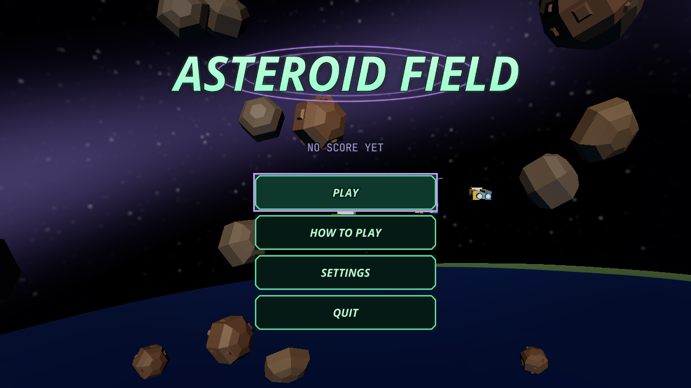
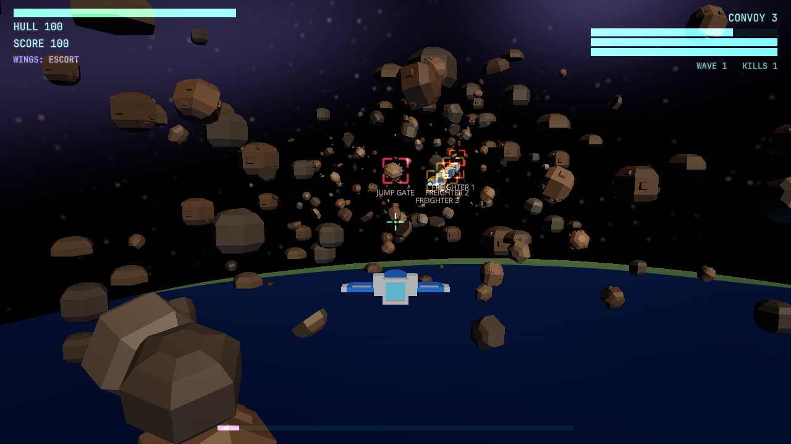

# Sample: Asteroid Field {#page-sample-asteroid-field}

[TOC]

**Level:** Confirmed. **Read first:** [Sample Games](samples.md).

| Title screen                                                         | In game                                                          |
|----------------------------------------------------------------------|------------------------------------------------------------------|
|  |  |

An escort game after Star Fox and X-Wing: a convoy of three freighters crosses an asteroid field to a jump gate, the
player escorts it in a fighter flown in six directions with two wingmen, through seven waves of enemy fighters. The
project is `samples/asteroid_field`; play `scenes/title.owl`.

## What it brings

A 6DoF space fight with agents on behaviour trees.

- **Ship controller:** the player's fighter is a `ShipController` (a persistent throttle, W raising it and S lowering
  it to 40 % reverse, Backspace cutting it, shown on the HUD; slide, roll, pitch and yaw on the keys and sticks without
  rotational inertia, strong flight assist dampers for little translation inertia, the wings levelled, *Mouse Steer*
  off), see [Scene and Components](scene.md#shipcontroller-component).
- **Mouse aim and aim assist:** the mouse moves an aim circle, the gimballed lasers leave toward its ray
  (`scene.get_view_ray`); the right button held turns the fighter toward it, in proportion to its offset from the centre
  cross (`entity.set_ship_turn`); the middle button locks the enemy nearest it, the wheel cycles the lock, and an X
  shows where to aim for the lasers, which carry the fighter's velocity, to meet the locked enemy.
- **A goal in sight:** a briefing at the start, an objective line with the distance of the convoy to the gate, markers
  on the freighters and the gate, the hull of each freighter and the wave on the HUD.
- **3D steering and formations:** the wingmen keep a slot in formation on the player, the enemies pursue and flee in
  open space with separation and avoidance (`SteeringAgent`, plane `Space`), the freighters `NavObstacle`s they steer
  around; pushed back out of a hull they enter, they break off when they close in on their target and hold their fire
  at point blank, see [AI](ai.md#ai-steering).
- **Behaviour trees:** `enemy.owlbt` and `wingman.owlbt` decide what the agents do; their Lua leaves are exported
  functions of the mission graph, see [AI](ai.md#ai-trees).
- **Visual scripts:** the mission and the menus are graphs; the lists of the fight (lasers, hits, waves) are the
  annotated Lua module `combat.lua`, see [Visual Scripts](visual-scripts.md#visual-scripts-lua).
- **Splines and data tables:** the convoy rides a spline, the waves are rows of `tables/waves.owltable`.
- **Queries:** the lasers ray-cast the rocks, the ships test them with sphere overlaps, see [Physics](physics.md#queries).
- **Rebounds and hit feedback:** the fighter bounces off the rocks and the ships (pushed out, its velocity reflected
  through `entity.set_ship_velocity`); a hit flashes the model hit (`entity.set_tint`) and throws sparks and a glow, a
  kill a fireball, an expanding flash and debris (pools of `ParticleEmitter`s fired by `entity.particles_emit`), a
  damaged fighter or freighter smokes (`entity.particles_play`); a hit on the player flashes the screen edges red and
  shakes the camera unless the reduced motion is set. The system cursor is hidden in flight
  (`input.set_cursor_visible`) and shown in the pause window.
- **HUD markers, trails, particles and the planet layer** of the rail shooter, reused.
- **Sound and accessibility:** the volumes drive the mixer buses; the waves and the losses have subtitles; the
  settings also hold the colour vision correction, the reduced motion, a sturdier convoy, a start without the
  flight assist and an inverted pitch; the enemy engines and the lasers pass by with Doppler.

## Files

| Path                         | Content                                                              |
|------------------------------|----------------------------------------------------------------------|
| `scenes/mission.owl`         | The route, the convoy, the fighters, the rocks, the gate, the planet |
| `scenes/`                    | Also `title`, `settings`, `victory`, `game_over`                     |
| `scripts/game/mission.owlvs` | The rules of the mission and the leaves of the trees                 |
| `scripts/game/combat.lua`    | Lasers, hits, rams, waves, convoy, lock, aim and lead, orders        |
| `scripts/game/*.owlbt`       | The enemy and the wingman trees                                      |
| `tables/waves.owltable`      | The waves                                                            |
| `prefabs/`                   | Fighter, interceptor, lasers                                         |
| `huds/play.owlhud`           | The HUD and its pause window                                         |
