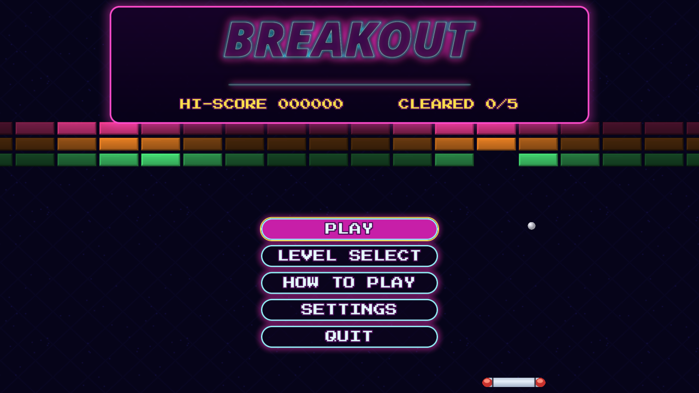
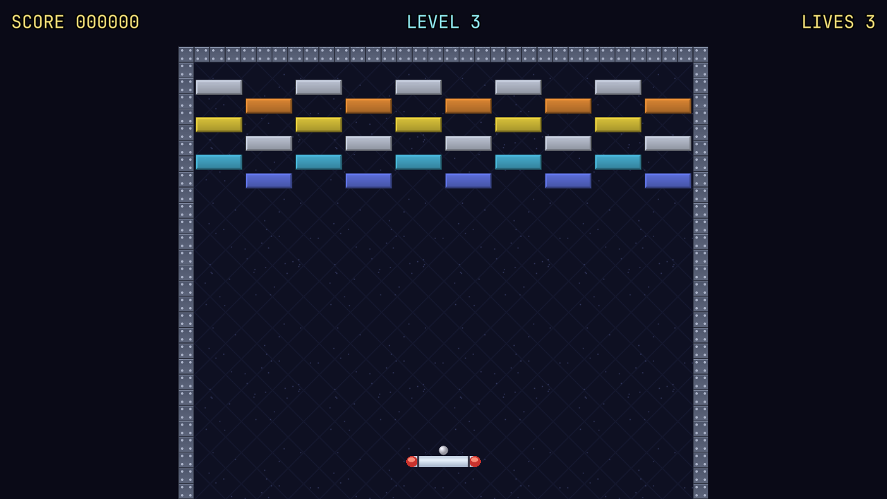

# Sample: Breakout {#page-sample-breakout}

[TOC]

**Level:** Beginner. **Read first:** [Sample Games](samples.md).

| Title screen                                             | In game                                            |
|----------------------------------------------------------|----------------------------------------------------|
|  |  |

A Breakout and Arkanoid game: five levels on one screen, three lives, bricks of one to three hits and two power-ups
(a wider paddle, a slower ball). The ball speeds up at each bounce and its angle depends on where it lands on the
paddle. The project is `samples/breakout`; play `scenes/title.owl`.

## What it brings

A first game to read from end to end: one rule script, a handful of prefabs and levels that are plain scenes.

- **Physics:** the paddle, the ball and the bricks are `PhysicBody` entities; the scripts steer the ball with
  `physics.set_velocity` and `physics.get_velocity`, see [Physics](physics.md).
- **Prefabs:** a brick (`prefabs/brick.owlprefab`) holds a static body, a sprite and a script, and the levels hold
  its instances with their overrides; the capsules and the burst of sparks are prefabs too.
- **2D lights and effects:** the bricks are lit around the ball (`Light2D`), the ball leaves a `Trail`, a broken brick
  bursts into sparks of its colour through a `ParticleEmitter`, see [Particles](particles.md).
- **HUD and UI:** `huds/play.owlhud` shows the score, the level, the lives and the pause window; the menus are UI
  canvases with focus navigation (keyboard, mouse, gamepad) and wipes between screens (`ui.transition_play`).
- **Menus:** an arcade cabinet: a lit marquee holds the neon title and the high score over the brick wall and the
  attract ball; the buttons are hollow neon tubes (a `UiButton` box with round corners, a border and a glow) that fill
  with magenta under the cursor, in the bundled pixel font `PressStart2P` with `Monoton` headings (`fonts/`).
- **Visual scripts:** every script is a graph (`.owlvs`, see [Visual scripts](visual-scripts.md)); the reading of
  the queue of brick events stays a Custom Lua node of `game.owlvs`.
- **Sound and settings:** the volume sliders drive the mixer buses, see [Sound](sound.md); the best score and the
  levels cleared are kept in the settings.

## Files

| Path               | Content                                                                             |
|--------------------|-------------------------------------------------------------------------------------|
| `scenes/`          | `title`, `level_select`, `level_1` to `level_5`, `settings`, `victory`, `game_over` |
| `scripts/game/`    | `game.owlvs` (rules, power-ups, saves), `paddle.owlvs`, `ball.owlvs`, `brick.owlvs` |
| `scripts/ui/`      | The arcade menus, graphs too                                                        |
| `prefabs/`         | `brick`, `brick_burst` and the `power_*` capsules                                   |
| `huds/play.owlhud` | Score, level, lives, messages, pause window                                         |

To add a level, duplicate a level scene, set the `level` and `next_scene` properties of its `Game` entity and point
the level before at it. The full rules and controls are in `samples/breakout/README.md`.
