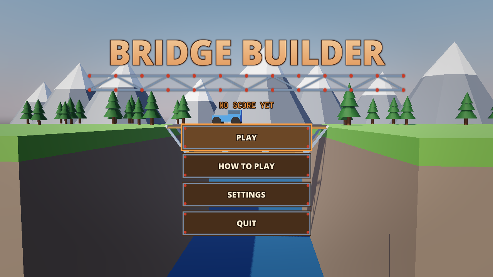
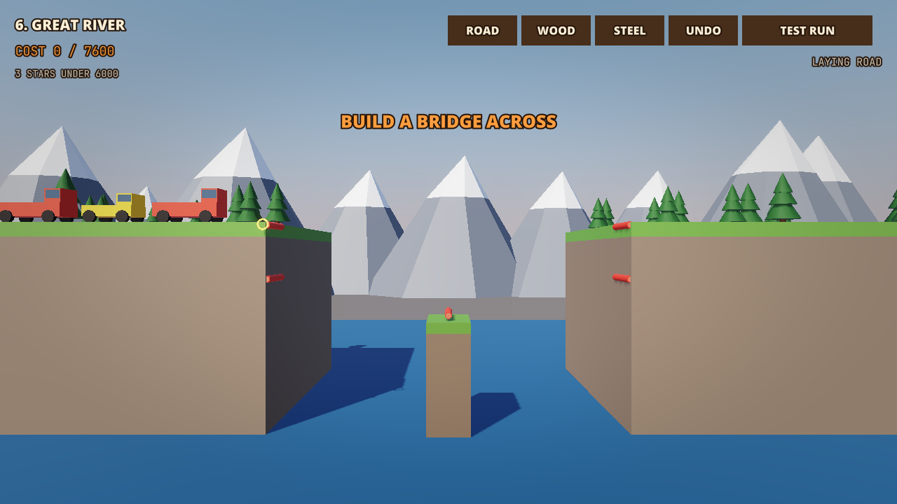

# Sample: Bridge Builder {#page-sample-bridge-builder}

[TOC]

**Level:** Confirmed. **Read first:** [Sample Games](samples.md).

| Title screen                                                         | In game                                                        |
|----------------------------------------------------------------------|----------------------------------------------------------------|
|  |  |

A bridge building game after Poly Bridge: six gaps of a valley to span within a budget, seen from the side. Roads,
wooden and steel beams are laid from node to node on a grid; the test run turns them into bodies hinged at their
nodes and sends the vehicles across. A bridge that holds earns one to three stars, the cheaper the better. The project
is `samples/bridge_builder`; play `scenes/title.owl`.

## What it brings

A false 2D game in 3D whose bodies are made in Play.

- **2D bodies in a 3D view:** the parts, the vehicles and the cliffs are 2D bodies locked to the plane z = 0; the
  camera looks at the plane from the side and the models are deep, see [Physics](physics.md).
- **Joints made in Play:** `physics.add_joint` hinges each part to its nodes with the break force of its kind;
  `physics.get_joint_load` gives the load each joint holds, drawn as a colour from green to red, and `on_joint_break`
  reports a joint that snaps, see [Physics](physics.md#joints).
- **Assemblies:** a part body carries a `Tail` part holding the joint of its far end, and each vehicle its two wheels,
  see [Physics](physics.md#assemblies).
- **Prefabs:** the plan of each kind of part and its body for the run are spawned with `scene.spawn_prefab`.
- **Visual scripts:** the rules of a level (`level.owlvs`), the vehicles, the parts and the menus are graphs; the lists
  of the build (nodes, parts, undo, cost, the joints of a run) are the annotated Lua module `bridge.lua`, see
  [Visual Scripts](visual-scripts.md#visual-scripts-lua).
- **Saves:** the design of each gap and its best result are kept in the settings; the result replays the run from
  the saved design.
- **Sound and accessibility:** the volumes drive the mixer buses; the sounds that tell something have subtitles; the
  settings also hold the colour vision correction, the reduced motion, the colours of the loads and a slow test run.

## Files

| Path                         | Content                                                                         |
|------------------------------|---------------------------------------------------------------------------------|
| `scenes/level_1.owl` to `6`  | The gorge, the anchors, the vehicles, the valley; the level in its scene script |
| `scenes/`                    | Also `title`, `level_select`, `settings`, `victory`                             |
| `scripts/game/level.owlvs`   | The rules of a level                                                            |
| `scripts/game/vehicle.owlvs` | A vehicle of the test run                                                       |
| `scripts/game/part.owlvs`    | A part of the test run                                                          |
| `scripts/game/bridge.lua`    | Nodes, parts, undo, cost, saved design, bodies and joints of the run            |
| `prefabs/`                   | Plans and bodies of the parts, nodes                                            |
| `huds/play.owlhud`           | The build tools, the load, the result and pause windows                         |

To make another gap, duplicate a level scene, move the cliffs, the pillars and the `Anchor` entities, set the budget,
the star budget and the bounds of the grid in the properties of its scene script and point the `next_scene` of the
level before it at it; a vehicle is an entity with the `vehicle.owlvs` script and two wheel parts.
