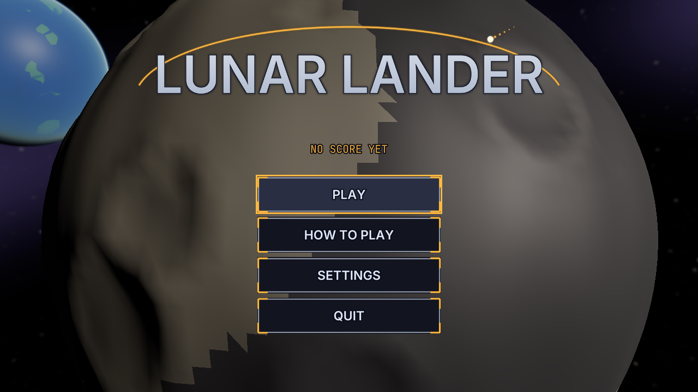
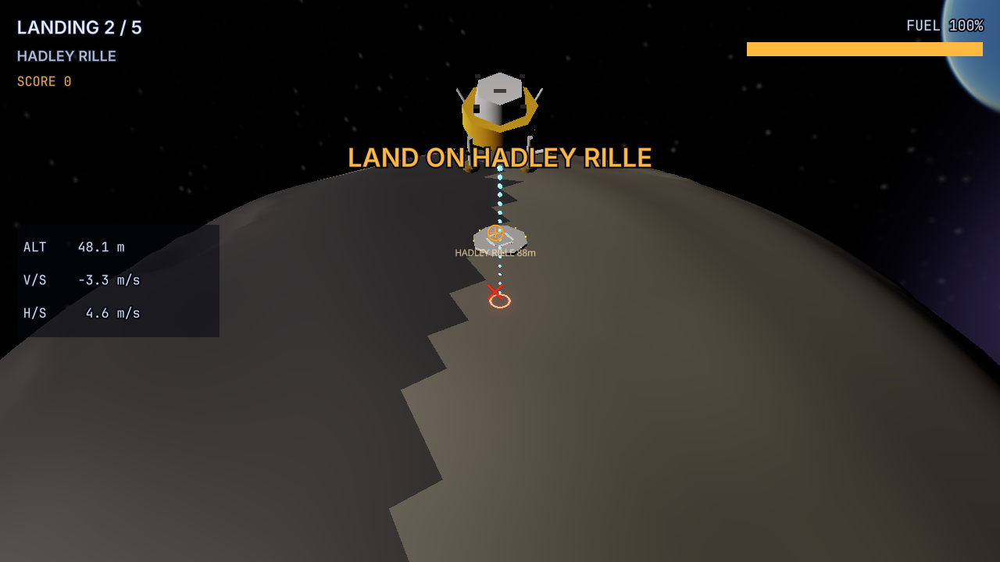

# Sample: Lunar Lander {#page-sample-lunar-lander}

[TOC]

**Level:** Confirmed. **Read first:** [Sample Games](samples.md).

| Title screen                                                     | In game                                                      |
|------------------------------------------------------------------|--------------------------------------------------------------|
|  |  |

A landing game after Lunar Lander: five landings on a small moon, from a hover above the first pad to a descent from
orbit into a crater of the far side. The main engine pushes along the lander, the stick tilts it, the side jets slide
it; a touchdown too hard snaps a leg. The fuel left, the precision and the softness of each touchdown make the score.
The project is `samples/lunar_lander`; play `scenes/title.owl`.

## What it brings

A 3D physics game whose rules are visual scripts.

- **Visual scripts:** the rules of a landing (`scripts/game/landing.owlvs`), the hull (`hull.owlvs`) and every menu
  (`scripts/ui/*.owlvs`) are graphs; the vector maths they call is the annotated Lua module
  `scripts/game/lander.lua`, its functions nodes of the palette, see [Visual Scripts](visual-scripts.md#visual-scripts-lua).
- **Gravity field:** the moon is a static `Mesh` body with a spherical `GravitySource`; the lander falls towards its
  centre, harder near the ground, and circles it on the orbital landings, see [Physics](physics.md#gravity).
- **Trajectory prediction:** `physics.predict_trajectory` gives the path of the next seconds, drawn as beads, and a
  ray cast along it finds the impact point, marked on the ground and by a HUD marker.
- **Breakable joints:** each leg is a body held to the hull by a fixed `PhysicJoint` with a break force; a hard
  touchdown breaks it and `on_joint_break` ends the landing, see [Physics](physics.md#joints).
- **Forces and angular velocity:** the engine and the side jets push with `physics.add_force` in `on_tick`; the stick
  sets the turn rate with `physics.set_angular_velocity`, so that the lander stops turning when it is released.
- **Foot contacts and an orbit camera:** the touchdown is the first sole a short ray from each leg finds on the
  ground; the chase camera keeps a heading carried with the lander over the moon, turned and zoomed by the player.
- **Planet layer:** the Earth hangs in the sky through a `RendererPlanet` layer, see [Planets](planets.md).
- **HUD markers:** the target pad and the predicted impact, with the distance, see
  [HUD system](design/hud-system.md#world-markers).
- **Sound and accessibility:** the volumes drive the mixer buses; the touchdown and the crashes have subtitles; the
  settings also hold the colour vision correction, the reduced motion, the inverted tilt and a hidden predicted path.

## Files

| Path                          | Content                                                                  |
|-------------------------------|--------------------------------------------------------------------------|
| `scenes/landing_1.owl` to `5` | The moon, the five pads, the Earth, the lander, the beads, the camera    |
| `scenes/`                     | Also `title`, `settings`, `victory`, `game_over` over a view of the moon |
| `scripts/game/landing.owlvs`  | The scene script of a landing: its properties and its rules              |
| `scripts/game/hull.owlvs`     | The hull reports a broken leg or a crash                                 |
| `scripts/game/lander.lua`     | Thrust, attitude, telemetry, predicted path, chase camera, score         |
| `scripts/ui/`                 | `title`, `settings`, `result` (victory and game over), `backdrop`        |
| `huds/play.owlhud`            | Landing, pad, score, fuel, read-outs, messages, the pause window         |

A landing is a scene: its scene script holds the pad to land on, the fuel, the start velocity and the next scene. To
make another one, duplicate a landing scene, move the lander (its legs follow, they are its children) and light
another pad: its `HudMarker` on, the marker of the old one off.
