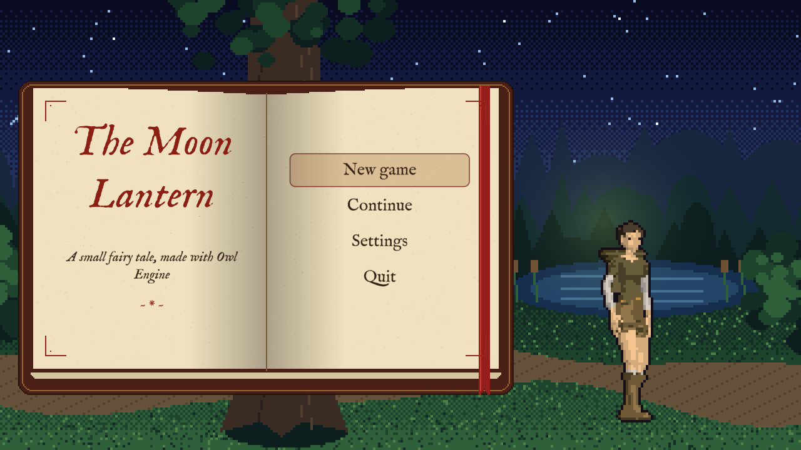
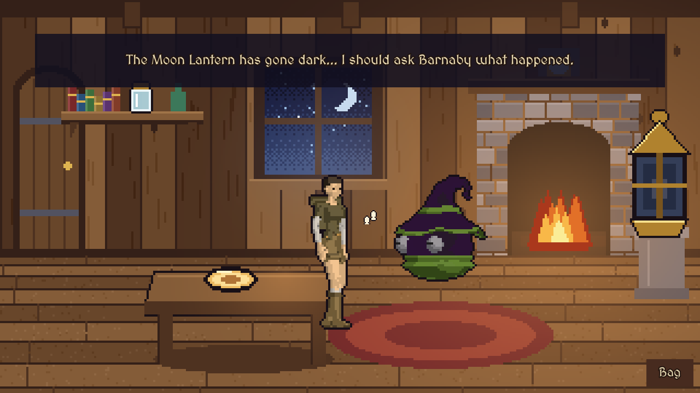

# Sample: The Moon Lantern {#page-sample-point-and-click}

[TOC]

**Level:** Confirmed. **Read first:** [Sample Games](samples.md).

A small point-and-click fairy tale in the spirit of The Legend of Kyrandia: three rooms (a cottage, a glade, a troll
bridge), one chain of puzzles, objects picked, combined and used, no death and no dead end, and an ending. Wren, apprentice
of the wizard Barnaby, must find the moonstone of the dark Moon Lantern and give it a spark. The project is
`samples/point_and_click`; play `scenes/title.owl`.

| Title screen                                                            | In game                                                             |
|-------------------------------------------------------------------------|---------------------------------------------------------------------|
|  |  |

## What it brings

Painted pixel-art backdrops with 3D skinned actors walking on them.

- **Mixed renderer stack:** the `actors` layer is a `RendererMesh` drawn as pixel art (toon shading, the resolution of
  the backdrop, an outline); the `world` layer is 2D with depth test (backdrop, props, masks); a `cursor` layer is in
  screen space. See [Renderer](renderer.md).
- **Walking:** the floor of a room is a `WalkArea` with holes, the actors are `WalkAgent`s with an `Animator` (idle,
  walk, reach out, wave), scaled and sorted by depth, and `WalkBehind` masks hide them behind the oak, the table or
  the parapet, see [Skinned Meshes](skinned_meshes.md). The hero walks the corners of a path on the navigation mesh
  of the room, `RoomNav`, a `NavMeshVolume` baked from the walk area when the room starts, see
  [Pathfinding](pathfinding.md#pathfinding-navmesh-walk).
- **Hotspots and bag:** `Hotspot_<id>` entities list what a click does, `scripts/game/adventure.lua` holds the cursor,
  the verbs and the bag, and the object in hand is the tool cursor (`ui.set_tool_cursor`).
- **Dialogues:** Barnaby and the troll talk through `dialogues/*.owldlg` with choices, see
  [Dialogues](dialogues.md).
- **Visual scripts:** the rooms and the menus are graphs (`.owlvs`); the act handlers of a room, which hand
  closures to the act animation, are Custom Lua nodes.
- **Menus:** a storybook open over the glade: the name of the tale on the left page, the entries on the right one in
  `IMFellEnglish` (`fonts/`), ink on paper with a sepia wash under the selected entry; the settings fill both pages,
  and down from the last slider turns to the right page (`UiFocus` neighbours).
- **Sequences:** the ending is `sequences/ending.owlseq`, see [Sequences](sequences.md).
- **Localisation:** `localisation.yml` holds every text in English and French, the language is a setting, and
  subtitles of the sounds are available, see [Localisation](languages.md).
- **Saves:** the game is saved when the hero enters a room and from the pause window.

## Files

| Path             | Content                                                     |
|------------------|-------------------------------------------------------------|
| `scenes/`        | `title`, `cottage`, `glade`, `bridge`, `settings`, `ending` |
| `scripts/game/`  | `adventure.lua`: cursor, verbs, bag, dialogues, pause       |
| `scripts/rooms/` | One visual script per room, calling `adventure.lua`         |
| `dialogues/`     | `barnaby.owldlg`, `troll.owldlg`                            |
| `sequences/`     | `ending.owlseq`                                             |
| `meshes/`        | The adventurer, the wizard and the goblin (Quaternius, CC0) |
