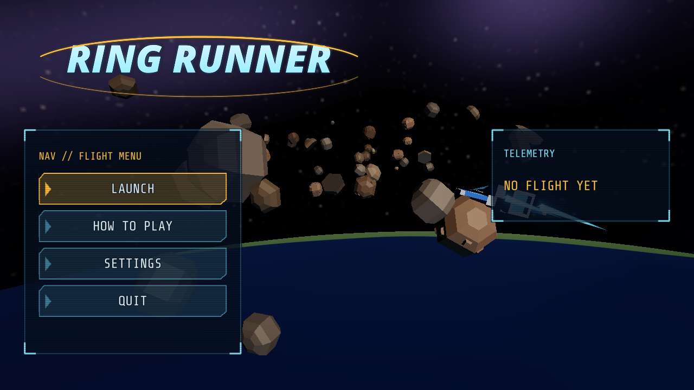
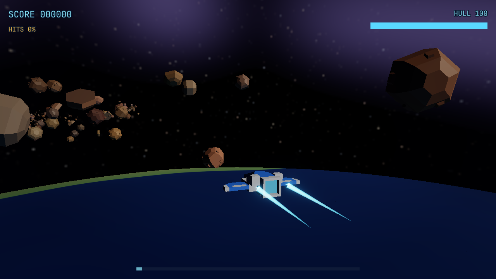

# Sample: Ring Runner {#page-sample-rail-shooter}

[TOC]

**Level:** Confirmed. **Read first:** [Sample Games](samples.md).

A rail shooter after Star Fox: one lane of about three minutes through the asteroid ring of a planet, squadrons of
fighters and a boss, the Warden, at the end. The ship rides the rail by itself; the player steers inside the frame,
aims two reticles, fires and barrel-rolls. The victory screen counts the score and awards a medal. The project is
`samples/rail_shooter`; play `scenes/title.owl`.

| Title screen                                                    | In game                                                   |
|-----------------------------------------------------------------|-----------------------------------------------------------|
|  |  |

## What it brings

A 3D game driven by a spline, with its waves in data.

- **Rail and spline follower:** the level has a `Spline` (`Rail`) and a carrier (camera, ship, reticles) that rides it
  with a `SplineFollower`; all gameplay is in rail coordinates (distance along, across, up). The scene uses a floating
  origin so the camera stays near zero.
- **Steering formations:** the two wingmen hold their slots beside the ship on `SteeringAgent`s (`Space`, a
  formation on the ship), and in a squadron flying a `line` or a `vee` the fighters hold the slots of their leader;
  shot down, the leader leaves its wing to scatter past the ship, see [AI](ai.md#ai-steering-formations).
- **Planet layer:** the planet turns below the lane through a `RendererPlanet` layer, see [Planets](planets.md).
- **3D meshes:** ships and rocks are glTF models rendered by `RendererMesh`.
- **Particles and trails:** explosions (fire, smoke, embers, shards, a shock wave), engine trails, the engine flames
  of the enemies (a `Local` emitter at each engine) and laser bolts use `ParticleEmitter` and `Trail`, see
  [Particles](particles.md).
- **Data tables:** the `waves` table (distance, kind, count, pattern, place) and the `enemies` table (stats of each kind
  and its temper: `accuracy` and `pursuit`, from the timid scouts to the reckless raiders), see
  [Data Tables](data_tables.md).
- **Sequences:** `intro`, `boss` and `outro` are `.owlseq` cutscenes played on the camera of the carrier by
  `SequencePlayer`s, see [Sequences](sequences.md).
- **Visual scripts:** `rail.owlvs` and the menus are graphs; the rules of `scripts/game/rs/` are Lua modules the
  graph calls as Lua Function nodes.
- **Menus:** cockpit displays over the live 3D backdrop: panels on the left of the screen and the telemetry on the
  right, dark glass with corner brackets and scanlines, cut-corner buttons with a chevron that turn amber under the
  cursor; readouts in `ShareTechMono`, headings in `Audiowide` (`fonts/`).
- **HUD:** `huds/play.owlhud` shows score, hits, hull, a boss bar and distance; `HudMarker`s tag targets.
- **Sound and accessibility:** the volumes drive the mixer buses; the `reduced_motion` setting stops the camera
  shake; steering can be inverted.

## Files

| Path                      | Content                                                                 |
|---------------------------|-------------------------------------------------------------------------|
| `scenes/level.owl`        | The rail, the carrier, the rocks, the planet                            |
| `scenes/`                 | Also `title`, `settings`, `victory`, `game_over` over live 3D backdrops |
| `scripts/game/rail.owlvs` | The scene script of the level, a graph                                  |
| `scripts/game/rs/`        | `core`, `field`, `foes`, `guns`, `fx`                                   |
| `tables/`                 | `waves` and `enemies`                                                   |
| `sequences/`              | `intro`, `boss`, `outro`                                                |
| `prefabs/`                | Lasers, enemy shots, fighter, interceptor, boss                         |
