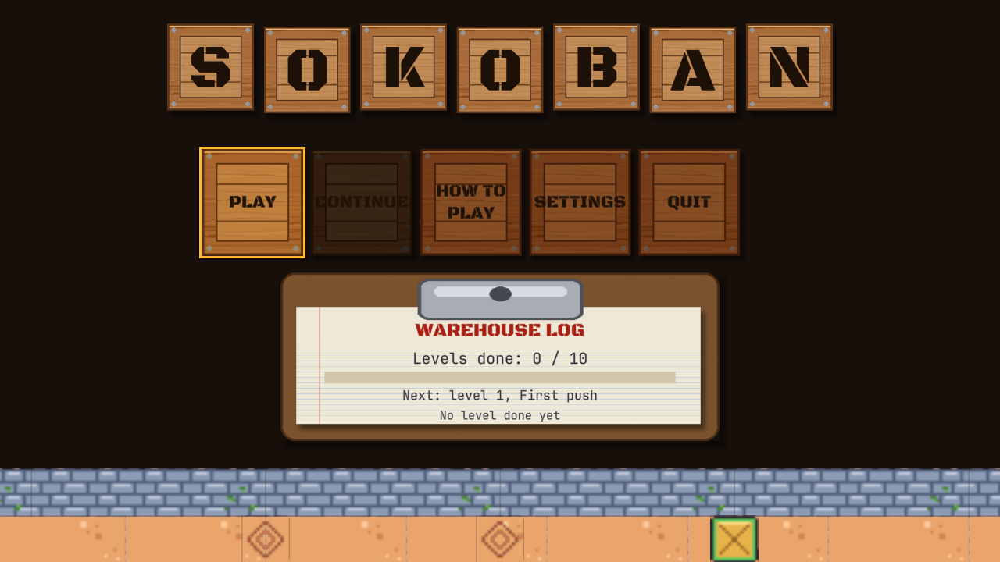
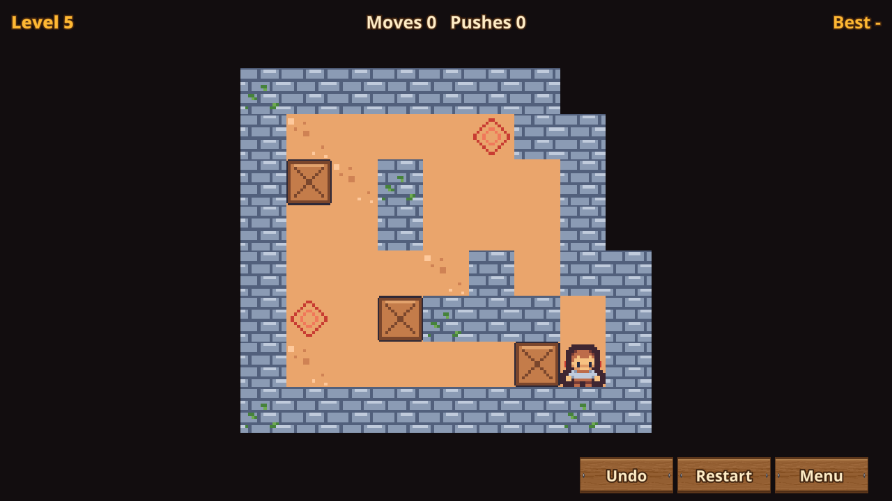

# Sample: Sokoban {#page-sample-sokoban}

[TOC]

**Level:** Beginner. **Read first:** [Sample Games](samples.md).

| Title screen                                           | In game                                          |
|--------------------------------------------------------|--------------------------------------------------|
|  |  |

A Sokoban game: ten levels of rising difficulty, from one crate to five. Push every crate onto a goal; crates are
pushed one at a time, never pulled, and an undo is always at hand. The fewest moves of each level and the levels done
are kept between sessions. The project is `samples/sokoban`; play `scenes/title.owl`.

## What it brings

A game whose levels are data, not scenes full of entities.

- **Tilemaps:** a level is an `.owltilemap` with three layers (`floor`, `goals`, `boxes`); the rules read and move
  the cells from Lua, see [Tilemaps and Tilesets](editor_tilemaps.md). The tiles come from `tilesets/sokoban.owltileset`.
- **Data tables:** `tables/levels.owltable` lists the levels in play order (scene and name); the title, the level
  select and the level before each one follow the table, see [Data Tables](data_tables.md).
- **Undo stack:** `scripts/game/sokoban.owlvs` records every step and push so the player can undo them; the undo,
  the take-back and the restart are Custom Lua nodes of the graph, the rest of the rules are nodes.
- **Particles and animation:** crates sparkle on their goal and a push raises dust (`ParticleEmitter`); the hero
  and the crates use animated sprites.
- **Menus:** a warehouse: the title letters and the buttons are crates with stencilled names (a nine-slice texture
  in the box of each `UiButton`, lit by its hover colour), side by side on the title; the progress, the settings, the
  level list and the victory are typed on a clipboard; stencil font `BlackOpsOne` (`fonts/`).
- **HUD and UI:** `huds/level.owlhud` shows the level, the moves, the best score and Undo / Restart / Menu buttons;
  the level select list is filled by `scripts/ui/level_select.owlvs`.

## Files

| Path                           | Content                                                                     |
|--------------------------------|-----------------------------------------------------------------------------|
| `scenes/`                      | `title`, `level_select`, `level_01` to `level_10`, `settings`, `victory`    |
| `tilemaps/level_01.owltilemap` | One level                                                                   |
| `tables/levels.owltable`       | The levels in play order                                                    |
| `scripts/game/`                | `sokoban.owlvs` (rules, undo) and the module `levels.lua` (table, progress) |
| `huds/level.owlhud`            | The level HUD and its pause window                                          |

To add a level, duplicate a level scene, point its `Level` entity at a new tilemap, set the `level` property of its
`Game` entity and add a row to `levels.owltable`.
