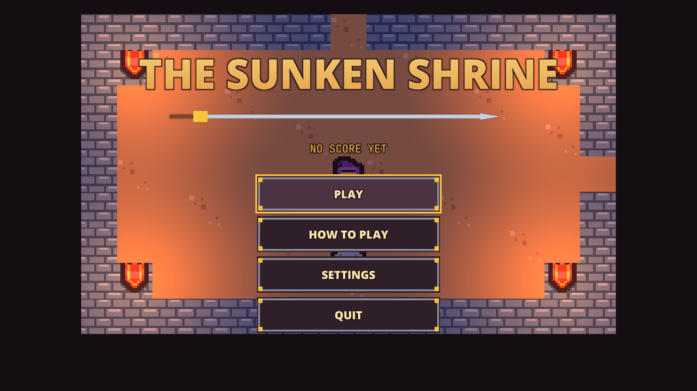
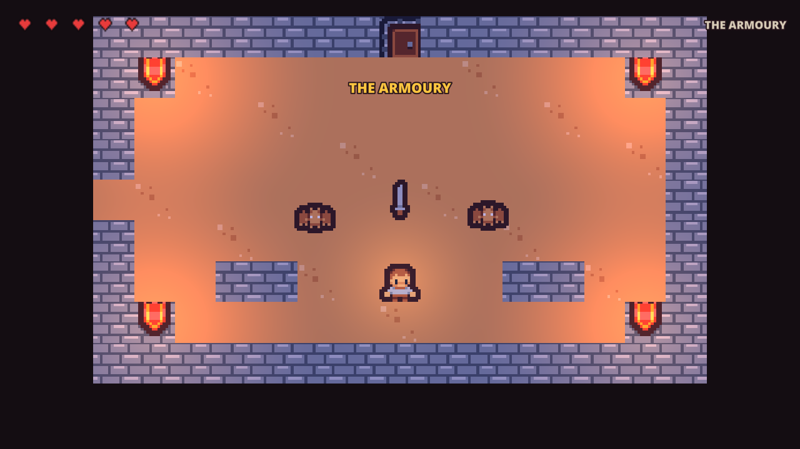

# Sample: The Sunken Shrine {#page-sample-sunken-shrine}

[TOC]

**Level:** Beginner. **Read first:** [Sample Games](samples.md).

| Title screen                                                           | In game                                              |
|------------------------------------------------------------------------|------------------------------------------------------|
|  |  |

A Zelda-like after The Legend of Zelda: six rooms of a dungeon, one screen each, seen from above. The hero talks to an
old man, finds a key, takes a sword, lights the braziers of a dark crypt, pushes a block onto a plate and defeats a
guardian with three phases to take the heart of the shrine. The project is `samples/sunken_shrine`; play
`scenes/title.owl`.

## What it brings

A top-down 2D adventure whose rules are visual scripts.

- **Tilemaps:** each room is an `.owltilemap` painted with the Kenney Tiny Dungeon sheet; its walls are a static body,
  see [Tilemaps and Tilesets](editor_tilemaps.md).
- **Behaviour trees and steering in the plane:** the creatures and the guardian are `SteeringAgent`s (plane
  `Plane2D`) run by `BehaviourTreeAgent`s that back off when hit, chase the hero when close and wander, see
  [AI](ai.md); their kinematic bodies carry the velocity the steering decides.
- **2D lights:** torches, braziers lit one by one, a light on the hero and a dark crypt, see
  [Renderer](renderer.md#renderer-lighting2d).
- **Strokes you can read:** the blade sweeps an arc across the facing direction, a chevron marks it between
  strokes, and the hero shows its back, front or side (`isometric.set_sprite_frame` on its sheet); `shrine.lua`
  poses them each frame.
- **Hits you feel:** a creature's touch pushes the hero back, flashes it red, shakes the camera (not with the reduced
  motion) and leaves it blinking through its grace; the hearts sit large on a dark plate of the HUD.
- **Dialogue:** the old man speaks through a `.owldlg` dialogue shown in the HUD, see [Dialogues](dialogues.md).
- **Visual scripts:** the rooms, the hero, the creatures, the exits and the menus are graphs; the few lines a graph
  would hide (the block pushed, the names of things) are the annotated Lua module `shrine.lua`, see
  [Visual Scripts](visual-scripts.md#visual-scripts-lua).
- **Memory between rooms and saves:** what was found and opened, the hearts and the counters live in the game state,
  saved in slot 1 with the room by `save.save_game`; **Continue** on the title loads it, a fall ends on a game over
  screen whose Retry starts the room again. The best score is kept in the settings.
- **Sound and accessibility:** the volumes drive the mixer buses; the sounds that tell something have subtitles; the
  settings also hold the colour vision correction, the reduced motion, gentler creatures and a brighter dark crypt.

## Files

| Path                                            | Content                                          |
|-------------------------------------------------|--------------------------------------------------|
| `scenes/room_1.owl` to `6`                      | The rooms                                        |
| `scenes/`                                       | Also `title`, `settings`, `victory`, `game_over` |
| `scripts/game/room.owlvs`                       | The rules of a room                              |
| `scripts/game/player.owlvs`                     | The hero                                         |
| `scripts/game/creature.owlvs`, `guardian.owlvs` | The creatures and the guardian                   |
| `scripts/game/*.owlbt`                          | Their behaviour trees                            |
| `scripts/game/exit.owlvs`, `heart.owlvs`        | The exits and the heart of the shrine            |
| `tilemaps/`, `tilesets/`                        | The rooms and the tiles                          |
| `dialogues/old_man.owldlg`                      | The old man                                      |
| `huds/play.owlhud`                              | The HUD                                          |
