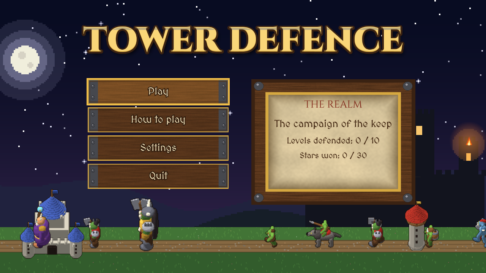
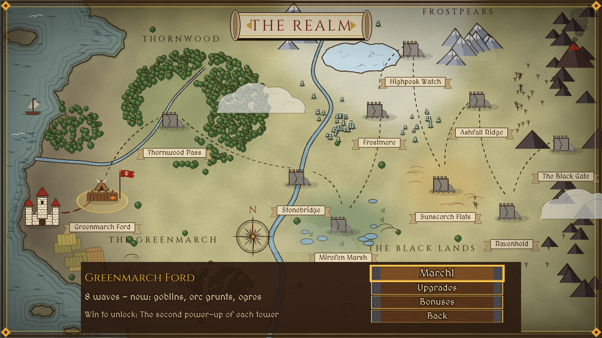
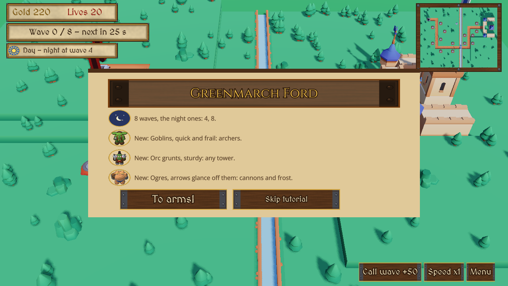
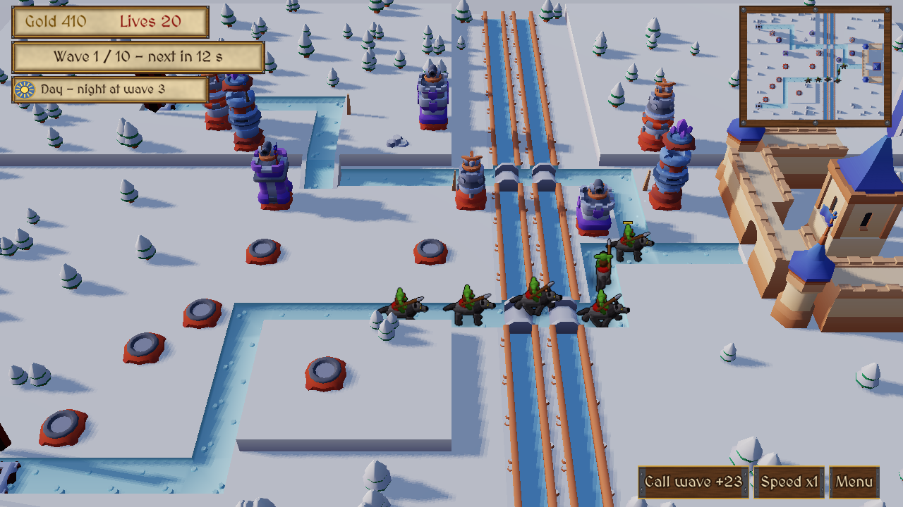

# Sample: Tower defence {#page-sample-tower-defence}

[TOC]

**Level:** Confirmed. **Read first:** [Sample Games](samples.md).

|  |                            |
|------------------------------------------------------------|------------------------------------------------------------------------------------|
|   |  |

A tower defence in the spirit of Warcraft 1 and 2: the Horde marches on a human keep through ten levels in 3D with
relief, between visits to a hand-inked world map. Players build archer, cannon and frost towers on stone pads, raise
them, cast two spells, and earn stars spent on upgrades. Day and night alternate and change every tower and enemy;
levels add modifiers (fog, blizzard, blood moon...). The project is `samples/tower_defence`; play `scenes/title.owl`.

## What it brings

The largest sample, and the one that mixes the most rendering styles in one scene.

- **Render styles mixed:** terrain, towers and keep are 3D meshes lit by the sun of a `DayNightCycle` under a
  `ProceduralSky`; the Horde, projectiles and effects are 2D sprites in a billboard layer lit by 2D lights (torches,
  `LightFlicker`); particles have their own layer; the minimap is a `RenderTarget`; the world map is a 2D scene.
  See [Renderer](renderer.md).
- **Material graphs:** the tiles take `materials/td_water.owlmat` (ripples flowing on the river), `td_ground.owlmat`
  (a change of shade over the grass and roads) and `td_snow.owlmat` (snow, sand and ash, with twinkling glints),
  written and given to the tiles by `tools/samples/tower_defence/generate_materials.py`.
- **Data tables:** `towers` and `enemies` hold the values of each kind and `waves_01` to `waves_10` a row per wave, so
  balancing is table editing, see [Data Tables](data_tables.md).
- **Dialogues:** each level opens with a briefing, `briefing_01.owldlg` to `briefing_10.owldlg` in `dialogues/`, see
  [Dialogues](dialogues.md).
- **Splines and steering:** the enemies walk a `Spline` road in several lanes from the gate to the keep; each one is
  a `SteeringAgent` that arrives at its lane point, keeps apart from the others and steps around them, see
  [AI](ai.md#ai-steering).
- **Particles:** sparks, dust, embers, the rain of arrows and the trails of projectiles are pooled emitters burst by
  the script, see [Particles](particles.md).
- **Prefabs:** enemies, towers (one per level and power-up) and projectiles are prefabs spawned by the script.
- **HUD:** `huds/play.owlhud` holds gold, lives, wave, day or night, spells and the briefing window, and the tutorial
  points at its targets.
- **Sound and accessibility:** the volumes drive the Music and SFX buses; the settings hold a colour vision
  correction, reduced motion and subtitles of the horn, the blows at the keep and the coins.
- **Visual scripts:** the level script `defence.owlvs` and the menus are graphs; the rules of `scripts/game/td/` are
  Lua modules the graph calls as Lua Function nodes.
- **Fonts:** two bundled fonts, `Cinzel` and `MedievalSharp`, see `fonts/`.
- **Menus:** parchment and wood: gold capitals, wooden plank buttons raised over their boards by a soft shadow, the
  parade of the Horde under them.

## Files

| Path                         | Content                                                                                        |
|------------------------------|------------------------------------------------------------------------------------------------|
| `scenes/`                    | `title`, `world_map`, `upgrades`, `level_01` to `level_10`, `settings`, `victory`, `game_over` |
| `tables/`                    | `towers`, `enemies`, `waves_01` to `waves_10`                                                  |
| `dialogues/`                 | `briefing_01.owldlg` to `briefing_10.owldlg`                                                   |
| `scripts/game/defence.owlvs` | The properties and hooks of a level, a graph calling the rules of `scripts/game/td/`           |
| `scripts/ui/`                | The menus, `world_map.owlvs`, `upgrades.owlvs`                                                 |
| `huds/play.owlhud`           | The level HUD                                                                                  |

To make a level, duplicate `scenes/level_01.owl`, move the terrain tiles, the pads and the `Road` spline, add a waves
table and a briefing, and set the properties of the `Game` entity. The README of the project lists every property.
