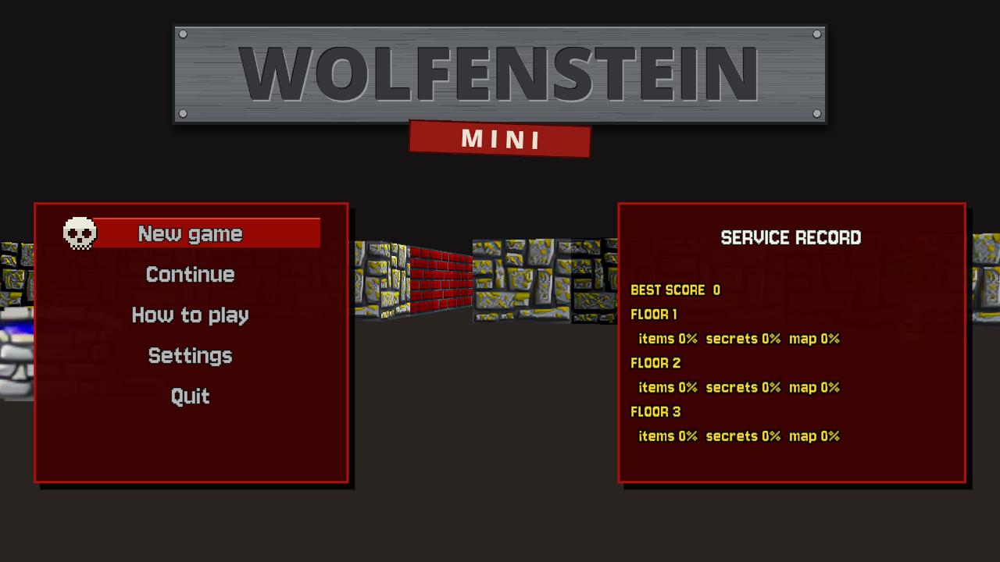
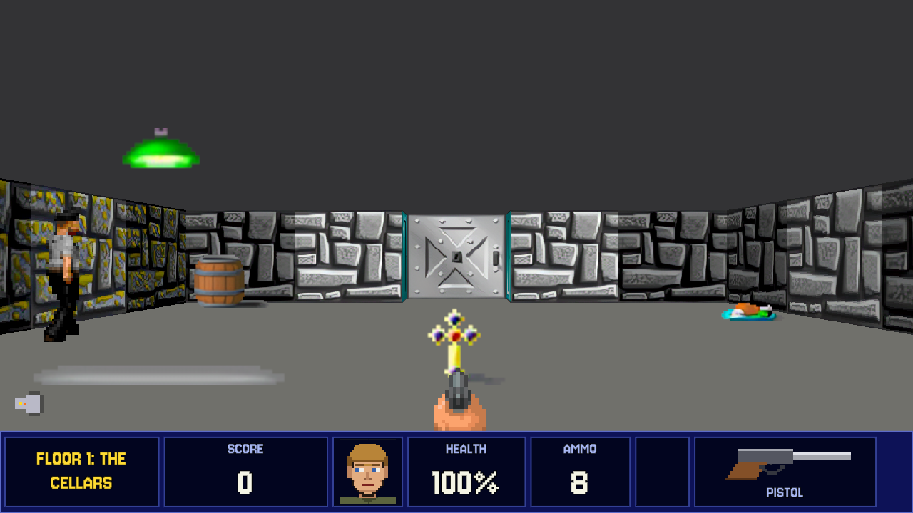

# Sample: Wolfenstein mini {#page-sample-wolfenstein}

[TOC]

**Level:** Beginner. **Read first:** [Sample Games](samples.md).

| Title screen                                                        | In game                                                       |
|---------------------------------------------------------------------|---------------------------------------------------------------|
|  |  |

An exploration game in the spirit of Wolfenstein 3D: three floors of 32x32 cells drawn by the raycast renderer, with
treasure, food, keys and locked doors, secret walls and an elevator on each floor. There are no guards nor weapons.
At the end of a floor a tally counts the items, the secrets and the share of the map explored. The project is
`samples/wolfenstein`; play `scenes/title.owl`.

## What it brings

The reference for the raycast style, see [Raycaster Method](raycaster_method.md).

- **Raycast renderer:** the walls come from `.owltilemap` files, doors are `RaycastDoor` entities and secret walls
  `RaycastPushWall` entities; a `RendererRaycast` layer draws them.
- **Triggers and physics:** pick-ups and locked doors are `Trigger` entities counted by their tag (`Cross`,
  `GoldKey`, `Secret`...), the player is a `PhysicBody`, see [Physics](physics.md).
- **Particles in the raycast view:** the sparks of a pick-up are drawn by the `raycast_fx` particle layer.
- **HUD markers:** a key and the elevator switch get a `HudMarker` (name, distance, an arrow on the screen edge)
  once seen; the minimap is a tilemap that fills as the player looks around.
- **Sequences:** the elevator ride is `sequences/elevator.owlseq`, see [Sequences](sequences.md).
- **Accessibility:** the settings hold a colour vision correction, reduced motion and subtitles of the secret walls
  and the elevator (`ui.show_subtitle`).
- **Saves:** the floor is saved when it starts and on F6; **Continue** loads the newer, see
  [Lua API: Saves](lua-api-saves.md).

## Files

| Path         | Content                                                                         |
|--------------|---------------------------------------------------------------------------------|
| `scenes/`    | `title`, `level_1` to `level_3`, `tally`, `settings`, `victory`                 |
| `scripts/`   | `game/` (player, pick-ups, doors, secrets, fog, markers, exit, elevator), `ui/` |
| `tilemaps/`  | The walls of each floor and its minimap                                         |
| `sequences/` | `elevator.owlseq`                                                               |
| `huds/`      | `play.owlhud`: floor, score, keys, messages, pause window                       |

To add a floor, duplicate a level scene and set the `next_scene` property of its `ExitElevator` script on the floor
before.
