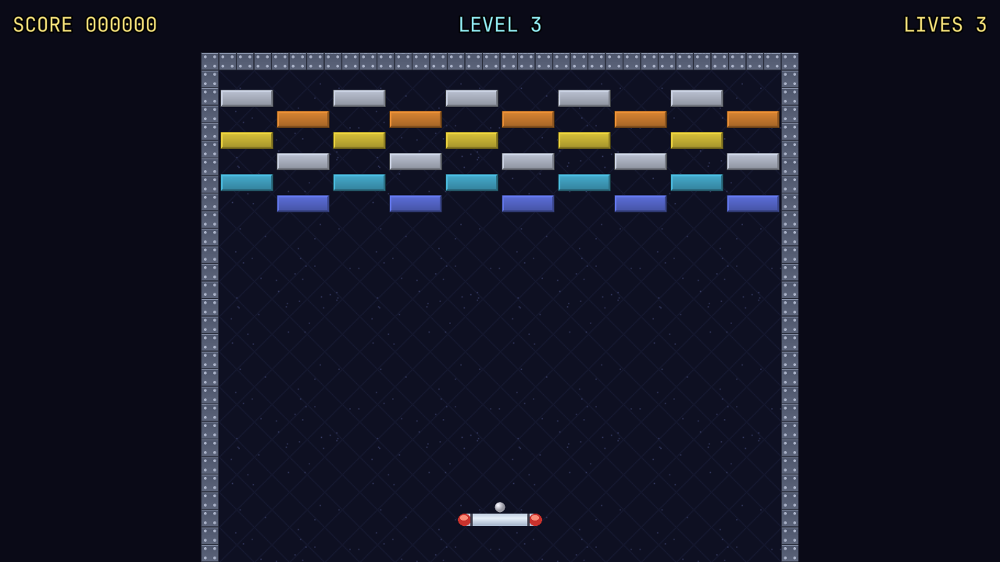
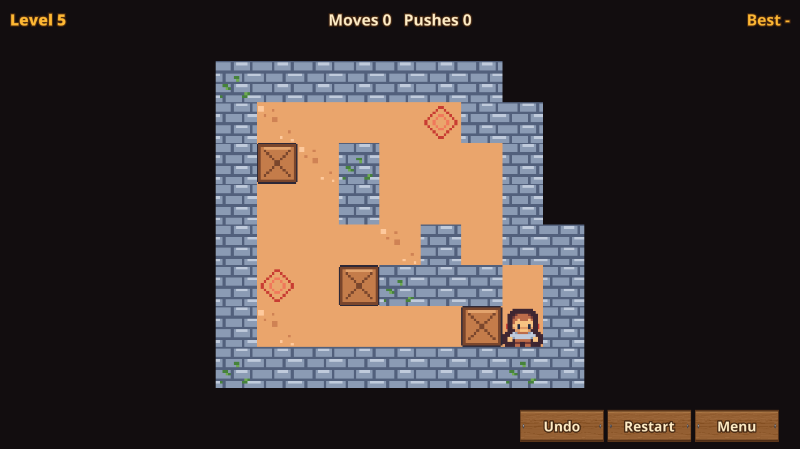
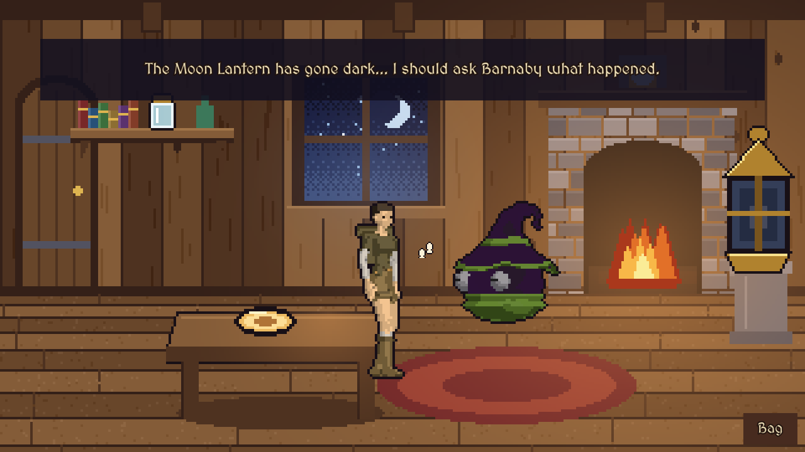
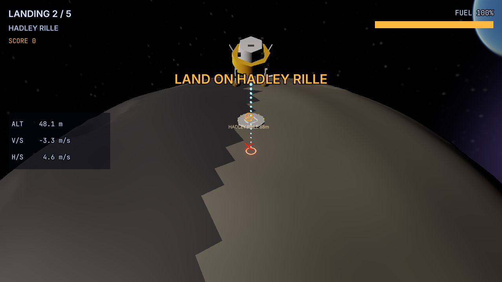
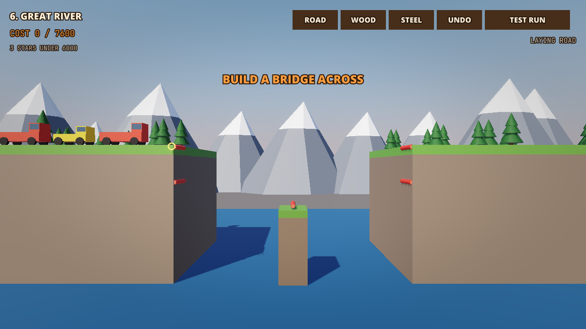
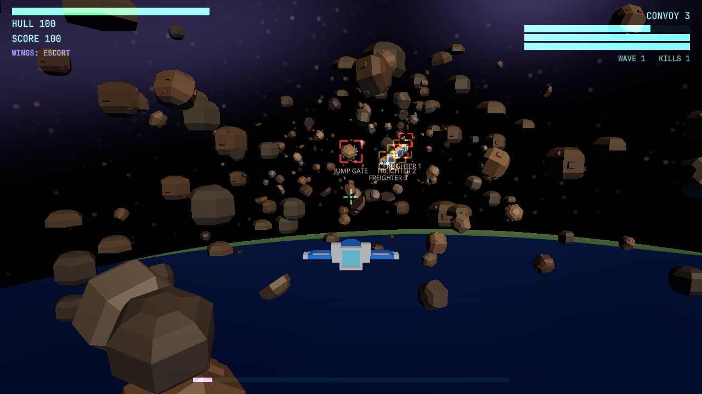
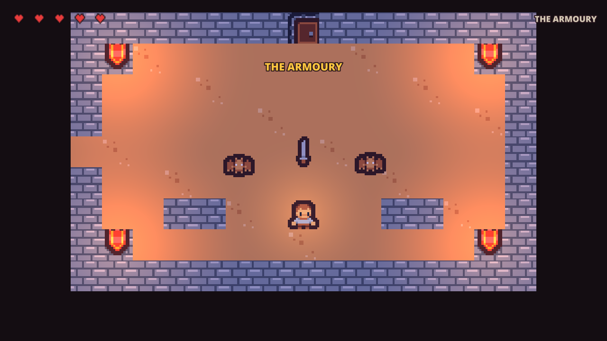

# Sample Games {#page-samples}

[TOC]

**Level:** Beginner. **Read first:** [Getting Started](getting_started.md).

Ten small but complete games made with Owl Engine, one project folder each under `samples/`, beside the Engine
Demo. Open one from the **Sample games** list of the Owl Nest File screen, or with **Open project**, and play its
`scenes/title.owl`; every one can be packaged with **Package the game**.

Each project is self-contained (its own `owl_project.yml` and a title scene as `firstScene`): what a sample reuses
from the Engine Demo is copied, never pointed at. The rules are Lua scripts or visual scripts, the art and the
sounds are CC0 or home-made, and each game has at least one scenario test.

| Game              | After                  | Main style                        | Page                                          |
|-------------------|------------------------|-----------------------------------|-----------------------------------------------|
| Breakout          | Breakout, Arkanoid     | 2D, neon lights                   | [Breakout](sample_breakout.md)                |
| Sokoban           | Sokoban                | 2D tilemap                        | [Sokoban](sample_sokoban.md)                  |
| Wolfenstein mini  | Wolfenstein 3D         | Raycast                           | [Wolfenstein mini](sample_wolfenstein.md)     |
| Tower defence     | Warcraft 1 and 2       | 3D with 2D sprites and particles  | [Tower defence](sample_tower_defence.md)      |
| Ring Runner       | Star Fox               | 3D on a rail, planet              | [Ring Runner](sample_rail_shooter.md)         |
| The Moon Lantern  | The Legend of Kyrandia | 2D backdrops, 3D actors           | [The Moon Lantern](sample_point_and_click.md) |
| Lunar Lander      | Lunar Lander           | 3D, gravity field, breakable legs | [Lunar Lander](sample_lunar_lander.md)        |
| Bridge Builder    | Poly Bridge            | 3D side view of 2D bodies, joints | [Bridge Builder](sample_bridge_builder.md)    |
| Asteroid Field    | Star Fox, X-Wing       | 6DoF flight, steering, trees      | [Asteroid Field](sample_asteroid_field.md)    |
| The Sunken Shrine | The Legend of Zelda    | 2D tilemap, 2D lights, trees      | [The Sunken Shrine](sample_sunken_shrine.md)  |

|                |                |      |
|------------------------------------------------------------|----------------------------------------------------------|-------------------------------------------------------------|
|    |       |  |
|        |  |     |
|  |                                                          |                                                             |

## What each game shows

| Feature                                  | Breakout | Sokoban | Wolfenstein | Tower defence | Ring Runner | Moon Lantern | Lunar Lander | Bridge Builder | Asteroid Field | Sunken Shrine |
|------------------------------------------|----------|---------|-------------|---------------|-------------|--------------|--------------|----------------|----------------|---------------|
| 2D sprites and 2D lights                 | yes      |         |             | yes           |             |              |              |                |                | yes           |
| Tilemaps                                 |          | yes     | yes         |               |             |              |              |                |                | yes           |
| Raycast renderer                         |          |         | yes         |               |             |              |              |                |                |               |
| 3D meshes                                |          |         |             | yes           | yes         | yes          | yes          | yes            | yes            |               |
| Physics bodies                           | yes      |         | yes         |               |             |              | yes          | yes            |                | yes           |
| Particles                                | yes      | yes     | yes         | yes           | yes         |              |              |                | yes            |               |
| Splines                                  |          |         |             | yes           | yes         |              |              |                | yes            |               |
| Data tables                              |          | yes     |             | yes           | yes         |              |              |                | yes            |               |
| Dialogues                                |          |         |             | yes           |             | yes          |              |                |                | yes           |
| Sequences                                |          |         | yes         |               | yes         | yes          |              |                |                |               |
| Localisation                             |          |         |             |               |             | yes          |              |                |                |               |
| Gravity fields and trajectories          |          |         |             |               |             |              | yes          |                |                |               |
| Visual scripts                           |          |         |             |               |             |              | yes          | yes            | yes            | yes           |
| Joints and assemblies                    |          |         |             |               |             |              | yes          | yes            |                |               |
| AI: steering and behaviour trees         |          |         |             |               |             |              |              |                | yes            | yes           |
| Menus, settings, volumes, saved progress | yes      | yes     | yes         | yes           | yes         | yes          | yes          | yes            | yes            | yes           |

Lunar Lander, Bridge Builder, Asteroid Field and The Sunken Shrine are written in [Visual Scripts](visual-scripts.md);
no sample uses the pathfinding tile graph nor a navigation mesh, shown by the Engine Demo
([Pathfinding](pathfinding.md)).

## Common ground

- **Menus and HUD:** every game has a title, a settings screen and a HUD (`huds/play.owlhud` or a canvas) with a
  pause window listing the controls; the controls are never shown during play. See [Scene and Components](scene.md).
- **Sound:** the settings drive the master, music and effects volumes of the mixer buses (`volume_*`), see
  [Sound](sound.md).
- **Input:** an input actions file maps keyboard, mouse and gamepad together, see [Events and Input](event_input.md).
- **Progress:** the best scores, the levels done and the settings are kept between sessions.
- **Generators:** the first art, sounds, layouts and menus come from `tools/samples/<game>/`; running a generator again
  overwrites the edits made in Owl Nest.

## Where next

[Getting Started](getting_started.md) opens the Engine Demo and the samples, [Scripting Games in Lua](scripting.md)
explains the scripts they use, and [Making Games with Owl](guide_game_maker.md) lists the other pages.
