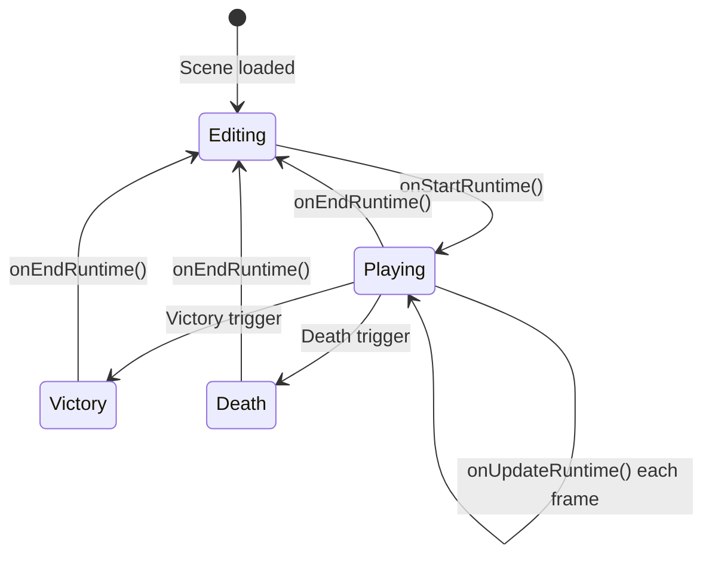
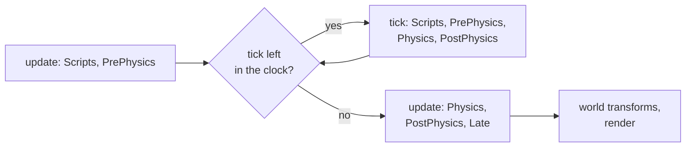
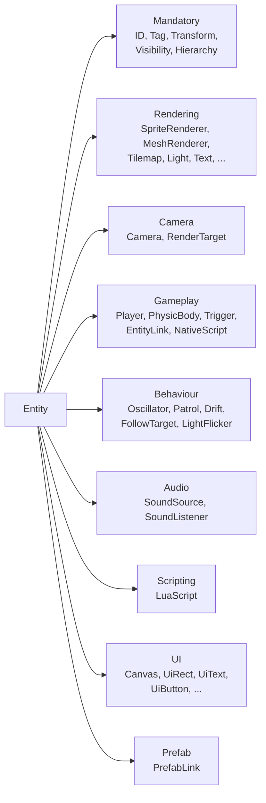
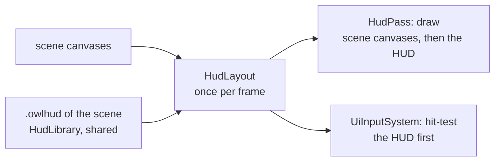
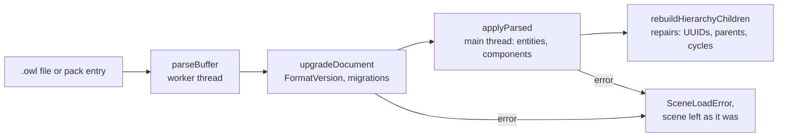
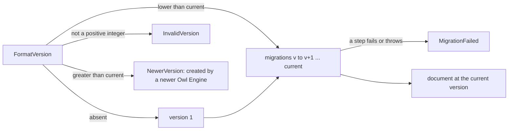
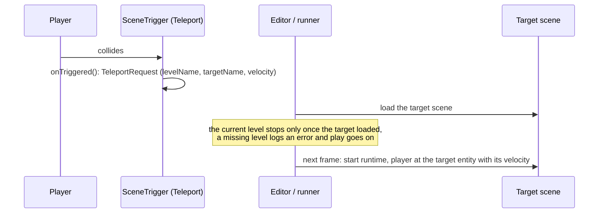

# Scene and Components {#page-scene}

[TOC]

This page documents the Entity-Component-System (ECS), scene lifecycle, component
reference, and serialization.

## Overview

Owl Engine uses an ECS built on [EnTT](https://github.com/skypjack/entt). A `Scene` owns an
`entt::registry` containing all entities and their components. Entities are lightweight
handles (`Entity` wraps `entt::entity` + `Scene*`). Each entity automatically receives
five mandatory components: `ID`, `Tag`, `Transform`, `Visibility`, and `Hierarchy`.

Scenes are serialized to and from YAML files (`.owl` extension).

## Entity Lifecycle

### Creation

| Method                                    | Description                            |
|-------------------------------------------|----------------------------------------|
| `Scene::createEntity(name)`               | Create entity with auto-generated UUID |
| `Scene::createEntityWithUUID(uuid, name)` | Create with explicit UUID              |

### Destruction

| Method                                     | Behaviour                                                                        |
|--------------------------------------------|----------------------------------------------------------------------------------|
| `Scene::destroyEntity(entity)`             | Children reparented to grandparent in its sibling slot; world position preserved |
| `Scene::destroyEntityWithChildren(entity)` | Cascade delete of entire subtree                                                 |
| `Scene::destroyEntityDeferred(entity)`     | Runtime path: subtree queued, destroyed by `flushPendingDestructions()`          |

The first two are immediate (editor). Runtime code (Lua `scene.destroy_entity`, trigger callbacks) uses the deferred
form, flushed at the end of `onUpdateRuntime()` and at the start of `onEndRuntime()`. All three run `on_destroy`,
remove the Box2D bodies and stop the sounds while the whole subtree is still intact.

While the scene runs, runtime resources follow their components through EnTT `on_construct` / `on_destroy` hooks
(connected by `onStartRuntime()`, disconnected by `onEndRuntime()`): removing a `LuaScript` or `NativeScript` calls
its `on_destroy`, a `SoundSource` stops, a `PhysicBody`, `Tilemap`, raycast door or pushwall loses its body, and an
added (or duplicated) `PhysicBody` gets a body at the next physics frame.

### Component API

| Method                                  | Description                |
|-----------------------------------------|----------------------------|
| `entity.addComponent<T>(args)`          | Attach a new component     |
| `entity.addOrReplaceComponent<T>(args)` | Attach or overwrite        |
| `entity.getComponent<T>()`              | Get reference to component |
| `entity.hasComponent<T>()`              | Check if component exists  |
| `entity.removeComponent<T>()`           | Detach a component         |

### Queries

| Method                   | Returns                             |
|--------------------------|-------------------------------------|
| `getAllEntities()`       | All entities as `vector<Entity>`    |
| `getRootEntities()`      | Entities with `parentId == 0`       |
| `getChildren(entity)`    | Direct children as `vector<Entity>` |
| `findEntityByUUID(uuid)` | Entity matching UUID, or null       |
| `getEntityCount()`       | Total entity count                  |

### Duplication

| Method                     | Behaviour                                                |
|----------------------------|----------------------------------------------------------|
| `duplicateEntity(entity)`  | Create root copy with new UUID, no children              |
| `duplicateSubtree(entity)` | Recursive duplicate with new UUIDs and correct hierarchy |

## Scene Lifecycle



`Editing` runs no simulation, `Playing` runs physics, scripts and triggers, `Victory` and `Death` show their overlay.

### Lifecycle Methods

| Method                             | When Called        | What It Does                                                               |
|------------------------------------|--------------------|----------------------------------------------------------------------------|
| `onStartRuntime()`                 | Play pressed       | Init physics and `playOnStart` sounds, create scene and entity Lua scripts |
| `onUpdateRuntime(timestep)`        | Each frame (Play)  | Runs the scene's systems phase by phase (below), then renders              |
| `onRenderRuntime()`                | Each frame (Pause) | Render only, no simulation                                                 |
| `onUpdateEditor(timestep, camera)` | Each frame (Edit)  | Render with editor camera                                                  |
| `onEndRuntime()`                   | Stop pressed       | Stop sounds, destroy physics                                               |
| `onViewportResize(size)`           | Viewport resized   | Resize all cameras                                                         |

### Systems and phases {#systems}

`onUpdateRuntime()` holds no gameplay: it advances the scene's simulation clock, runs the systems of the scene's
`SystemSchedule` (`Scene::getSystems()`), phase by phase, then prepares the world transforms and renders. Within a
phase, systems run in insertion order. Once the game is won or lost (`Victory` / `Death`), only the `Ended` phase
runs.

A system has an `update` function, run once per frame, and an optional `tick` function, run once per fixed
simulation tick (see [Fixed simulation tick](#fixed-tick)); either may be empty. A frame runs:



| Phase         | Engine systems                                                                                                              | Contract                                  |
|---------------|-----------------------------------------------------------------------------------------------------------------------------|-------------------------------------------|
| `Scripts`     | `owl.physics_poses` (simulated body poses), `owl.scripts` (native, Lua)                                                     | May move, create or destroy entities      |
| `PrePhysics`  | `owl.oscillators`, `owl.patrols`, `owl.fly_cameras`, `owl.voxel_players`, `owl.raycast_walls`, `owl.player_input`           | Gameplay controllers before the step      |
| `Physics`     | `owl.physics` (one Box2D step and `on_collision` per tick)                                                                  | Owns the physics step                     |
| `PostPhysics` | `owl.drift`, `owl.animation`, `owl.sockets`, `owl.light_flicker`, `owl.entity_links`, `owl.triggers`, `owl.floating_origin` | Last phase allowed to change the world    |
| `Late`        | `owl.navigation`, `owl.sound`, `owl.sprite_animation`                                                                       | Reads the settled world (caches armed)    |
| `Ended`       | `owl.game_over` ("Victory!" / "You loose!" message)                                                                         | Replaces every other phase once game over |

`owl.scripts` calls `on_update` in its `update` and `on_tick` in its `tick`; `owl.physics` steps the world in its
`tick`. `Scene::getInputFrame()` gives the input of the running step (the tick frame in a `tick`, the frame one in an
`update`), with `isKeyJustPressed` / `isKeyJustReleased` edges seen once at either rate
([event and input](event_input.md)); `Scene::getActions()` gives the same split for the game's
[actions](event_input.md#actions), which engine systems and scripts read instead of keys. The `SystemContext` gives the frame (or tick) duration, the tick count of the frame, the index of the running
tick and the interpolation alpha. Every new scene copies `SystemSchedule::getDefault()`. A game changes it once,
before loading its scenes, or edits one scene's schedule; `Scene::copy()` (Play) keeps the scene's schedule:

```c++
auto& systems = scene::SystemSchedule::getDefault();
systems.add({.name = "game.score", .phase = scene::SystemPhase::PostPhysics, .update = &updateScore});
systems.add({.name = "game.ai", .phase = scene::SystemPhase::PrePhysics, .tick = &stepAi});
systems.insertBefore("owl.physics", {.name = "game.wind", .phase = {}, .tick = &applyWind});
systems.replace("owl.game_over", &showMyGameOverScreen);
systems.replaceTick("game.ai", &stepSmarterAi);
systems.remove("owl.voxel_players");
```

### Fixed simulation tick {#fixed-tick}

Each scene owns a `SimulationClock` (`Scene::getSimulationClock()`): every frame adds its duration to an accumulator
and runs as many ticks of `1 / tickRate` seconds as it holds, at most `maxTicksPerFrame` (the time beyond is
dropped, so a long frame slows the game down instead of stalling it). The leftover time over the tick duration is
the interpolation alpha (`SimulationClock::getAlpha()`, Lua `time.tick_alpha()`), used to draw the physics bodies
between their last two steps. A simulation run with the same ticks gives the same result however the frames are cut.

The scene clock runs at `Scene::setTimeScale(scale)` (0 to 16, Lua `time.set_scale`) and stops with
`Scene::setPaused(true)` (Lua `time.set_paused`): the frame duration the systems, the ticks and `getRuntimeSeconds()`
see is the real one times `getEffectiveTimeScale()`. Paused, the scripts still get `on_update` with a zero duration,
no tick nor physics step runs and the animations hold their frame; the UI input, the screen transitions and the toasts
keep the real time (`getRealFrameSeconds()`). `onStartRuntime()` resets the scale to 1 and resumes.

The rate is a project setting, edited in Owl Nest's *Project Settings* (**Simulation** section) and saved in
`owl_project.yml` when it differs from the defaults:

```yaml
OwlProject:
  name: MyGame
  simulation:
    tickRate: 60          # ticks per second, 1 to 1000 (default 60)
    maxTicksPerFrame: 8   # ticks one frame runs at most, 1 to 64 (default 8)
```

The editor and the runner hand it to the `app::EngineContext` (`setSimulationSettings`; *Pack Game* writes it to
`runner.yml` as `TickRate` / `MaxTicksPerFrame`), and `onStartRuntime()` gives it to the scene's clock and resets
it; a scene without engine context (tests) keeps the settings set on its clock. In the editor, **Step Frame** while
paused runs exactly one tick.

The engine systems live in `scene::systems` (private, `source/owl/private/scene/systems/`).

## Component Reference {#components}



### Game components (open registry) {#component-registry}

`scene::ComponentRegistry` lists every component the scene saves, loads, copies and shows in the editor: the engine
ones first (in serialization order), then those a game registers at startup, before loading any scene. A game
component needs a `key()`, `serialize()` / `deserialize()` like the engine ones, and optionally a `name()`:

```c++
struct Score {
    int64_t points = 0;
    static auto key() -> const char* { return "Score"; }
    static auto name() -> const char* { return "Score"; }
    void serialize(const core::Serializer& iOut) const;    // writes `Score: {points: ...}`
    void deserialize(const core::Serializer& iNode);       // reads the value under `Score`
};

scene::ComponentRegistry::registerComponent<Score>(/* optional inspector body: */ [](scene::Entity& ioEntity) {
    return ImGui::DragScalar("Points", ImGuiDataType_S64, &ioEntity.getComponent<Score>().points);
});
```

It is then saved in scenes and prefabs, copied (duplication, Play), offered by "Add Component" and the
`component.add` / `component.remove` commands, and drawn in the inspector (its body, or a note), undoable like any
engine component. `ComponentRegistry::describe<T>()` + `registerDescriptor` give finer control (not optional, not
copied).

### Mandatory Components

These are automatically added to every entity and cannot be removed.

#### ID

| Field | Type   | Description       |
|-------|--------|-------------------|
| `id`  | `UUID` | Unique identifier |

Serialized directly as the entity key in YAML (`Entity: <uuid>`).

#### Tag

| Field | Type     | YAML Key | Description  |
|-------|----------|----------|--------------|
| `tag` | `string` | `Tag`    | Display name |

#### Transform

| Field       | Type              | YAML Key    | Description                         |
|-------------|-------------------|-------------|-------------------------------------|
| `transform` | `math::Transform` | `Transform` | Local position, rotation, and scale |

The **local** transform; `Scene::getWorldTransform(entity)` gives the world one through a persistent cache
([Transform Hierarchy](#transform-hierarchy)).

#### Visibility

| Field           | Type   | YAML Key     | Serialized | Description                              |
|-----------------|--------|--------------|------------|------------------------------------------|
| `gameVisible`   | `bool` | `Visibility` | Yes        | Rendered during gameplay                 |
| `editorVisible` | `bool` | —            | No         | Rendered in editor (always true on load) |

#### Hierarchy

| Field         | Type           | YAML Key    | Description                        |
|---------------|----------------|-------------|------------------------------------|
| `parentId`    | `UUID`         | `Hierarchy` | Parent UUID (0 = root)             |
| `childrenIds` | `vector<UUID>` | —           | Rebuilt from `parentId` after load |

### Rendering Components

#### SpriteRenderer

| Field          | Type         | Default        | Description                                                                                                    |
|----------------|--------------|----------------|----------------------------------------------------------------------------------------------------------------|
| `color`        | `math::vec4` | `{1, 1, 1, 1}` | Tint colour                                                                                                    |
| `texture`      | `Texture2D`  | `nullptr`      | Sprite texture                                                                                                 |
| `tilingFactor` | `float`      | `1.0`          | Texture repetition                                                                                             |
| `normalMap`    | `Texture2D`  | `nullptr`      | Tangent-space normal map (OpenGL convention, green up) lighting the sprite under the 2D lights; flat when null |
| `castShadows`  | `bool`       | `false`        | The sprite quad blocks the 2D lights casting shadows; the sprite itself stays lit                              |
| `lit`          | `bool`       | `true`         | The 2D lights of the scene light the sprite; unlit it keeps its colour (glows, markers)                        |

YAML key: `SpriteRenderer`

#### AnimatedSpriteRenderer

YAML key: `AnimatedSpriteRenderer`: a spritesheet of `columns × rows` frames played from `firstFrame` to `lastFrame`
every `frameDuration` seconds, looping or not, tinted by `color`, lit by the 2D lights unless `lit` is false (written
only when false: badges and markers keep their colour). The optional `speedCurve` multiplies each frame's
`dt` by its value at the normalized progress inside `[firstFrame, lastFrame]` (omitted from the file when empty). Field
table, UVs and runtime behaviour: [Renderer > Animated Sprites](renderer.md#animated-sprites).

#### CircleRenderer

| Field       | Type         | Default        | Description          |
|-------------|--------------|----------------|----------------------|
| `color`     | `math::vec4` | `{1, 1, 1, 1}` | Circle colour        |
| `thickness` | `float`      | `1.0`          | Ring thickness (0–1) |
| `fade`      | `float`      | `0.005`        | Edge fade amount     |

YAML key: `CircleRenderer`

#### MeshRenderer

| Field         | Type        | Default        | Description                                                                                                                                                  |
|---------------|-------------|----------------|--------------------------------------------------------------------------------------------------------------------------------------------------------------|
| `mesh`        | path        | empty          | Asset path of a `.gltf`, `.glb` or `.obj` file                                                                                                               |
| `color`       | `vec4`      | `{1, 1, 1, 1}` | Tint multiplied with the base colour of the file's material                                                                                                  |
| `texture`     | `Texture2D` | none           | Replaces the material's base-colour texture                                                                                                                  |
| `transparent` | `bool`      | `false`        | Alpha blending (the colour alpha), drawn after the opaque meshes, sorted back-to-front                                                                       |
| `materials`   | list        | empty          | One slot per submesh: `material` (`.owlmat` asset path, empty for the file's own material) and `overrides` (fields of the material replaced for this entity) |

YAML key: `MeshRenderer`. Drawn in 3D by a `RendererMesh` layer of the render stack; the file is loaded once per
engine context and shared by every entity drawing it ([Renderer > Static meshes](renderer.md#renderer-meshes)); each
slot's material is shared through the `MaterialLibrary` ([Renderer > Materials](renderer.md#renderer-materials)). Lua:
`entity.set_mesh` / `get_mesh`, `entity.set_tint` / `get_tint`, `entity.set_material` / `get_material`. A skinned mesh
is drawn in the pose of the `Animator` of the entity (bind pose without one), and a mesh with levels of detail draws the
level picked by its screen size ([Skinned meshes](skinned_meshes.md)).

#### Animator

| Field         | Type           | Default | Description                                                                                         |
|---------------|----------------|---------|-----------------------------------------------------------------------------------------------------|
| `playing`     | `bool`         | `true`  | Whether the state machine advances; off holds the pose                                              |
| `speed`       | `float`        | `1`     | Time scale of the machine                                                                           |
| `preview`     | `bool`         | `false` | Plays in Edit mode too (Owl Nest); written only when set                                            |
| `entry`       | string         | empty   | State entered first; empty for the first state                                                      |
| `parameters`  | list           | empty   | `name`, `type` (`Float`, `Bool`, `Trigger`) and default `value`                                     |
| `states`      | list           | empty   | `name`, `clip` (a clip of the mesh file, empty for the rest pose), `speed`, `loop`                  |
| `transitions` | list           | empty   | `from` (`*` for any state), `to`, `duration` (cross-fade), `exitTime` (-1 none), `conditions`       |

YAML key: `Animator`, system `owl.animation` (`PostPhysics`). Plays the clips of the skinned mesh of the
`MeshRenderer` of the entity: the first transition whose conditions all hold (`Greater` / `Less` than a threshold,
`IsTrue` / `IsFalse`; a fired trigger is cleared by the transition using it) cross-fades to its target; a transition
without condition nor exit time leaves at the end of the clip. Lua: the `animator` table
([Lua API: Animation and sockets](lua-api-animation.md)); guide: [Skinned meshes](skinned_meshes.md).

#### MeshSockets and SocketAttachment

`MeshSockets` lists named attachment points of the entity: `name`, `bone` (empty for the entity origin) and an offset
`translation`, `rotation`, `scale`; it adds to the `socket_*` nodes of the mesh file and hides one of the same name.
`SocketAttachment` (`socket`: a socket name) snaps the entity on that socket of its parent: system `owl.sockets`
(`PostPhysics`, after `owl.animation`) sets its local transform to the socket every frame, so a socket bound to a bone
carries it with the animation. `Scene::attachToSocket` parents the entity and adds the attachment (the hierarchy
changes in place, nothing is reloaded); `Scene::detachFromSocket` removes it. Lua: the `socket` table.

#### Light {#light-component}

| Field              | Type    | Default          | Description                                                                                            |
|--------------------|---------|------------------|--------------------------------------------------------------------------------------------------------|
| `type`             | `Type`  | `Directional`    | `Directional`, `Point`, `Spot`, `Rectangle`, `Disc` or `Sphere`                                        |
| `enabled`          | `bool`  | `true`           | Whether the light shines; switched off it keeps its settings                                           |
| `color`            | `vec3`  | `{1, 1, 1}`      | Colour, sRGB as authored                                                                               |
| `intensity`        | `float` | `100000` / `800` | Directional: illuminance in lux (default 100 000). Other types: luminous power in lumens (default 800) |
| `range`            | `float` | `10`             | Distance where a point, spot or area light reaches zero                                                |
| `size`             | `vec2`  | `{1, 1}`         | Rectangle: width (along X) and height (along Y), at least 0.001                                        |
| `radius`           | `float` | `0.1`            | Disc and sphere: radius, at least 0.001                                                                |
| `innerAngle`       | `float` | 20 degrees       | Half angle of the full-intensity spot cone (radians in YAML)                                           |
| `outerAngle`       | `float` | 30 degrees       | Half angle where the spot reaches zero (radians in YAML)                                               |
| `castShadows`      | `bool`  | `true`           | First directional light: cascades; the other lights: the nearest to the camera, within a budget        |
| `shadowDistance`   | `float` | `60`             | Directional only: distance from the camera the shadows cover                                           |
| `cascadeCount`     | `uint`  | `4`              | Directional only: number of shadow cascades, 1 to 4                                                    |
| `shadowResolution` | `uint`  | `1024`           | Texels of each cascade, of a spot map or of each face of a point or area cube, 256 to 4096             |
| `shadowBias`       | `float` | `1.5`            | Normal-offset bias, in shadow-map texels                                                               |
| `angularRadius`    | `float` | `0`              | Directional only: apparent radius in radians (sun 0.0047), soft shadows (PCSS) and a wider highlight   |

YAML key: `Light`. `intensity` is in physical units (sun 100 000 lx, overcast 10 000, moon 0.25; candle 12 lm,
60 W bulb 800, fireplace 2 000); point, spot and sphere lights fall off with 1/d², every local light is cut off
smoothly at `range`, and the camera `ev100` brings the values back to the displayable range. Shines along -Z of the
entity's world transform; a point or sphere light ignores the rotation and a directional light the position. A
rectangle spans the X and Y axes of the entity and a disc lies in its XY plane, both emitting from their -Z face only
and spreading the power over their area. Lights the 3D layers only (`MeshRenderer` meshes, voxel worlds), up to 64 per frame;
the sun of the layer config lights only a scene without any `Light` component (none once the scene has one, even switched off), the ambient comes from the `Environment` or the layer config. See
[Renderer > Lights and shadows](renderer.md#renderer-lights). Lua: `entity.set_light_color` / `get_light_color`,
`entity.set_light_intensity` / `get_light_intensity`, `entity.set_light_enabled` / `is_light_enabled`,
`entity.set_light_range`.

#### ReflectionProbe {#reflectionprobe-component}

| Field           | Type    | Default     | Description                                                                                  |
|-----------------|---------|-------------|----------------------------------------------------------------------------------------------|
| `shape`         | `Shape` | `Box`       | `Box` or `Sphere`: the volume of influence, centred on the entity, aligned on the world axes |
| `extents`       | `vec3`  | `{2, 2, 2}` | Box: half size along X, Y and Z, at least 0.01                                               |
| `radius`        | `float` | `3`         | Sphere: radius, at least 0.01                                                                |
| `blendDistance` | `float` | `0.5`       | Distance inside the volume over which the probe fades in from its border                     |
| `parallax`      | `bool`  | `true`      | Project the reflected ray on the volume, so a room reflects its walls in place               |
| `intensity`     | `float` | `1`         | Scale of the captured reflections                                                            |
| `resolution`    | `uint`  | `128`       | Texels of each face of the cube, a power of two from 16 to 512                               |
| `realtime`      | `bool`  | `false`     | Capture again while the scene runs, the realtime probes in turn, one per frame               |

YAML key: `ReflectionProbe`. The scene seen from the probe (sky and 3D layers, without the probes) is captured into a
cube and prefiltered by roughness; inside the volume it replaces the specular of the `Environment`, the diffuse still
comes from the environment. A point blends the two probes of largest influence, the environment fills what they
leave. A probe is captured when it first shows, moves, changes resolution, when the environment finishes loading, on
the **Bake** button of the inspector (`captureRequest`, not saved) or the `scene.capture_reflection_probes` command;
the probes nearest to the camera are used, 4 on OpenGL and 16 on Vulkan. See
[Renderer > Reflection probes](renderer.md#renderer-probes).

#### Light2D {#light2d-component}

| Field            | Type    | Default     | Description                                                                                |
|------------------|---------|-------------|--------------------------------------------------------------------------------------------|
| `type`           | `Type`  | `Point`     | `Ambient`, `Point` or `Spot`                                                               |
| `enabled`        | `bool`  | `true`      | Whether the light shines; switched off it keeps its settings                               |
| `color`          | `vec3`  | `{1, 1, 1}` | Colour, sRGB as authored                                                                   |
| `intensity`      | `float` | `1`         | Multiplier of the colour                                                                   |
| `radius`         | `float` | `5`         | Distance where a point or spot light reaches zero, in world units                          |
| `falloff`        | `float` | `2`         | Exponent of the fade `1 - d / radius`: 1 linear, 2 brighter near the light                 |
| `height`         | `float` | `1`         | Height above the sprite plane: the slant of the light on normal maps and isometric atlases |
| `innerAngle`     | `float` | 25 degrees  | Half angle of the full-intensity spot cone (radians in YAML)                               |
| `outerAngle`     | `float` | 40 degrees  | Half angle where the spot reaches zero (radians in YAML)                                   |
| `castShadows`    | `bool`  | `false`     | Sprites flagged `castShadows` block the light                                              |
| `shadowSoftness` | `float` | `1`         | Penumbra width in bins of the shadow map (0 hard, 1 to 3 soft)                             |

YAML key: `Light2D`. Lights the 2D layers (sprites, tilemaps, isometric sprites), up to 64 per frame; a scene without any enabled `Light2D` draws unlit, and a scene with lights but no `Ambient` one keeps a white ambient, so lights only add. A point or spot light sits at the world position of its entity, a spot points along the entity +X axis (its Z rotation). See [Renderer > 2D lighting](renderer.md#renderer-lighting2d). Lua: the `entity.*_light_*` functions below also reach a `Light2D`; `entity.has_component(id, 'Light2D')`.

#### Environment {#environment-component}

| Field       | Type    | Default              | Description                                                                                                                                                    |
|-------------|---------|----------------------|----------------------------------------------------------------------------------------------------------------------------------------------------------------|
| `hdri`      | path    | empty                | Asset path of the equirectangular `.hdr` image                                                                                                                 |
| `ambient`   | `vec3`  | `{0.63, 0.63, 0.67}` | Constant sky colour (sRGB) lighting the scene when `hdri` is empty                                                                                             |
| `intensity` | `float` | `10000`              | Luminance in cd/m² (nits) of a pixel value of 1 of the image, or of a white `ambient` (clear day 10 000, overcast 2 000, dusk 100, night 0.01; 0: lights only) |
| `rotation`  | `float` | `0`                  | Rotation about the vertical axis (radians)                                                                                                                     |
| `showSky`   | `bool`  | `true`               | Draw the image behind the scene as its sky                                                                                                                     |

YAML key: `Environment`. The first visible one of the scene lights the 3D layers (`MeshRenderer` meshes, voxel worlds)
with the image, diffuse and reflections; without an image the `ambient` colour is a constant sky, and without any `Environment` the layer `Ambient` is. See
[Renderer > Image-based lighting](renderer.md#renderer-ibl).

#### ProceduralSky {#proceduralsky-component}

| Field             | Type     | Default              | Description                                                             |
|-------------------|----------|----------------------|-------------------------------------------------------------------------|
| `enabled`         | `bool`   | `true`               | Off goes back to the image or the constant ambient of the `Environment` |
| `sunDirection`    | `vec3`   | `{0.3, 0.8, -0.5}`   | Direction towards the sun; a `DayNightCycle` writes it                  |
| `turbidity`       | `float`  | `3`                  | Haze of the air, from 2 (very clear) to 10 (hazy)                       |
| `groundColor`     | `vec3`   | `{0.38, 0.36, 0.33}` | Colour of the ground below the horizon (sRGB)                           |
| `nightColor`      | `vec3`   | `{0.42, 0.48, 0.66}` | Colour of the night sky (sRGB)                                          |
| `nightBrightness` | `float`  | `0.015`              | Brightness of the night sky against the zenith at noon                  |
| `stars`           | `float`  | `1`                  | Brightness of the stars, 0 for none                                     |
| `discSize`        | `float`  | `2.5`                | Angular diameter of the sun and moon discs, in degrees; 0 for none      |
| `resolution`      | `uint32` | `512`                | Width of the sky image, in pixels (its height is half)                  |

YAML key: `ProceduralSky`. Computes a clear sky (Preetham model), a dusk glow and a dark night, and replaces the image of the `Environment` of the same scene: it keeps the `intensity`, `rotation` and `showSky` of the
`Environment`, not its `hdri`. The sky is prefiltered on a worker like an HDRI, again whenever the sun moves; the
scene lights and reflects it as it does an image ([Renderer > Image-based lighting](renderer.md#renderer-ibl)). The sun,
the moon (opposite the sun, with seas and craters) and the stars are not in that image: the sky shader draws them at the
resolution of the screen (`renderer::skyBodiesOf`), so the sun moves smoothly and the stars stay about a pixel wide.

#### DayNightCycle {#daynightcycle-component}

| Field             | Type    | Default           | Description                                                                  |
|-------------------|---------|-------------------|------------------------------------------------------------------------------|
| `enabled`         | `bool`  | `true`            | Off freezes the time of day (the lighting still follows it)                  |
| `timeOfDay`       | `float` | `9`               | Hour of the day, from 0 to 24                                                |
| `dayLength`       | `float` | `600`             | Duration of a whole day, in seconds                                          |
| `azimuth`         | `float` | `90`              | Direction of the sunrise about the vertical axis, in degrees (0: -Z, 90: +X) |
| `maxElevation`    | `float` | `60`              | Height of the sun at noon, in degrees above the horizon                      |
| `sun`             | UUID    | `0`               | Directional `Light` turned with the sun and the moon (0: none)               |
| `sunIlluminance`  | `float` | `100000`          | Illuminance of the sun at its highest, in lux                                |
| `sunColor`        | `vec3`  | `{1, 0.96, 0.9}`  | Colour of the sun high in the sky (sRGB)                                     |
| `sunsetColor`     | `vec3`  | `{1, 0.55, 0.3}`  | Colour of the sun at the horizon (sRGB)                                      |
| `moonIlluminance` | `float` | `4000`            | Illuminance of the moon at its highest, in lux (brighter than nature)        |
| `moonColor`       | `vec3`  | `{0.62, 0.72, 1}` | Colour of the moonlight (sRGB)                                               |
| `nightExposure`   | `float` | `3`               | Exposure added to the cameras at night in Play, in EV                        |

YAML key: `DayNightCycle`, system `owl.day_night` (`PostPhysics`). The hours advance with the scene time; each frame the system turns the `sun` light (shadows
included) along the path of the sun by day and of the moon by night, sets its colour and illuminance, writes the
direction into the `ProceduralSky` of the scene (and the disc size, twice the `angularRadius` of the light when it is set) and, in Play, adds `nightExposure` to the exposure of the cameras as
the eye adapts to the dark. Lua: `entity.get_time_of_day(id)`, `entity.set_time_of_day(id, hours)`,
`entity.set_day_night_enabled(id, bool)`.

#### Text

| Field               | Type     | Default        | Description                                                                  |
|---------------------|----------|----------------|------------------------------------------------------------------------------|
| `text`              | `string` | `""`           | Text content                                                                 |
| `font`              | `Font`   | default font   | MSDF font                                                                    |
| `color`             | `vec4`   | `{1, 1, 1, 1}` | Text colour                                                                  |
| `kerning`           | `float`  | `0.0`          | Extra letter spacing                                                         |
| `lineSpacing`       | `float`  | `0.0`          | Extra line spacing                                                           |
| `outlineWidth`      | `float`  | `0.0`          | Outline reach, in text heights (`0.05` is about a pixel at 20 px); `0`: none |
| `outlineColor`      | `vec4`   | `{0, 0, 0, 1}` | Outline colour                                                               |
| `backgroundColor`   | `vec4`   | `{0, 0, 0, 0}` | Box behind the text, alpha `0`: none                                         |
| `backgroundPadding` | `float`  | `0.2`          | Margin of the box, in text heights                                           |

The outline and background keys are written only when set. YAML key: `TextRenderer`

#### Tilemap

| Field         | Type            | Default | Description                                           |
|---------------|-----------------|---------|-------------------------------------------------------|
| `tilesetPath` | `path`          | `""`    | Relative path (project root) to a `.owltileset` asset |
| `width`       | `uint32`        | `16`    | Grid width in cells                                   |
| `height`      | `uint32`        | `16`    | Grid height in cells                                  |
| `cellSize`    | `float`         | `1.0`   | World-space size of one cell                          |
| `layers`      | `vector<Layer>` | `[]`    | Ordered back-to-front layers (see below)              |

Each layer carries its own grid + parallax:

| Layer field | Type            | Default  | Description                                                             |
|-------------|-----------------|----------|-------------------------------------------------------------------------|
| `name`      | `string`        | `""`     | Designer-friendly layer name                                            |
| `visible`   | `bool`          | `true`   | Whether the layer is rendered                                           |
| `parallax`  | `vec2`          | `{1, 1}` | Per-axis camera multiplier (1 = world, 0 = camera-locked)               |
| cells       | `TileCell` grid | empty    | Terrain tile, overlay tile (`-1` = none, at most 65534) and 8-bit flags |

YAML key: `Tilemap`.

- The grid is centred on the entity origin (rows extend down along Y) and follows the full world transform.
- The renderer draws the terrain tile; the overlay and the flags are saved for the isometric tracks and roads and for
  games.
- Cells are reached only through `TilemapLayer::getTile` / `setTile` / `getCell` / `setCell` / `getChunk` /
  `setChunk` / `resize` / `assign` / `fill`, which keep one generation per 32 × 32 chunk for the renderer cache
  ([Chunked tilemaps](renderer.md)).
- Tiles index the atlas in row-major order; each collidable tile (declared in the tileset) becomes one static Box2D
  fixture at `onStartRuntime`. The tileset resolves lazily against `Application::getAssetDirectories()`.

The **`Tileset`** asset (`.owltileset`, `scene::Tileset`, authored in the Tile Palette) holds the atlas texture,
`tileWidth` / `tileHeight`, `columns × rows`, sparse per-tile metadata (`collidable`, `name`) and its `kind`:
`Orthogonal` (default, omitted) or `Isometric` for the 2:1 diamond tiles of the isometric layer
([Isometric layer](renderer.md)). A tileset drawn by a voxel world may add `normalTexture` and `roughnessTexture`,
images on the same grid as the atlas (tangent-space normals; roughness, where 50 % grey keeps the roughness of the block):
`voxel.slang` reads them and averages the far texels of such atlases, and export packs them. Any tileset may add an
`opacityTexture` on the same grid: its red channel multiplies the alpha of the atlas (black cuts the texel out, grey
blends it), read by the tilemap, isometric, raycast wall and voxel shaders.

##### Tilemap storage and the `.owltilemap` file {#tilemap-storage}

A layer stores its cells in 32 × 32 chunks (`TilemapChunk`), each a structure of arrays: 1 024 `uint16` terrain ids,
1 024 `uint16` overlay ids, 1 024 `uint8` flags, 5 KiB in all. A chunk is allocated on its first write, so the memory
follows the painted area and not the grid: an empty 4096² layer costs its chunk tables (384 KiB), a full 1024² one
5 MiB. No call returns or takes the whole grid but `assign`, kept for small maps. Copies of a layer share their
chunks until one of them writes (copy on write); `getChunkRef` hands out a shared, read-only `TilemapChunkRef` that
later writes never change, and `setChunkRef` puts one back. Owl Nest's undo is built on it.

A `.owltilemap` file (format 3) is a YAML header, the YAML end-of-document line `...`, then a binary payload:

```yaml
Tilemap: world_map
FormatVersion: 3
tilesetPath: tilesets/world_platform.owltileset
width: 48
height: 24
cellSize: 1
layers:
  - name: ground
  - name: roads
    visible: false
payloadBytes: 10280
...
<binary payload>
```

An optional `generator` map in the header holds the procedural generation of the tilemap ([PCG graphs](pcg_graphs.md)):
`graph` (a `.owlpcg` path), `seed`, `layer`, `origin` and `size` (`[0, 0]` reaches the end of the grid).

The payload holds only the non-empty chunks, **little-endian whatever the host**:

| Field            | Type                             | Content                                                         |
|------------------|----------------------------------|-----------------------------------------------------------------|
| magic            | 8 bytes                          | `OWLTCHNK`                                                      |
| chunk side       | `u32`                            | 32                                                              |
| layer count      | `u32`                            | the number of layers of the header                              |
| per layer: count | `u32`                            | its stored chunks                                               |
| per chunk: x, y  | `u32`, `u32`                     | chunk coordinates, inside the layer's chunk grid                |
| per chunk: cells | 1 024 × (`u16`, `u16`, `u8`)     | terrain ids, then overlay ids (`0xFFFF` = none), then flags     |
| corner heights   | `u8`, then `u8` × (w + 1)(h + 1) | `0` for a flat map, else `1` and the corner heights, row by row |
| checksum         | `u32`                            | FNV-1a 32 of every payload byte before it                       |

A payload missing, shorter or longer than `payloadBytes`, a wrong magic, chunk side or layer count, a chunk outside
its layer or given twice, or a checksum mismatch is refused with a log, and the asset keeps its content. Format 1
files (one comma-separated `tiles` string per layer) migrate to 2, format 2 files load flat through the 2 → 3
migration; both are written back as format 3, while the `inline:` tilemaps of scenes keep the text form (terrain
only). A full 1024² layer loads in about 9 ms (bench `tilemap/load/1024x1024`).

Format 3 adds the **corner heights** of the isometric terrain, `(width + 1) × (height + 1)` bytes after the layers (one
flag byte when the map is flat). In memory the grid is private to `TilemapAsset`, empty while flat: `getCornerHeight`,
`getCellCorners`, `getCellSlope` and `getCellBaseHeight` read it, `setCornerHeight`, `raiseCorner`, `lowerCorner`,
`raiseArea`, `lowerArea` and `levelArea` edit it and return the `CornerHeightChange` list (undo / redo with
`applyCornerChanges`), `setCornerHeights` replaces it. The invariant is that corners next to each other differ by at
most one step, which gives every cell one of the 19 slopes of `scene/TilemapTerrain.h`; the edits pull the neighbours
along, a loaded grid that breaks it is repaired with a warning, and `resize` copies the border corners into the new
ones. Bit 0 of a cell's flags (`foundationFlag`) asks the isometric renderer for the foundation of the terrain
tile. `.owltileset` files of `kind: Isometric` may hold a `slopes` list (`id`, `tiles` and optional `foundations`, 19
tile indices each, `-1` for none) read by `Tileset::resolveTile`. See [Isometric renderer](design/isometric.md).

#### IsometricObject

| Field       | Type     | Default        | Description                                                                                          |
|-------------|----------|----------------|------------------------------------------------------------------------------------------------------|
| `atlasPath` | `path`   | `""`           | Relative path of an object sheet (`.json` of `tools/iso_atlas`); the texture is the `.png` beside it |
| `building`  | `string` | `""`           | Name of the object in the sheet                                                                      |
| `color`     | `vec4`   | `{1, 1, 1, 1}` | Tint multiplied with the sprites                                                                     |

YAML key: `IsometricObject`. A building of the sheet drawn by the isometric layer as one depth-correct slice per
footprint tile; the translation is the back corner of the footprint, rotation and scale are ignored. The sheet is
resolved lazily like a tilemap, from the open pack first, then the asset directories ([Objects](design/isometric.md)).

#### BackgroundTexture

| Field      | Type        | Default              | Description                         |
|------------|-------------|----------------------|-------------------------------------|
| `mode`     | `Mode`      | `Background`         | `Background` or `Skybox`            |
| `type`     | `Type`      | `SolidColor`         | `SolidColor`, `Gradient`, `Texture` |
| `color`    | `vec4`      | `{0.2, 0.3, 0.8, 1}` | Main / bottom colour                |
| `topColor` | `vec4`      | `{0.8, 0.9, 1, 1}`   | Top colour (gradient)               |
| `texture`  | `Texture2D` | `nullptr`            | Background or equirectangular       |

YAML key: `BackgroundTexture`. Only the first entity with this component is rendered.

### Camera Component

| Field              | Type                  | Default | Description                                                                |
|--------------------|-----------------------|---------|----------------------------------------------------------------------------|
| `primary`          | `bool`                | `true`  | Active camera for rendering                                                |
| `fixedAspectRatio` | `bool`                | `false` | Lock aspect ratio                                                          |
| `camera`           | `SceneCamera`         | —       | Orthographic or perspective                                                |
| `toneMapping`      | `ToneMapping`         | `None`  | `None`, `PbrNeutral` or `Aces` (`camera.toneMapping`)                      |
| `postProcess`      | `PostProcessSettings` | all off | EV100, exposure, bloom, vignette, LUT, lens effects (`camera.postProcess`) |

YAML key: `Camera`. See [Renderer > Camera System](renderer.md).

| Field                          | Type    | Default     | Description                                                                                      |
|--------------------------------|---------|-------------|--------------------------------------------------------------------------------------------------|
| `ev100`                        | `float` | `15`        | Exposure value at ISO 100 (15 sunny, 12 overcast, 8 bright interior, 5 dim room, 3 candle light) |
| `autoExposure`                 | `bool`  | `false`     | Exposure follows the average brightness of the frame                                             |
| `autoExposureMin`              | `float` | `-2`        | Lowest EV100 of the automatic exposure                                                           |
| `autoExposureMax`              | `float` | `16`        | Highest EV100 of the automatic exposure                                                          |
| `autoExposureSpeed`            | `float` | `2`         | Adaptation speed, in EV per second                                                               |
| `exposure`                     | `float` | `0`         | Exposure compensation in EV, on top of `ev100` or the automatic exposure                         |
| `bloom`                        | `bool`  | `false`     | Glow of the bright parts                                                                         |
| `bloomThreshold`               | `float` | `1`         | Luminance above which the colour blooms                                                          |
| `bloomKnee`                    | `float` | `0.5`       | Softness of the threshold                                                                        |
| `bloomIntensity`               | `float` | `0.1`       | Strength of the glow                                                                             |
| `bloomScatter`                 | `float` | `0.7`       | Spread of the glow                                                                               |
| `vignette`                     | `bool`  | `false`     | Darkened edges                                                                                   |
| `vignetteIntensity`            | `float` | `0.3`       | Strength of the vignette                                                                         |
| `vignetteSmoothness`           | `float` | `0.4`       | Softness of its edge                                                                             |
| `vignetteColor`                | `vec3`  | `{0, 0, 0}` | Colour the edges fade to (sRGB)                                                                  |
| `lut`                          | path    | empty       | Asset path of a `.cube` colour-grading LUT                                                       |
| `lutContribution`              | `float` | `1`         | Weight of the LUT, 0 to 1                                                                        |
| `chromaticAberration`          | `bool`  | `false`     | Red and blue split towards the edges                                                             |
| `chromaticAberrationIntensity` | `float` | `0.3`       | Strength of the split, 0 to 1                                                                    |
| `filmGrain`                    | `bool`  | `false`     | Grain over the image, new each frame                                                             |
| `filmGrainIntensity`           | `float` | `0.15`      | Strength of the grain, 0 to 1                                                                    |
| `filmGrainSize`                | `float` | `1.5`       | Size of a grain in pixels, 1 to 4                                                                |
| `depthOfField`                 | `bool`  | `false`     | Blur away from the focus distance                                                                |
| `focusDistance`                | `float` | `5`         | Distance that stays sharp                                                                        |
| `focusRange`                   | `float` | `5`         | Distance from the focus to the largest blur                                                      |
| `bokehRadius`                  | `float` | `8`         | Largest blur radius, pixels of a 1080-pixel-high frame                                           |
| `motionBlur`                   | `bool`  | `false`     | Blur along the motion of the camera, in Play                                                     |
| `motionBlurIntensity`          | `float` | `0.5`       | Fraction of the frame the shutter stays open                                                     |

`postProcess` sits inside the `camera` map next to `toneMapping`; every key is optional. The passes and their order are in
[Renderer > Post-process](renderer.md#renderer-post-process).

#### RenderTarget {#rendertarget}

| Field          | Type       | Default        | Description                                               |
|----------------|------------|----------------|-----------------------------------------------------------|
| `enabled`      | `bool`     | `true`         | Off keeps the last image                                  |
| `targetName`   | `string`   | `minimap`      | Name the `UiImage` of the HUD refers to                   |
| `size`         | `vec2ui`   | `{256, 256}`   | Size of the image, in pixels                              |
| `clearColor`   | `vec4`     | `{0, 0, 0, 1}` | Colour of the image where nothing is drawn                |
| `hiddenLayers` | `string[]` | `[]`           | Layers of the renderer stack the image leaves out         |

YAML key: `RenderTarget`. On an entity with a `Camera`: that camera draws the scene each frame into an off-screen
image of `size` pixels instead of the screen, and a `UiImage` whose `renderTarget` is `targetName` shows it
([HUD system > Minimap](design/hud-system.md#minimap)). With a `FollowTarget` on the same entity it makes a minimap.
`hiddenLayers` keeps the markers drawn over the world (a build wheel, the hints of a tutorial) out of the image; the
inspector shows a **Draw** switch per layer of the stack.

### Gameplay Components

#### Player

| Field           | Type    | Default | Description                |
|-----------------|---------|---------|----------------------------|
| `primary`       | `bool`  | `true`  | Active player              |
| `linearImpulse` | `float` | `0.1`   | Horizontal movement force  |
| `jumpImpulse`   | `float` | `0.2`   | Vertical jump force        |
| `canJump`       | `bool`  | `true`  | Whether jumping is allowed |

YAML key: `Player`. Input is read each frame from the `move` and `jump` actions via `parseInputs()`.

#### FirstPersonController {#firstpersoncontroller-component}

| Field              | Type    | Default  | Description                                                             |
|--------------------|---------|----------|-------------------------------------------------------------------------|
| `enabled`          | `bool`  | `true`   | Off leaves the entity to scripts; Lua `entity.set_first_person_enabled` |
| `walkSpeed`        | `float` | `2.2`    | Walking speed, in world units per second                                |
| `runSpeed`         | `float` | `4`      | Speed while `sprint` is held                                            |
| `lookSpeed`        | `float` | `1.8`    | Speed of the `look` action, in radians per second                       |
| `mouseSensitivity` | `float` | `0.0025` | Radians per pixel of mouse movement while the cursor is captured        |
| `captureCursor`    | `bool`  | `true`   | Clicking the view captures the cursor for mouse look                    |
| `eyeHeight`        | `float` | `1.6`    | Height of the eye above the feet                                        |
| `height`           | `float` | `1.75`   | Height of the body box                                                  |
| `radius`           | `float` | `0.25`   | Half width of the body box                                              |
| `stepHeight`       | `float` | `0.35`   | Highest step climbed without jumping                                    |
| `gravity`          | `float` | `9.81`   | Downward acceleration                                                   |
| `jumpSpeed`        | `float` | `3.5`    | Upward speed of a jump; 0 for none                                      |
| `reach`            | `float` | `2.2`    | Farthest an interaction trigger is used from, along the view            |

YAML key: `FirstPersonController`, system `owl.first_person` (`PrePhysics`). Walks the entity (the eye, usually under a `Camera`) on foot in 3D: the actions
`move`, `look`, `sprint` and `jump` drive it. The body box collides with the world boxes of the `MeshRenderer`
entities (`data::geometry::moveBoxAmong`: per-axis resolution, wall sliding, steps up to `stepHeight`); the body holds
still until every mesh of the scene is loaded. Without a `Player`, the `Trigger` components test the body box of
the first walker (`FirstPersonController` or `VoxelPlayer`) against their own box in 3D. An `Interaction` trigger
answers a first-person walker only when aimed at: the view ray hits the box of its meshes (its subtree, else its
transform) within `reach`, before any other mesh; while aimed at, the silhouette of its meshes is outlined
(`Scene::setOutline`, its box for a trigger without mesh), and `interact` uses it. The
aiming crosshair of the voxel player shows, and the view is read from the `Transform` each frame, so a script or Owl
Nest can turn the walker.

#### PhysicBody

`type` (`Static`, `Dynamic`, `Kinematic`), `fixedRotation`, `colliderSize`, `density`, `restitution`, `friction`.
YAML key: `PhysicBody`; fields, defaults and lifecycle in [Physics](physics.md#physicbody-component).

#### Trigger

| Field              | Type          | Default   | Description                                                                     |
|--------------------|---------------|-----------|---------------------------------------------------------------------------------|
| `type`             | `TriggerType` | `Victory` | `Victory`, `Death`, `Target`, `Teleport`, `Timer`, `Interaction`, `LuaCallback` |
| `levelName`        | `string`      | `""`      | Target scene (Teleport type)                                                    |
| `targetName`       | `string`      | `""`      | Target entity name (Teleport type)                                              |
| `timerDuration`    | `float`       | `1.0`     | Duration in seconds (Timer type)                                                |
| `timerRepeating`   | `bool`        | `false`   | Whether the timer repeats (Timer type)                                          |
| `interactionRange` | `float`       | `1.5`     | Range multiplier (Interaction type)                                             |
| `callbackName`     | `string`      | `""`      | Custom Lua callback name (empty = type default)                                 |

YAML key: `Trigger`. Overlap-based triggers detect player collision and fire Lua callbacks.
All overlap triggers also dispatch `on_trigger_enter` / `on_trigger_exit` edge events.
In a 3D scene, where no `Player` exists, the tested body is the box of the first `FirstPersonController` or `VoxelPlayer`.
See [Lua Scripting > Trigger System](scripting.md) for callback details and examples.

#### EntityLink

| Field              | Type     | Default | Description                                                      |
|--------------------|----------|---------|------------------------------------------------------------------|
| `linkedEntityId`   | `UUID`   | `0`     | UUID of the entity to follow (written only once bound)           |
| `linkedEntityName` | `string` | `""`    | Its name: display, and fallback when the UUID is unset or absent |

YAML key: `EntityLink`. The linked entity's world position is copied to this entity
each frame, converting to local space when parented. The link binds by UUID first, so renaming the target keeps it;
a link without UUID, or whose UUID is not in the scene (a prefab instantiated elsewhere), binds to the first entity
with that name and takes its UUID. Saving a scene binds its name-only links, typing a new name in the inspector
rebinds by name. `duplicateSubtree()` and prefab instantiation point the links between members of the copy at the
copies; links to entities outside it are kept. A link whose target does not exist is ignored, with one warning,
until the target appears.

#### NativeScript

Enables C++ scripting via `ScriptableEntity`. Use `bind<T>()` to associate a script
class that implements `onCreate()`, `onUpdate(timestep)`, and `onDestroy()`.

YAML key: `NativeScript` (not typically serialized in scenes).

### Behaviour Components

Authored behaviours that replace the scripts every game would copy. Each has an inspector, a Lua switch
(`entity.set_<x>_enabled`, `entity.is_<x>_enabled`) and a system that reads the scene time (`Scene::getRuntimeSeconds()`),
so the result depends on the fields and the time only.

#### LightFlicker

YAML key: `LightFlicker`, system `owl.light_flicker` (`PostPhysics`). It changes the intensity of the `Light` or
`Light2D` of the same entity around the values authored in the scene, which stay untouched (Play runs on a copy). The
colour shift tints the sprite of the entity when it has one, the colour of the light otherwise.

| Field            | Type    | Default     | Description                                                                             |
|------------------|---------|-------------|-----------------------------------------------------------------------------------------|
| `style`          | enum    | `Fire`      | `Fire` (layered noise), `Candle` (wavering from the seed), `Pulse` (two sines, a torch) |
| `enabled`        | `bool`  | `true`      | Off leaves the light as authored (Lua `entity.set_flicker_enabled`)                     |
| `amplitude`      | `float` | `0.28`      | Largest relative swing of the intensity (0.28: 72 % to 128 %)                           |
| `speed`          | `float` | `1`         | Time scale                                                                              |
| `seed`           | `float` | `0`         | Offset in the noise: lights with different seeds never flicker together                 |
| `colorShift`     | `vec3`  | `[0, 0, 0]` | Added to the colour at the brightest moment, taken off at the dimmest                   |
| `positionJitter` | `vec3`  | `[0, 0, 0]` | Largest displacement along each axis, in world units                                    |
| `dipRate`        | `float` | `0`         | Dips per second (a draught bends the flame); 0 for none                                 |
| `dipDepth`       | `float` | `0.5`       | Share of the intensity a full dip takes off                                             |
| `follow`         | UUID    | none        | Entity whose flicker this one follows (the flame cards of a fire)                       |
| `scaleResponse`  | `vec3`  | `[0, 0, 0]` | Relative scale change per unit of relative intensity change of the followed entity      |

```yaml
LightFlicker:
  style: Candle
  amplitude: 0.35
  seed: 48
  positionJitter: [0.004, 0, 0.004]
  dipRate: 0.55
```

#### Oscillator

YAML key: `Oscillator`, system `owl.oscillators` (`PrePhysics`, `update` and `tick`). Moves the entity from its rest
position (the `Transform` of the scene) to the rest position plus `offset` and back. An entity with a `PhysicBody` is
moved through the physics step, its velocity set every tick towards the position of that tick, so a `Kinematic` body
carries the bodies standing on it; any other entity has its `Transform` written each frame.

| Field     | Type    | Default     | Description                                                          |
|-----------|---------|-------------|----------------------------------------------------------------------|
| `enabled` | `bool`  | `true`      | Lua `entity.set_oscillator_enabled`                                  |
| `offset`  | `vec3`  | `[4, 0, 0]` | Farthest displacement from the rest position (drawn in the viewport) |
| `period`  | `float` | `4`         | Seconds of a round trip                                              |
| `phase`   | `float` | `0`         | Share of the cycle done when Play starts                             |
| `easing`  | enum    | `Linear`    | `Linear` (constant speed) or `Smooth` (sinusoidal)                   |

A platform that went `speed` units per second over `distance` units has `offset` = `distance` and `period` =
`2 * distance / speed`.

#### Patrol

YAML key: `Patrol`, system `owl.patrols` (`PrePhysics`). Walks the `Transform` from waypoint to waypoint, waits at each,
and turns round at the last (`PingPong`) or goes back to the first (`Loop`); the entity starts at the first waypoint.
Without waypoints a `wanderRadius` above 0 picks a random point around the rest position each time it arrives, from
`seed` only. It does not avoid obstacles: a route round them is a navigation request (`path.*`).

| Field           | Type        | Default    | Description                                                     |
|-----------------|-------------|------------|-----------------------------------------------------------------|
| `enabled`       | `bool`      | `true`     | Lua `entity.set_patrol_enabled`                                 |
| `waypoints`     | `vec3` list | empty      | Positions in the space of the `Transform`; z stays the entity's |
| `mode`          | enum        | `PingPong` | `Loop` or `PingPong`                                            |
| `speed`         | `float`     | `1.2`      | World units per second                                          |
| `waitTime`      | `float`     | `1.5`      | Seconds at each waypoint                                        |
| `wanderRadius`  | `float`     | `0`        | Random wander radius when there are no waypoints                |
| `seed`          | `float`     | `0`        | Seed of the wander                                              |
| `faceDirection` | `bool`      | `false`    | Mirror the sprite (scale x) towards the direction               |
| `hopHeight`     | `float`     | `0`        | Hop while walking, in world units                               |
| `hopRate`       | `float`     | `9`        | Rate of the hop, in radians per second                          |

#### Drift

YAML key: `Drift`, system `owl.drift` (`PostPhysics`). Places the entity at `cameraFollow` times the position of the
primary camera, plus its rest position, plus a drift that grows by `velocity` each second and jumps from `+range` to
`-range` on an axis whose `range` is above 0.

| Field          | Type    | Default       | Description                                                   |
|----------------|---------|---------------|---------------------------------------------------------------|
| `enabled`      | `bool`  | `true`        | Lua `entity.set_drift_enabled`                                |
| `velocity`     | `vec3`  | `[0.3, 0, 0]` | World units per second                                        |
| `range`        | `vec3`  | `[20, 0, 0]`  | Half extent of the drift per axis; 0 for no wrap              |
| `cameraFollow` | `float` | `0`           | Share of the camera movement followed: 0 pins it to the world |

#### FollowTarget

YAML key: `FollowTarget`, system `owl.follow_target`. Places the entity at the position of the `target` entity plus
`offset` (world axes), and turns it with the heading of the target when `followYaw` is on, from the yaw it had at the start.

| Field       | Type   | Default      | Description                            |
|-------------|--------|--------------|----------------------------------------|
| `enabled`   | `bool` | `true`       | Off leaves the entity where it is      |
| `target`    | UUID   | `0`          | Entity followed (0: none)              |
| `offset`    | `vec3` | `[0, 20, 0]` | Offset from the target, in world units |
| `followYaw` | `bool` | `true`       | Turn with the heading of the target    |

Lua switches it with `entity.set_follow_target_enabled(id, enabled)` and `entity.is_follow_target_enabled(id)`.

### Audio Components

See [Sound System](sound.md) for the full audio guide.

- **SoundSource** (YAML: `SoundSource`): audio playback with 3D spatial support
- **SoundListener** (YAML: `SoundListener`): marks the entity as the audio "ear"

### Scripting Components

See [Scripting](scripting.md) for the full Lua API reference.

#### LuaScript

| Field        | Type                     | YAML Key    | Description                                    |
|--------------|--------------------------|-------------|------------------------------------------------|
| `scriptPath` | `string`                 | `LuaScript` | Relative path to the `.lua` script file        |
| `properties` | `vector<ScriptProperty>` | —           | Typed property list declared in the Lua script |

One isolated `lua_State` per instance; callbacks, properties and lifecycle are in [Lua Scripting](scripting.md).

### UI Components

UI elements are drawn by the **HUD pass**, the implicit last pass of the frame, in pixels over every render layer
(`RendererTag` does not route them). A HUD is a tree under a `Canvas` entity; each `UiRect` lives in its parent's
rectangle (nearest ancestor with a `UiRect`, or the screen), in Y-down pixels from the top left. `HudLayout`
(`Scene::getHudLayout`) lays it out once per frame and `UiInputSystem` hit-tests that same layout:



Design: [HUD system](design/hud-system.md).

#### HUD asset (`.owlhud`) {#hud-asset}

A HUD can live in its own file instead of in each scene: `.owlhud` holds the same entities as a scene under a root
`Hud:` key with its own `FormatVersion`. A scene names it with `Hud: huds/gameplay.owlhud` (nothing: the project's
`DefaultHud`; an empty value: no HUD). `app::EngineContext::getHudLibrary()` loads each file once into a scene shared by
every scene asking for it, so its widget values survive a scene transition; `Scene::onStartRuntime` loads it before the
scripts start, so no `on_create` pays for its fonts against its time quota. The HUD is drawn after, and clicked before,
the scene's own canvases; Lua `ui.find(name)` searches it first and `scene.find_entity` falls back to it. Saves keep
its widget values. Design: [HUD system](design/hud-system.md).

#### Canvas

| Field                 | Type   | YAML Key              | Description                                                       |
|-----------------------|--------|-----------------------|-------------------------------------------------------------------|
| `space`               | `enum` | `space`               | `ScreenOverlay`                                                   |
| `sortOrder`           | `int`  | `sortOrder`           | Canvases draw in ascending order, the last one on top             |
| `referenceResolution` | `vec2` | `referenceResolution` | Resolution the widgets are authored at (1280×720 by default)      |
| `scaleMode`           | `enum` | `scaleMode`           | `ConstantPixels`, `ScaleWithHeight` (default), `MatchSmallerSide` |
| `wrapFocus`           | `bool` | `wrapFocus`           | Keyboard and gamepad focus wraps at the ends of the menu (off)    |

#### UiRect

| Field          | Type   | YAML Key    | Description                                                                       |
|----------------|--------|-------------|-----------------------------------------------------------------------------------|
| `anchorMin`    | `vec2` | `anchorMin` | Anchor of the top-left corner in the parent, (0, 0) top-left, (1, 1) bottom-right |
| `anchorMax`    | `vec2` | `anchorMax` | Anchor of the bottom-right corner; distinct from `anchorMin`, the rect stretches  |
| `pivot`        | `vec2` | `pivot`     | Point of the rect placed at the anchors plus the offset, (0, 0) top-left          |
| `size`         | `vec2` | `size`      | Reference pixels, added to the span of the anchors                                |
| `anchorOffset` | `vec2` | `offset`    | Offset of the pivot from its anchor, positive Y down                              |

The 9 presets (`UiRect::Anchor`, `setAnchor`, `getAnchor`) put both anchors on one point of the parent. Older files
migrate without moving a widget ([Format versions](#format-versions-and-migrations)).

#### UiText

| Field                 | Type     | Description                                                         |
|-----------------------|----------|---------------------------------------------------------------------|
| `text`                | `string` | Display text (UTF-8)                                                |
| `font`                | `string` | Font name (default font when absent)                                |
| `fontSize`            | `float`  | Ascender-to-descender height, in pixels                             |
| `color`               | `vec4`   | Text colour (RGBA)                                                  |
| `horizontalAlignment` | `enum`   | `Left` (default), `Center`, `Right` in the `UiRect`                 |
| `verticalAlignment`   | `enum`   | `Top`, `Middle` (default), `Bottom`, `Baseline` (first one centred) |
| `wrap`                | `bool`   | Break the lines on spaces within the rectangle width                |
| `fit`                 | `enum`   | `Overflow` (default), `Clip` at the rectangle, `Shrink` the font    |
| `minFontSize`         | `float`  | Smallest size `Shrink` reaches (8 by default)                       |
| `kerning`             | `float`  | Extra advance between glyphs, in font units                         |
| `lineSpacing`         | `float`  | Extra space between lines, in font units                            |
| `outlineWidth`        | `float`  | Outline reach in reference pixels; absent or `0`: none              |
| `outlineColor`        | `vec4`   | Outline colour (black by default), written with the width           |
| `backgroundColor`     | `vec4`   | Box behind the text block; absent or alpha `0`: none                |
| `backgroundPadding`   | `float`  | Margin of the box around the text block, in pixels (4 by default)   |

Glyphs keep the font aspect; the rectangle drives wrap, alignment and fit. `fontSize` is the ascender-to-descender
height of the font (before format 3 it filled the ink height of the string, so older texts draw smaller).

#### UiImage

| Field          | Type     | Description                                                                                                 |
|----------------|----------|-------------------------------------------------------------------------------------------------------------|
| `imageAsset`   | `string` | Texture file path                                                                                           |
| `tint`         | `vec4`   | Tint colour multiplier                                                                                      |
| `renderTarget` | `string` | Name of a [`RenderTarget`](#rendertarget) of the scene shown in place of the texture; empty for the texture |
| `columns`      | `uint`   | Columns of the sprite sheet grid of the texture (1, the default, shows the whole texture)                   |
| `rows`         | `uint`   | Rows of the sprite sheet grid                                                                               |
| `frame`        | `uint`   | Frame of the grid shown, row-major from the top left (Lua `ui.set_image_frame`)                             |

#### UiPanel

| Field             | Type   | Description                                      |
|-------------------|--------|--------------------------------------------------|
| `backgroundColor` | `vec4` | Background colour                                |
| `clipChildren`    | `bool` | Cut the descendants at the panel edges (scissor) |

#### UiButton

| Field         | Type     | Description               |
|---------------|----------|---------------------------|
| `label`       | `string` | Button text               |
| `normalColor` | `vec4`   | Default background colour |
| `hoverColor`  | `vec4`   | Colour when hovered       |
| `pressColor`  | `vec4`   | Colour when pressed       |
| `action`      | `string` | Lua callback on click     |

#### UiSlider

| Field      | Type    | Description                                                                        |
|------------|---------|------------------------------------------------------------------------------------|
| `value`    | `float` | Current value                                                                      |
| `minValue` | `float` | Minimum value                                                                      |
| `maxValue` | `float` | Maximum value                                                                      |
| `step`     | `float` | Change per `ui_left` / `ui_right` press when focused (0: a twentieth of the range) |

#### UiProgressBar

| Field             | Type    | Description         |
|-------------------|---------|---------------------|
| `value`           | `float` | Current value (0–1) |
| `backgroundColor` | `vec4`  | Track colour        |
| `fillColor`       | `vec4`  | Fill bar colour     |

#### UiWindow

A panel with a title bar, drawn as a batch of its own over the windows before it. Its `UiRect` includes the bar; the
children are laid out in the area under it and clipped to it. A window stays inside the screen, blocks the mouse for
the widgets and the world under it, comes to the front when clicked (it becomes the last child of its parent), moves
with its title bar and hides itself with the close button (`Visibility`; `ui.set_visible` shows it again). A modal
window is a dialog: while it is shown, the focus stays in it and the mouse reaches nothing outside it, the other
windows included.

| Field             | Type     | Description                                      |
|-------------------|----------|--------------------------------------------------|
| `title`           | `string` | Text of the title bar                            |
| `titleBarHeight`  | `float`  | Height of the bar, in reference pixels           |
| `titleFontSize`   | `float`  | Font size of the title                           |
| `bodyColor`       | `vec4`   | Colour of the body                               |
| `titleColor`      | `vec4`   | Colour of the title bar                          |
| `titleTextColor`  | `vec4`   | Colour of the title and of the close mark        |
| `draggable`       | `bool`   | The title bar drags the window                   |
| `closable`        | `bool`   | Show the close button                            |
| `modal`           | `bool`   | While shown, keep the focus and the mouse in it  |
| `onCloseCallback` | `string` | Lua function called when the close button is hit |

#### UiLayout

Arranges the children that carry a `UiRect` in hierarchy order, inside the content area of the widget (under the
title bar for a `UiWindow`) minus `padding`. Each child keeps the `size` of its own `UiRect`; its anchors and offset
do not apply, and a hidden child takes no room.

| Field         | Type    | Description                                                              |
|---------------|---------|--------------------------------------------------------------------------|
| `arrangement` | `enum`  | `Row`, `Column` or `Grid`                                                |
| `crossAlign`  | `enum`  | `Start`, `Center` or `End` across the direction (in the cell for a grid) |
| `spacing`     | `float` | Space between two children, in reference pixels                          |
| `padding`     | `float` | Space between the content area and the children                          |
| `columns`     | `uint`  | Cells per line of a grid                                                 |
| `cellSize`    | `vec2`  | Size of a grid cell; 0 on an axis takes the largest child                |

#### UiTooltip

Shown near the mouse once the widget, or a descendant without a tooltip of its own, has been hovered for `delay`
seconds; hidden while the button is pressed. Sized to its text, kept inside the screen, drawn over every window.

| Field             | Type     | Description                            |
|-------------------|----------|----------------------------------------|
| `text`            | `string` | Text (line feeds allowed)              |
| `delay`           | `float`  | Hover time before it shows, in seconds |
| `fontSize`        | `float`  | Font size, in reference pixels         |
| `padding`         | `float`  | Space between the text and the border  |
| `offset`          | `vec2`   | Offset of the box from the mouse       |
| `backgroundColor` | `vec4`   | Colour of the box                      |
| `textColor`       | `vec4`   | Colour of the text                     |

#### UiToolCursor

A sprite following the mouse over the HUD while a construction tool is active, pairing with the tile highlight of the
isometric layer. It needs no `UiRect`; the first active one is drawn last, in play only. Lua `ui.set_tool_cursor`.

| Field     | Type      | Description                                                           |
|-----------|-----------|-----------------------------------------------------------------------|
| `texture` | `texture` | Sprite                                                                |
| `tint`    | `vec4`    | Colour multiplied with the texture                                    |
| `size`    | `vec2`    | Size in reference pixels                                              |
| `hotspot` | `vec2`    | Point of the sprite on the mouse ((0,0) top-left, (1,1) bottom-right) |
| `active`  | `bool`    | Whether it is drawn                                                   |

#### UiFocus

Optional: a `UiButton` (not disabled) or a `UiSlider` already takes part in the keyboard and gamepad navigation
([HUD system](design/hud-system.md#focus-navigation-hud5-done)); this component tunes it. A neighbour is the UUID of
another widget among the focusable widgets of the scene and its HUD (remapped to the copies when a subtree is duplicated
or a prefab instantiated).

| Field                | Type     | Description                                                             |
|----------------------|----------|-------------------------------------------------------------------------|
| `focusable`          | `bool`   | Whether the widget can take the focus                                   |
| `initial`            | `bool`   | Takes the focus, shown, as soon as the scene plays                      |
| `up`                 | `uuid`   | Widget `ui_up` goes to (0: the nearest one above)                       |
| `down`               | `uuid`   | Widget `ui_down` goes to (0: the nearest one below)                     |
| `left`               | `uuid`   | Widget `ui_left` goes to (0: the nearest one on the left)               |
| `right`              | `uuid`   | Widget `ui_right` goes to (0: the nearest one on the right)             |
| `onFocusCallback`    | `string` | Lua function called when the widget takes the focus (`_focused_entity`) |
| `highlightColor`     | `vec4`   | Colour of the frame drawn around the focused widget                     |
| `highlightThickness` | `float`  | Thickness of the frame, in reference pixels                             |

#### UiScrollView

Shows a window of a content larger than the widget: the children are laid out in the viewport (the rectangle minus the
bars), shifted by `scrollOffset` and clipped to it. The content is `contentSize`, or, on an axis at 0, the extent of the
children a `UiLayout` of the same widget places, else the viewport. The offset is kept inside the content when the HUD
is laid out. Wheel, bars, `ui_scroll` and the focus scroll it, Lua `ui.scroll_get` / `ui.scroll_set`
([HUD system](design/hud-system.md#scroll-views-and-virtualised-lists-hud7-done)).

| Field            | Type    | Description                                                                   |
|------------------|---------|-------------------------------------------------------------------------------|
| `vertical`       | `bool`  | Scrolls up and down                                                           |
| `horizontal`     | `bool`  | Scrolls left and right                                                        |
| `contentSize`    | `vec2`  | Size of the content in reference pixels; 0 on an axis takes the layout extent |
| `scrollOffset`   | `vec2`  | Distance scrolled, in reference pixels                                        |
| `wheelStep`      | `float` | Scroll distance of a wheel notch, in reference pixels                         |
| `showScrollBar`  | `bool`  | Draw the bars (they take room) when the content overflows                     |
| `scrollBarWidth` | `float` | Thickness of a bar, in reference pixels                                       |
| `trackColor`     | `vec4`  | Colour of the bar track                                                       |
| `thumbColor`     | `vec4`  | Colour of the bar thumb                                                       |

#### UiList

A virtualised vertical list: a model of `itemCount` rows of which only those in view are drawn and bound, whatever the
count. A script gives the count (`ui.list_set_count`) and fills the rows in view in `onBindCallback`
(`ui.list_set_row(list, _row_index, text, detail, icon)`); a row not filled shows `Item N`. A click or `ui_up` /
`ui_down` on the focused list selects a row and runs `onSelectCallback`. Rows and indices are 1-based in Lua, 0-based
in the file.

| Field              | Type     | Description                                                          |
|--------------------|----------|----------------------------------------------------------------------|
| `itemCount`        | `uint`   | Number of rows of the model                                          |
| `rowHeight`        | `float`  | Height of a row, in reference pixels                                 |
| `rowSpacing`       | `float`  | Space between two rows                                               |
| `selectedIndex`    | `int`    | Selected row (-1 for none)                                           |
| `scrollOffset`     | `float`  | Distance scrolled, in reference pixels                               |
| `wheelStep`        | `float`  | Scroll distance of a wheel notch                                     |
| `fontSize`         | `float`  | Font size of the row texts                                           |
| `rowColor`         | `vec4`   | Colour of the rows                                                   |
| `rowAltColor`      | `vec4`   | Colour of every other row                                            |
| `hoverColor`       | `vec4`   | Colour of the row under the mouse                                    |
| `selectedColor`    | `vec4`   | Colour of the selected row                                           |
| `textColor`        | `vec4`   | Colour of the texts                                                  |
| `showScrollBar`    | `bool`   | Draw the bar (it takes room) when the rows overflow                  |
| `scrollBarWidth`   | `float`  | Thickness of the bar, in reference pixels                            |
| `trackColor`       | `vec4`   | Colour of the bar track                                              |
| `thumbColor`       | `vec4`   | Colour of the bar thumb                                              |
| `onSelectCallback` | `string` | Lua function called when the selection changes (`_selected_index`)   |
| `onBindCallback`   | `string` | Lua function called once for a row in view not filled (`_row_index`) |

### Prefab Components

#### PrefabLink

| Field                  | Type                   | YAML Key     | Description                                     |
|------------------------|------------------------|--------------|-------------------------------------------------|
| `prefabAssetPath`      | `string`               | `PrefabLink` | Relative path to the `.owlprefab` source file   |
| `syncedVersion`        | `uint32_t`             | —            | Prefab version when last synced                 |
| `uuidMapping`          | `vector<UuidMapEntry>` | —            | Instance UUID ↔ canonical UUID pairs            |
| `overriddenComponents` | `vector<string>`       | `overrides`  | Per-component override keys preserved on update |

On the root entity of a prefab instance only; children are tracked through `uuidMapping`
([Prefabs in Owl Nest](editor_scene.md#prefabs)).

An override key is `canonicalUUID:ComponentKey` (e.g. `5100000000000000003:AnimatedSpriteRenderer`).
A listed component keeps its instance state on update, whether it was modified, added or removed.

#### Updating an instance

`PrefabSerializer::applyToInstance()` updates the instance **in place**: entities are matched through
`uuidMapping` and rewritten with `SceneSerializer::applyEntityFromString()`, so handles, UUIDs and the
instance hierarchy survive.

| Element                            | On update                                             |
|------------------------------------|-------------------------------------------------------|
| Transform of the instance root     | Always kept: the placement is an implicit override    |
| Overridden component               | Kept as on the instance (modified, added or removed)  |
| Any other component (incl. `Tag`)  | Taken from the prefab, added or removed to match it   |
| Entity new in the prefab           | Created under its mapped parent, added to the mapping |
| Mapped entity gone from the prefab | Destroyed; its children move to the grandparent       |
| Entity added to the instance only  | Kept where it is                                      |

`revertInstance()` clears every override then updates: only the root placement and the entities added to
the instance only are kept. `revertComponent()` reverts a single component and clears its override.
`recordOverrides()` compares an entity with its state before an edit and marks the changed components;
`findInstanceRoot()` finds the instance an entity belongs to.

## Transform Hierarchy

Entities support parent-child relationships via the `Hierarchy` component.

### World Transform

`Transform` is **local**; the world transform walks the parent chain:

```
worldTransform = parentWorldTransform * localTransform
```

- Roots (`parentId == 0`) have local = world. No depth limit; a chain longer than the entity count (a loop in
  corrupted data) is reported and falls back to the local transform.
- World matrices live in a dense per-entity cache with no write hook: an entry is reused while its local transform,
  its parent and the parent's world are unchanged (a few compares per level), else recomposed with its descendants.
  Direct `Transform` writes, reparenting and destruction are therefore always seen.
- Once per frame `Scene::prepareWorldTransforms()` checks every entity (parents first) and computes the inherited
  visibility in the same pass; `Renderer2D` uploads the result (`getWorldMatrices()`, indexed by `getWorldIndex()`)
  as `sceneWorlds[]` ([Renderer](renderer.md#renderer2d)).

### Visibility Inheritance

An entity with a hidden ancestor is hidden: `Scene::isEffectivelyVisible()` walks the chain. During an update tick
it reads what `prepareWorldTransforms()` computed for both modes (one walk in total); outside it (tests, inspector)
the cache is bypassed and the state is always fresh.

### Hierarchy Operations

| Operation                | Behaviour                                                                        |
|--------------------------|----------------------------------------------------------------------------------|
| **Set parent**           | Cycle check at any depth, local transform recomputed to preserve world position  |
| **Unparent**             | Entity becomes root, world transform stored as new local                         |
| **Delete entity**        | Children reparented to grandparent in its sibling slot; world position preserved |
| **Delete with children** | Cascade delete of entire subtree                                                 |
| **Duplicate entity**     | Duplicate is a root entity with no children                                      |
| **Duplicate subtree**    | Recursive duplicate with new UUIDs and correct parent references                 |

### World positions and floating origin {#world-positions}

A float translation steps by 8 mm at 100 km and by 1 m at 10 000 km. For far worlds, a root entity carries a
`WorldPosition` (YAML key `WorldPosition`, `position: [x, y, z]` in double): its position in the world. Its
`Transform` translation is then its position relative to the scene's world origin (`Scene::getWorldOrigin()`), the
one the renderer and the physics see ([Large worlds](design/large-worlds.md)).

| Change                                   | Effect                                                                 |
|------------------------------------------|------------------------------------------------------------------------|
| `WorldPosition` added                    | Takes the entity's place: origin + translation                         |
| `Transform` moved (gameplay, gizmo)      | `position` = origin + translation                                      |
| `position` edited (inspector, file)      | Translation = `position` − origin                                      |
| `Scene::shiftWorldOrigin(origin)`        | Roots with a `WorldPosition` placed again from it, other roots shifted |

`Scene::syncWorldPositions()` applies the first rows: in the editor every frame, in Play at start and in the
`owl.floating_origin` system. When the scene's floating origin is enabled (`FloatingOrigin:` key, Scene Settings),
that system moves the origin onto the primary camera once the camera is farther than `shiftRadius` (2000 by default)
from it; the origin itself is saved with the scene. A child keeps its local transform and follows its parent.

A shift keeps the running simulation going where it was:

| What                                            | How it follows the shift                                                   |
|-------------------------------------------------|----------------------------------------------------------------------------|
| Physics bodies (`PhysicCommand::shiftOrigin`)   | Moved back with their two interpolated poses; velocities and contacts kept |
| `Oscillator`, `Patrol`, `LightFlicker`, `Drift` | Rest positions and waypoints moved back; a drift keeps its camera parallax |
| Sound listener and sources                      | Placed each frame from the transforms, after the shift                     |
| Navigation grids                                | Relative to their tilemap entity                                           |

Scripts read and place an entity in the world in double with `transform.get_world_position` and
`transform.set_world_position`, and read the origin with `scene.get_world_origin` ([Lua API](lua-api.md)). The
Engine Demo far orbit (`far_orbit.owl`) shows a station one astronomical unit away, sharp to the centimetre.

### Physics and Hierarchy

Physics bodies (Box2D) operate in **world space** independently of the scene hierarchy.
See [Physics > Hierarchy Interaction](physics.md) for details.

## Scene Serialization

`SceneSerializer` handles YAML I/O:

| Method                              | Description                                  |
|-------------------------------------|----------------------------------------------|
| `serialize(path)`                   | Write scene to `.owl` file, atomically       |
| `deserialize(path)`                 | Read scene from file                         |
| `deserializeFromBuffer(data, name)` | Read from memory (pack file)                 |
| `parseBuffer(data, name)`           | Parse YAML only (worker thread)              |
| `applyParsed(parsed)`               | Create the entities of a parsed scene (main) |

### Asset references {#scene-asset-references}

An asset field (`mesh`, `material`, `parent`, `hdri`, `scriptPath`, `tilesetPath`, `tilemapPath`, `prefabAssetPath`,
`atlasPath`, `soundAsset`, `LevelName`, the scene `Hud`, the `VoxelWorld` tileset, texture maps) is written
`gid:<16 hex>:<path hint>`: a GUID the project knows resolves to the file's current path, an unknown one to the
hint. A plain path, `nam:` and `pat:` still load. The Lua functions taking an asset path (`set_mesh`, `set_material`,
`load_scene`, `sound.play`, `spawn_prefab`, `ui.set_image`) accept a `gid:` reference too. See
[Content pipeline](design/content-pipeline.md#content-pipeline-cook).



The loading calls return a `SceneLoadResult` (`owl::expected<void, SceneLoadError>`); `describe(error)` gives a
readable reason.

| `SceneLoadError`       | Cause                                                             |
|------------------------|-------------------------------------------------------------------|
| `FileUnreadable`       | The file does not exist or cannot be read                         |
| `InvalidYaml`          | The data is not YAML                                              |
| `NotAScene`            | No `Scene` key, or `Entities` is not a list                       |
| `InvalidEntity`        | An entity has no scalar `Entity` id, or a field of the wrong type |
| `InvalidFormatVersion` | `FormatVersion` is not a positive integer                         |
| `NewerFormatVersion`   | The file was created by a newer version of Owl Engine             |
| `MigrationFailed`      | A migration step could not convert the file to the current format |

A failed load removes the entities it had already created: the target scene is left as it was.
Recoverable corruption is repaired with a warning instead of failing the load:

- a duplicated (or null) entity UUID gets a fresh one, the first entity keeps the original;
- an entity whose parent does not exist moves to the root;
- a hierarchy cycle (including an entity parented to itself) is cut, one entity of the cycle
  becoming a root, so duplication and cascade deletion always terminate.

### YAML Format

```yaml
Scene: My Scene
FormatVersion: 1
Entities:
  - Entity: 12345678
    Tag:
      tag: Platform
    Transform:
      translation: [0, -2, 0]
      rotation: [0, 0, 0]
      scale: [10, 0.5, 1]
    SpriteRenderer:
      color: [0.5, 0.5, 0.5, 1]
      tilingFactor: 1
      texture: nam:platform_texture
    PhysicBody:
      type: Static
      fixedRotation: false
      colliderSize: [1, 1, 1]
      density: 1
      restitution: 0
      friction: 0.5
    Hierarchy:
      parentId: 0
```

A scene with a floating origin adds, before `Entities:`:

```yaml
FloatingOrigin:
  enabled: true
  shiftRadius: 2000
  origin: [149600000000, 0, 0]
```

Components are written in the order of `SerializableComponents`. `Hierarchy` stores only `parentId`; children are
rebuilt by `Scene::rebuildHierarchyChildren()`, which also performs the repairs above.

### Format versions and migrations

Every file the engine writes carries a root `FormatVersion` integer:

| File                                | Format descriptor                              |
|-------------------------------------|------------------------------------------------|
| `.owl` scene                        | `SceneSerializer::format()`                    |
| `.owlprefab` prefab                 | `PrefabSerializer::format()`                   |
| `.owl_save` save                    | `SaveManager::format()`                        |
| `.owltileset` tileset               | `Tileset::format()`                            |
| `.owltilemap` tilemap               | `TilemapAsset::format()`                       |
| `.owlanim` animation clip           | `AnimationClip::format()`                      |
| `.owlvoxstruct` structure           | `data::voxel::VoxelStructure::format()`        |
| `.owlflow` node graph               | `gui::widgets::NodeCanvasSerializer::format()` |
| `settings.yml`, `game_settings.yml` | `SettingsManager::format()`                    |
| `owl_project.yml` (Owl Nest)        | `nest::Project::format()`                      |

Scenes are at version 7, prefabs at version 6 (they share the first five steps):

| Step  | Migration                 | Effect                                                                                                                                                                                              |
|-------|---------------------------|-----------------------------------------------------------------------------------------------------------------------------------------------------------------------------------------------------|
| 1 → 2 | `bindEntityLinksByName`   | A name-only `EntityLink` gets the UUID of the first entity with that tag                                                                                                                            |
| 2 → 3 | `centreLegacyUiText`      | A `UiText` without `horizontalAlignment` gets the centred layout it was drawn with                                                                                                                  |
| 3 → 4 | `convertLegacyHudLayout`  | A Y-up `UiRect` moves to the Y-down layout, an older `Canvas` to `ConstantPixels`                                                                                                                   |
| 4 → 5 | `dropUiRendererTag`       | `RendererTag: ui` leaves canvases and widgets, drawn by the HUD pass whatever their tag                                                                                                             |
| 5 → 6 | `convertToPhysicalLights` | Light and Environment factors become physical values that look the same at EV100 15: directional × π·1.2·2^15 lux, point × 4π²·1.2·2^15 lm, spot × π²·1.2·2^15 lm, Environment × 1.2·2^15 nits      |
| 6 → 7 | `moveCameraSceneScript`   | The script of the primary camera moves to the scene's `SceneScript` key when its source (found in the asset folders or next to the scene) never names `entity_id`; a script that is not found stays |

Tilemaps are at version 3 ([Tilemap storage](#tilemap-storage)). The prefab `Version` key is something else: it
counts the edits of one prefab and feeds `PrefabLink::syncedVersion`. A save embeds its scene with the scene's own
`FormatVersion`, and a `TilemapCells` list: the grid and the binary payload of each tilemap whose cells differ from
its `.owltilemap` file, put back by `SaveManager::restoreTilemapCells` once the tilemaps are resolved, before
`onStartRuntime()` builds their colliders.

On load, `core::upgradeDocument` (or `upgradeYamlDocument` inside the engine) reads the version:



A refused file is never partially loaded: the scene, prefab instance, project or settings stay as they were.

A `core::DocumentFormat` is a name plus an ordered list of `core::MigrationStep`:
`migrations[i]` upgrades version `i + 1` to `i + 2`, so the current version is always
`migrations.size() + 1` and adding a migration is what bumps the version. To change a format:

1. Write a step `auto migrateV1toV2(const core::Serializer& ioDocument) -> bool` in the format's
   `.cpp`. It edits the YAML root in place (`ioDocument.getImpl()->document`), logs and returns false
   when it cannot convert, and never touches `FormatVersion`.
2. Append it to the format's migration array (`g_sceneMigrations` in `SceneSerializer.cpp`, ...).
3. Change the writer to the new layout; it stamps the new version through `emitFormatVersion`.
4. Keep an old-version file as a test fixture and check it loads through the migration.

Scenes, prefabs and entity snapshots are read with rapidyaml (`core::YamlNode`, the reading rules of yaml-cpp):
a document at the current version, or a format 1 one without a name-only `EntityLink`, is read directly; any other
goes through the yaml-cpp migration chain (`upgradeDocumentText`) first. A new scene or prefab step must update that
shortcut (`canReadWithoutMigration`).

### Scene script

A scene owns one optional script, the root `SceneScript:` key (`scriptPath` and `properties`, written like a
`LuaScript`), read and written with `Scene::getSceneScript()`. At Play start it is loaded before the entity scripts
and gets `on_create`; each frame and tick it runs `on_update` / `on_tick` before the entity scripts of the
`Scripts` phase; `on_destroy` runs at the end. It has the hooks of an entity script, reaches the world through
`scene.*`, `entity.*`, `ui.*` and the other tables, and has no `entity_id`. The asset scanner packs it like any
script, and a changed `.lua` file reloads it with the entity scripts. Components read their value from `getImpl()->node`; writing stays on yaml-cpp.

### Atomic writes

Every one of these files is written by `platform::writeFileAtomic(path, content)`: a temporary file in the same
folder, flushed (`fsync`, `_commit` on Windows), renamed over the target. Any failure removes the temporary file,
keeps the previous one, logs and returns a `platform::WriteError` (`false` from the serializers).

### Play copy

Play runs on `Scene::copy()` of the editor scene: components by value, `VoxelWorld` chunks deep-copied (Play edits
never reach the editor scene; chunks still generating are re-queued).

## Teleport System

Cross-scene teleportation goes through a `TeleportRequest` on the scene:



`levelName` accepts `victory`, `victory.owl` or `scenes/victory.owl`: `.owl` is appended and the asset directories
are searched, `scenes/` included.

## Render Pipeline

`Scene::render()` iterates component groups in this order:

1. **BackgroundTexture** — first entity only
2. **SpriteRenderer** — `drawQuad()` with texture/colour/tiling
3. **AnimatedSpriteRenderer** — `drawQuad()` with computed UV coordinates
4. **CircleRenderer** — `drawCircle()` with thickness/fade
5. **Text** — `drawString()` with font/colour/kerning, em height from the Y scale

A `RendererVoxel` layer draws the `VoxelWorld` entities instead, a `RendererMesh` layer the `MeshRenderer` ones.

`renderWithStack` updates two spatial indexes (`getMeshSpatialIndex`: `MeshRenderer` entities; `getSpriteSpatialIndex`:
`SpriteRenderer` and `AnimatedSpriteRenderer` entities), loose octrees refiled only when the world matrix or the mesh
changes. The mesh pass and the 2D sprite loop skip the entities outside the frustum of the current renderer
view-projection, keeping the submission order; `getCullingStatistics()` reports the counts.

Every primitive carries its world z as sort key (depth first, then type, then submission order), so a circle under a
sprite (lower z) draws under it, whatever the group (`Renderer2D` draw order, see
[Renderer](renderer.md#renderer2d)).

`isEffectivelyVisible()` and `getWorldTransform()` hit the per-pass caches below, so the component groups do not
repeat the parent-chain walk.

### Per-pass Caches

Per-update-tick caches shared by the component-group scans of a frame:

| Cache                            | Key                      | Gated by                                                      | Cleared at                   |
|----------------------------------|--------------------------|---------------------------------------------------------------|------------------------------|
| Visibility in `m_worldNodes`     | entity index, both modes | `m_inUpdatePass`                                              | After mutators               |
| `m_layerContentCacheFirst`       | layer name               | `m_inUpdatePass`                                              | After mutators               |
| `m_layerContentCacheNotFirst`    | layer name               | `m_inUpdatePass`                                              | After mutators               |
| World matrices in `m_worldNodes` | entity index             | checked per read, trusted while `m_worldTransformCacheActive` | Never (recomposed on change) |
| `m_tilemapAssetsDirty` flag      | scene-wide               | (own gate)                                                    | After resolve                |

`onUpdateRuntime` arms them only after the mutating phases (scripts, physics, entity links, triggers), so their
changes show in the same frame. `onComponentAdded<Tilemap | RaycastDoor | RaycastPushWall>` and the public
`Scene::invalidateTilemapAssets()` (inspector path edits) set the `resolveAllTilemapAssets` dirty flag.
