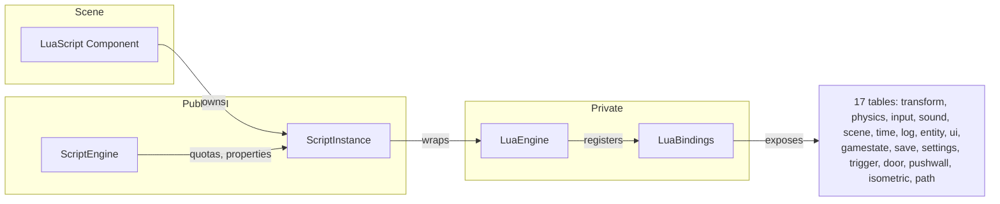
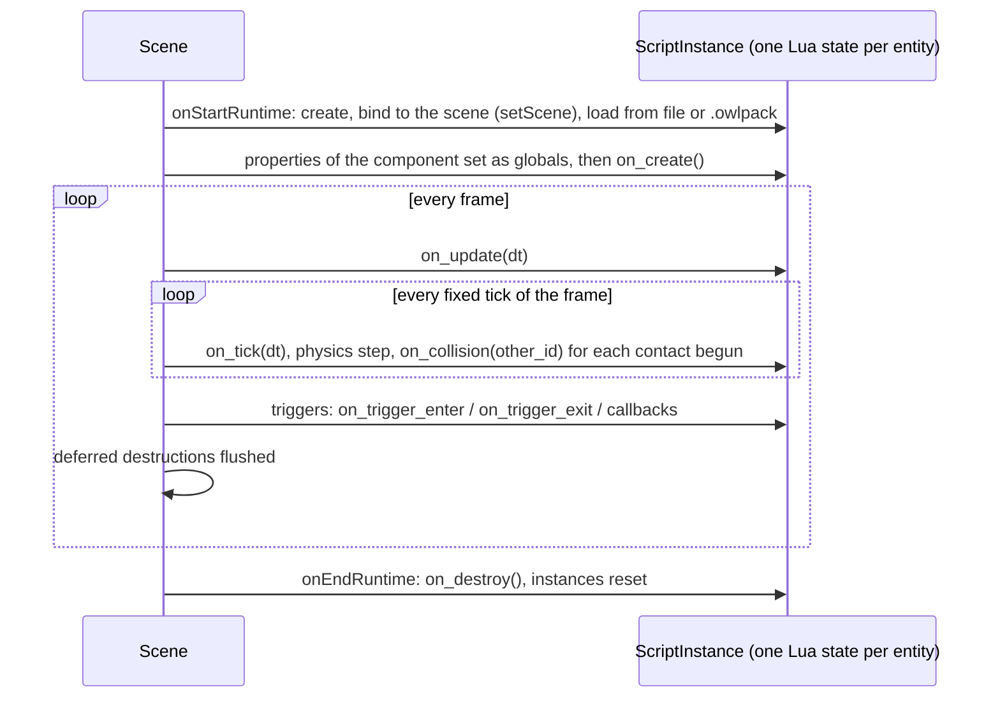

# Scripting Games in Lua {#page-scripting}

[TOC]

This page describes the Owl Engine Lua scripting system: how to attach scripts to entities,
write Lua callbacks, use the engine API from Lua, and manage script properties. Graphs edited in Owl Nest compile to
the same Lua: see [Visual scripts](visual-scripts.md).

## Overview

Owl Engine embeds Lua 5.5 as its gameplay scripting language. Scripts are attached to entities
via the `LuaScript` component, which provides lifecycle callbacks (`on_create`,
`on_update`, `on_destroy`, `on_collision`) and a property system for exposing
configurable values in the editor inspector.

Each script instance runs in an **isolated Lua state** — global variables in one
script do not affect other scripts. The Lua environment is **sandboxed**: no file or
system access, source chunks only, and a memory and time quota per instance (see
[Sandbox and quotas](#sandbox-and-quotas)).

## Architecture

| Class            | Role                                                                  |
|------------------|-----------------------------------------------------------------------|
| `ScriptEngine`   | Static: default quotas, property extraction (no scene, no Lua state)  |
| `ScriptInstance` | Per-entity isolated Lua state with lifecycle callbacks                |
| `LuaEngine`      | Private low-level wrapper around `lua_State*` (not public)            |
| `LuaBindings`    | Registers engine API tables into Lua states (not public)              |
| `LuaScript`      | Scene component: `scriptPath`, `properties`, runtime `instance`       |

`ScriptEngine` and `ScriptInstance` are the public API (`source/owl/public/script/`).
`LuaEngine` and `LuaBindings` are engine-private (`source/owl/private/script/`).



## Adding a Script to an Entity

1. Create a `.lua` file in your project's asset directory (e.g. `scripts/player.lua`)
2. In Owl Nest, select an entity and click **Add Component > Lua Script**
3. Drop the script from the Content Browser on the **Script** field (it stores the relative path, e.g.
   `scripts/player.lua`); **Open** shows it in the code editor
4. The exposed properties appear under **Properties**; they are read again when the file changes, values already set
   are kept
5. Edit property values in the inspector — they are saved with the scene
6. The **Hooks** list shows each function the engine calls (`on_create`, `on_update`, `on_tick`, `on_destroy`,
   `on_collision`, `on_trigger_enter`, `on_trigger_exit`, `on_triggered`, `on_interact`, `on_timer`): a defined hook
   gives its line and an **Open** button that reveals it in the code editor, an undefined one is dimmed
7. A HUD widget (button, slider, list, window, focus), a timer, an interaction or a Lua-callback trigger that names a
   function shows the script of the scene that defines it, with the same **Open** button, or a warning when none
   does

The resulting scene YAML looks like:

```yaml
LuaScript:
  scriptPath: "scripts/player.lua"
  properties:
    - name: "speed"
      type: "float"
      value: 5.0
    - name: "jumpForce"
      type: "float"
      value: 12.0
```

## Writing a Lua Script

### Basic Structure

```lua
-- Exposed properties (parsed by the editor)
properties = {
    { name = "speed",     type = "float",  default = 5.0 },
    { name = "jumpForce", type = "float",  default = 12.0 },
    { name = "label",     type = "string", default = "Player" },
    { name = "active",    type = "bool",   default = true },
}

-- Called once when the scene enters Play mode
function on_create()
    log.info("Entity " .. entity_id .. " created!")
end

-- Called every frame during Play mode
function on_update(dt)
    if input.is_action_pressed("jump") then  -- Space or gamepad A, see input_actions.yml
        local x, y, z = transform.get_position(entity_id)
        transform.set_position(entity_id, x, y + speed * dt, z)
    end
end

-- Called when the scene exits Play mode
function on_destroy()
    log.info("Entity destroyed")
end

-- Called when this entity's physics body starts touching another entity's body
function on_collision(other_entity_id)
    log.info("Collided with " .. other_entity_id)
end
```

### Lifecycle Callbacks

| Callback                 | When                                       | Arguments                     |
|--------------------------|--------------------------------------------|-------------------------------|
| `on_create()`            | Scene enters Play mode                     | None                          |
| `on_update(dt)`          | Every frame during Play mode               | `dt`: delta time (seconds)    |
| `on_tick(dt)`            | Every fixed simulation tick (60 Hz)        | `dt`: tick duration (seconds) |
| `on_destroy()`           | Entity destroyed, or Play mode ends        | None                          |
| `on_collision(other_id)` | Body starts touching another entity's body | `other_id`: UUID              |

All callbacks are optional — missing callbacks are silently skipped.

`on_update` follows the frame rate; `on_tick` runs at the project's fixed rate (`simulation.tickRate`, 60 Hz by
default, see [Fixed simulation tick](scene.md#fixed-tick)), zero, one or several times per frame, right before each
physics step. Put in `on_tick` what must behave the same at any frame rate (driving bodies, counters, AI steps) and
in `on_update` what follows the display (input polling, UI, camera). Inside `on_tick`, `time.delta()` returns the
tick duration; `time.tick_alpha()` gives the fraction of a tick the frame stands at, to blend what a script draws
between two ticks.

```lua
function on_tick(dt)
    local vx, vy = physics.get_velocity(entity_id)
    physics.set_velocity(entity_id, vx * 0.98, vy)   -- the same damping per step at 30 or 240 FPS
end
```

`input.is_action_just_pressed(action)` / `is_action_just_released(action)` (and the deprecated
`input.is_key_just_pressed(key)` / `is_key_just_released(key)` with their mouse equivalents) and `get_mouse_wheel()`
read the scene's input frame: in `on_tick` the edge since the previous tick, in `on_update` the edge since the
previous frame. Each press is seen once at either rate, even when a frame runs several ticks or none, and a key held
when the scene starts gives no edge; no `was_down` latch is needed:

```lua
function on_update(dt)
    if input.is_action_just_pressed("pause") then   -- Escape or Start, once per press
        scene.transition_to("scenes/main_menu.owl", "fade_out", 0.3)
    end
end
```

### Collision Callback

`on_collision(other_id)` is fed by Box2D contact events. It needs a Box2D body on both sides: a `PhysicBody`
component, a collidable tilemap, or the automatic body of a raycast door or pushwall. Only the entity receiving the
callback needs a `LuaScript`.

- Both entities are notified, each with the other's UUID, right after the physics step of the frame (before
  triggers).
- A pair is reported **once** when its first contact begins. It is reported again only after the two bodies have
  fully separated: resting on the ground, or sliding from one tilemap cell to the next, does not call it again.
- Entities that are hidden, or queued for destruction (themselves or through an ancestor), are skipped. The check is
  made before each call, so if the first entity's callback destroys the second, the second is not notified.
- `scene.destroy_entity` in the callback is deferred like everywhere else (see
  [Entity destruction](#entity-destruction)): destroying the entity itself or `other_id` is safe.
- Two static bodies never collide, and a body that only moves through `transform.set_position` does not move in
  Box2D (use `physics.set_velocity` or `physics.set_transform`).

### The `entity_id` Global

Every script instance has a global `entity_id` variable automatically set to the
owning entity's UUID. Use this to call engine API functions that require an entity
identifier.

### Properties Table

The `properties` table at the top level of a script declares configurable values.
Each entry must have:

| Field     | Type   | Description                                                                          |
|-----------|--------|--------------------------------------------------------------------------------------|
| `name`    | string | Property name (used as the Lua global variable)                                      |
| `type`    | string | A type of the table below                                                            |
| `default` | any    | Default value matching the declared type                                             |
| `min`     | number | Optional smallest value of a `float`, `int`, `vec2` or `vec3` (each component)       |
| `max`     | number | Optional largest value                                                               |
| `step`    | number | Optional drag step of the inspector field                                            |

| Type      | Lua value                                      | Inspector editor                       | `default`                |
|-----------|------------------------------------------------|----------------------------------------|--------------------------|
| `float`   | number                                         | Drag field                             | `5.0`                    |
| `int`     | integer                                        | Drag field                             | `3`                      |
| `string`  | string                                         | Text field                             | `'text'`                 |
| `bool`    | boolean                                        | Switch                                 | `true`                   |
| `color`   | table `{r, g, b, a}`, sRGB components in 0..1  | Colour picker with alpha               | `{1, 0.5, 0, 1}`         |
| `vec2`    | table `{x, y}`                                 | Two drag fields                        | `{0, 0}`                 |
| `vec3`    | table `{x, y, z}`                              | Three drag fields                      | `{0, 0, 0}`              |
| `entity`  | integer UUID of an entity, `0` for none        | Combo of the entities of the scene     | `0`                      |
| `numbers` | sequence of numbers                            | List with **+** and remove buttons     | `{1, 2, 3}`              |
| `strings` | sequence of strings                            | List with **+** and remove buttons     | `{'a', 'b'}`             |

The editor reads this table to populate the inspector. When the scene enters Play mode,
the engine sets each property as a Lua global with the value configured in the inspector
(overriding the `default`). Every field of the inspector shows the `default` of the script in the tooltip of its reset
button, which puts the value back; a property the scene does not list takes the `default` of the script when the
script loads in Play; the values and the lists are saved with the scene (`name`, `type`, `value`), the
`min`, `max` and `step` stay in the script.

### Scene script

A scene can own one script of its own, the **Script** section of Scene Settings in Owl Nest (the `SceneScript:` key of
the `.owl` file). It has the hooks and the `properties` of an entity script and runs before the entity scripts in the
same frame, but it belongs to no entity: `entity_id` is `nil`, so it drives the scene through `scene.*`, `ui.*`,
`gamestate.*` and the other tables, and finds the entities it moves by name or tag. Put there what used to be parked on
the camera; a script that moves its own entity stays a `LuaScript` of that entity.

### HUD script

A `.owlhud` file can own a scene script too (the `SceneScript` key, set in the Scene Settings of the HUD). It runs in
Play with every scene that draws the HUD, with the hooks and the `properties` of a scene script (`Scene::getHudScript`).
A widget callback (button `onClickCallback`, slider, list...) is looked up in the scripts of the widget, then in the HUD
script and the scene script, then in the entity scripts.

## Engine API Reference

Every script sees the tables below. The full list of functions, with their typed parameters and returned values,
is the [Lua API reference](lua-api.md), generated from the binding registry; this section only adds what a
function table cannot say.

### `input`

**Actions** are the way to read the player: `input.is_action_pressed(action)`, `is_action_just_pressed`,
`is_action_just_released`, `get_action_value(action)` (button 0 or 1, axis in [-1, 1]) and
`get_action_vector(action)` (x right, y down, in the unit disc) read the actions of the project's `input_actions.yml`
(plus the built-in `move`, `look`, `jump`, `sprint`, `interact`, `primary`, `secondary` and `ui_*`; see
[Actions](event_input.md#actions)). `input.has_action(action)` tells a misspelt name from a released action. They
follow the tick and frame rules above and work with the keyboard, the mouse and any gamepad without a line of code:

```lua
function on_update(dt)
    local dx, dy = input.get_action_vector("move")
    physics.set_velocity(entity_id, dx * speed, -dy * speed)
    if input.is_action_just_pressed("jump") then jump() end
end
```

`input.is_key_pressed`, `is_key_just_*`, `is_mouse_button_pressed` and `is_mouse_button_just_*` are **deprecated**: a
raw key cannot be rebound nor played with a pad. Key codes match the GLFW key constants (e.g. `65` = A, `87` = W,
`32` = Space).

Gamepads are read by slot (`0` to `15`, the first pad plugged in is `0`). Buttons use the Xbox layout: `0` = A,
`1` = B, `2` = X, `3` = Y, `4` / `5` = bumpers, `6` = Back, `7` = Start, `8` = Guide, `9` / `10` = stick clicks,
`11` to `14` = D-pad up, right, down, left. Axes: `0` / `1` = left stick x / y, `2` / `3` = right stick, y down, in
[-1, 1]; `4` / `5` = left / right trigger in [0, 1]. `input.get_gamepad_stick(pad, stick, dead_zone)` applies a
radial dead zone (0.15 when left out) and rescales past it, so a resting stick reads exactly `0, 0`;
`input.get_gamepad_axis(pad, axis)` is the raw value. The `_just_` functions follow the tick and frame rules above.

```lua
function on_tick(dt)
    if not input.is_gamepad_connected(0) then return end
    local x, _ = input.get_gamepad_stick(0, 0)
    physics.set_velocity(entity_id, x * speed, select(2, physics.get_velocity(entity_id)))
    if input.is_gamepad_button_just_pressed(0, 0) then jump() end
end
```

### `scene`

`scene.find_entity` scans every entity: call it once (in `on_create`) and keep the id. It looks in the scene, then in the
scene's HUD asset (`Hud:` key, see [Scene](scene.md#hud-asset)). `scene.find_entities(tag)` returns every entity of
the scene with the tag as an array (the iso town indexes its trees by cell with it).

`scene.spawn_prefab(path, [x, y, z])` instantiates a `.owlprefab` asset (read from the open pack, then the asset
folders) and returns the id of its root, placed at the position when one is given (0 when the prefab cannot be
read). Its scripts are created and get `on_create` at the next safe point of the frame (before or after the scripts
of the frame), never inside the call; its bodies join the physics world, its animations play and its timer triggers
start. A spawned entity is destroyed like any other with `scene.destroy_entity`; one destroyed in the frame it was
spawned never starts. `entity.add_component(id, key)` adds a component with its default values by YAML key:

```lua
local WAVE = { "prefabs/enemy.owlprefab", "prefabs/enemy.owlprefab", "prefabs/boss.owlprefab" }

function spawn_wave()
    for i, path in ipairs(WAVE) do
        local id = scene.spawn_prefab(path, -8.0 - i * 1.5, 2.0, 0.0)
        if id ~= 0 then enemies[#enemies + 1] = id end
    end
end
```

`scene.pick_entity([x, y])` returns the entity drawn under a viewport pixel, the mouse by default (0 when none): the
sprites, circles and meshes of the world, not the UI (`ui.is_mouse_over_ui()` tells when the mouse is on a widget).
An entity of an isometric layer is picked on its sprite as drawn, any other one on the ray of the primary camera (a
sprite of a billboard layer turned to it); a hit in a later layer of the render stack wins, then the nearest one. With
a tag (`scene.pick_entity(nil, nil, "Tower")`) only the entities of that tag and their children count, and a hit on a
child returns its tagged ancestor: a tower made of several meshes is picked as one.

### `time`

`time.delta()` is the duration of the frame (or of the fixed tick in `on_tick`) on the scene clock.
`time.set_scale(scale)` runs that clock faster or slower (0 to 16, back to 1 when a scene starts): the ticks, the
physics, the animations, the behaviour components and `dt` follow it. `time.set_paused(true)` stops it: `on_update`
still runs, with a zero `dt`, so the script can drive its pause menu; no tick, physics step nor animation runs
until `time.set_paused(false)`. The UI, the screen transitions and `time.real_delta()` keep the real time:

```lua
function on_update(dt)
    if input.is_action_just_pressed("pause") then
        time.set_paused(not time.is_paused())
        ui.set_visible(pause_window, time.is_paused())
    end
    if input.is_action_just_pressed("fast_forward") then
        time.set_scale(time.get_scale() == 1.0 and 3.0 or 1.0)
    end
    menu_clock = menu_clock + time.real_delta()    -- runs during the pause too
end
```

### `ui`

`ui.find(name)` returns the first widget with this tag, searching the HUD asset before the scene (0 when none); the other
`ui.*` functions take its id wherever the widget lives. A button callback of a HUD widget runs on the script above it in
the HUD, else on the first script of the active scene that defines it.

The keyboard and the gamepad drive a focus over the buttons and sliders (`ui_*` actions, see
[HUD system](design/hud-system.md#focus-navigation-hud5-done)): `ui.set_focus(id)` gives it to a widget and shows it,
`ui.get_focus()` returns the widget holding it (0 when none), and a `UiFocus` with an `onFocusCallback` calls that
function when its widget takes the focus, with the widget id in `_focused_entity`. A script can also read
`input.is_action_just_pressed("ui_cancel")` to go back from a menu.

A `UiScrollView` or a `UiList` scrolls with the wheel, its bar and the focus; `ui.scroll_get(id)` and
`ui.scroll_set(id, x, y)` read and move it (reference pixels, kept inside the content). A list is a model fed by the
script, which only builds the rows in view ([HUD system](design/hud-system.md#scroll-views-and-virtualised-lists-hud7-done)):

```lua
function on_create()
    ui.list_set_count(ui.find("Vehicles"), 1000)      -- the rows exist, none is built yet
end

function on_bind_vehicle()                            -- the list's onBindCallback, once per row coming in view
    ui.list_set_row(_list_entity, _row_index, "Train " .. _row_index, "12 km/h", "textures/train.png")
end

function on_pick_vehicle()                            -- the list's onSelectCallback
    log.info("selected " .. _selected_index)          -- 1-based, as the rows
end
```

`ui.list_invalidate(id)` binds the rows in view again after the data changed; `ui.list_set_selected(id, index)` selects
and scrolls without running the callback.

`ui.set_image(id, texture_path)` shows another texture in a `UiImage` (an empty path clears it). A `UiImage` whose
`Columns` and `Rows` cut its texture into a sprite sheet shows one frame of it: `ui.set_image_frame(id, frame)` picks
it (row-major from the top left, 0-based) and `ui.get_image_frame(id)` reads it, for a weapon view or hotbar icons.

While a `UiWindow` of the scene or of its HUD is shown (a pause menu, an inventory), the engine fires no world
interaction (doors, interaction triggers); `ui.is_world_blocked()` tells a script so, to ignore its own world clicks
in that frame.

#### Transition kinds

`ui.transition_play(type, duration, [r, g, b, a])` accepts:

| `type`         | Effect                                                        |
|----------------|---------------------------------------------------------------|
| `"fade"`       | Cross-fade *to* the configured colour (alias of `"fade_in"`). |
| `"fade_in"`    | Cross-fade from opaque colour to transparent.                 |
| `"fade_out"`   | Cross-fade from transparent to opaque colour.                 |
| `"wipe_left"`  | Coloured bar slides off-screen towards the left.              |
| `"wipe_right"` | Bar slides off-screen towards the right.                      |
| `"wipe_up"`    | Bar slides off-screen towards the top.                        |
| `"wipe_down"`  | Bar slides off-screen towards the bottom.                     |

The colour arguments are optional — passing only `type` and `duration`
defaults to opaque black. With three-colour
arguments, alpha defaults to `1`. `scene.transition_to(path, type, duration, [r, g, b, a])` takes the same colour
for its cover, its loading screen and the reveal of the next scene (the sample games give each its own).

```lua
-- Cinematic exit before loading the raycast level: 0.3 s wipe-left in black.
pending_scene = "scenes/raycast_demo.owl"
ui.transition_play("wipe_left", 0.3)

-- 0.5 s magenta fade-out for a dramatic boss reveal.
ui.transition_play("fade_out", 0.5, 0.8, 0.1, 0.6, 1.0)
```

`ui.transition_fade_in(d)` and `ui.transition_fade_out(d)` remain available
as zero-allocation shorthands for scripts written before the wipe variants
existed.

### `entity`

`entity.has_component(id, name)` and `entity.get_name(id)` query an entity; `entity.set_tint(id, r, g, b, [a])` and
`entity.get_tint(id)` write and read the colour a `SpriteRenderer` or `AnimatedSpriteRenderer` multiplies into its
texture, which is how a script flashes a sprite on a hit or fades a coin out (false / nothing for an entity without a
sprite). See `engine_demo/scripts/platformer/platformer_player.lua` and `coin.lua`.

### `isometric`

The `isometric` functions take the entity carrying the isometric `Tilemap` (`scene.find_entity("Ground")`, cached).
`isometric.pick_cell(map)` returns the cell under the mouse (or under a window pixel), slope-aware, nothing when the
pixel is off the map; `isometric.get_cell(map, layer, x, y)` and `isometric.set_cell(map, layer, x, y, terrain, overlay)`
read and write a cell of a layer (layers from 0, -1 for none) without undo, which is how the sample town lays roads,
and `isometric.get_size(map)` gives the grid width, height and cell size; they work on a 2D tilemap too (the Sokoban
sample keeps its crates in a layer). `isometric.get_slope(map, x, y)` and `isometric.get_height(map, x, y)` give the slope of a cell and the world height of
the surface under a world position, to stand vehicles on the terrain. `isometric.set_sprite_frame(sprite, frame)` pins an
`AnimatedSpriteRenderer` on one frame of its sheet (`isometric.get_sprite_frame(sprite)` reads it), so one entity shows
the picture of its heading. `ui.is_mouse_over_ui()` tells a click on the HUD
from a click on the map. See `engine_demo/scripts/iso/iso_town.lua` and `iso_town_traffic.lua`.

### `path`

The `path` functions take the entity carrying a `Tilemap` with `navigation` rules (see [Pathfinding](pathfinding.md)).
`path.find(map, from_x, from_y, to_x, to_y)` queues a query and returns a request; the scene searches it over the
next frames, `path.poll(map, request)` answers `pending`, `found`, `not_found` or `unknown`, `path.get(map, request)`
returns the cells as `{x1, y1, x2, y2, ...}` and the cost in cells, `path.release(map, request)` frees the request.
`path.find_now` searches at once, `path.get_version(map)` changes when a road is built or bulldozed,
`path.is_valid(map, request, from_cell)` tells whether the rest of a path still exists and `path.get_edge_cost` and
`path.is_walkable` read the graph. See `engine_demo/scripts/iso/iso_town_traffic.lua`.

### `gamestate`

The game state persists across scene transitions and is included in save files. A value keeps its Lua type
(integer, number, string, boolean): a string that reads as a number, such as `"0110"`, stays a string, in the game
state as in `settings.set`.

### `save`

Save files are stored in `games/<game>/saves/` of the [user directory](architecture.md#architecture-user-directory)
(`user/` beside the game) as YAML `.owl_save` files. A save holds the game state, the scene, the HUD
widget values, the body velocities and the cells of every tilemap changed since it was read from its file
(`isometric.set_cell`, roads and buildings laid in game): the load puts them back before the colliders are built.

### `settings`

Persistent game settings with a two-layer system: game defaults (`game_settings.yml` in
project assets) overlaid with user overrides (`settings.yml` in user directory).

**Built-in keys** (auto-applied by `settings.apply()`):

| Key                 | Type  | Description             |
|---------------------|-------|-------------------------|
| `resolution_width`  | int   | Window width in pixels  |
| `resolution_height` | int   | Window height in pixels |
| `fullscreen`        | bool  | Fullscreen mode         |
| `resizable`         | bool  | Window resizable        |
| `volume_master`     | float | Master bus volume       |
| `volume_music`      | float | Music bus volume        |
| `volume_sfx`        | float | SFX bus volume          |
| `volume_ambient`    | float | Ambient bus volume      |
| `volume_voice`      | float | Voice bus volume        |

The accessibility keys (`ui_scale`, `color_blind_mode`, `color_blind_strength`, `reduced_motion`, `subtitles`,
`subtitle_scale`, `subtitle_background`) apply at the next frame without `settings.apply()`, but for the transition
wipes of `reduced_motion`; a script with a camera shake of its own reads `settings.get("reduced_motion")`
([Accessibility](design/accessibility.md)). `ui.show_subtitle(text, seconds)` shows a subtitle, `ui.clear_subtitles()`
removes them.

The `volume_*` keys are the player's volume of each mixer bus, multiplied by the designer mix of the scene
([Mixer](sound.md#sound-mixer)).

Custom game-specific keys (e.g., `player_speed`, `player_jump_impulse`) can be defined in
`game_settings.yml` and read from Lua the same way.

**Game defaults file** (`game_settings.yml` in project assets):

```yaml
GameSettings:
  - key: player_speed
    type: float
    value: 8.0
  - key: volume_master
    type: float
    value: 1.0
```

**User overrides** are saved to `games/<game>/settings.yml` in the
[user directory](architecture.md#architecture-user-directory) (`user/` beside the game).

### `trigger`

Control trigger entities from Lua.

## Trigger System

Triggers are entities with a `Trigger` component. They detect overlap with the player
and fire events. The engine provides 7 trigger types:

| Type            | Behaviour                                                       |
|-----------------|-----------------------------------------------------------------|
| **Victory**     | Sets scene status to Victory (game won)                         |
| **Death**       | Sets scene status to Death (game over)                          |
| **Target**      | Passive position marker (no action on overlap)                  |
| **Teleport**    | Teleports the player to a target entity, optionally cross-level |
| **Timer**       | Fires a Lua callback after a configurable duration              |
| **Interaction** | Fires a Lua callback when the player presses E in range         |
| **LuaCallback** | Fires a Lua callback every frame while overlapping              |

### Trigger Callbacks

All overlap-based triggers (except Victory, Death, Target) fire edge events, on the trigger entity's script and
on the player's script. `other_id` is the other side: the player's UUID for the trigger, the trigger's UUID for the
player.

```lua
-- Called once when the player enters the trigger volume
function on_trigger_enter(other_id)
    log.info("Player entered!")
end

-- Called once when the player exits the trigger volume
function on_trigger_exit(other_id)
    log.info("Player left!")
end
```

Each type also has a primary callback. The callback name is configurable in the
inspector (the **Callback** field); if left empty, the default name is used:

| Type            | Default Callback | When it fires                         |
|-----------------|------------------|---------------------------------------|
| **Timer**       | `on_timer`       | When the timer duration expires       |
| **Interaction** | `on_interact`    | When the player presses E in range    |
| **LuaCallback** | `on_triggered`   | Every frame while the player overlaps |

`on_triggered` receives the player's UUID as its only argument (`on_triggered(other_id)`); `on_timer` and
`on_interact` take no argument. `on_interact` does not fire while a `UiWindow` is shown (a pause menu, an inventory),
nor on the frame whose click closes it; the built-in activation of a raycast door or secret wall waits the same way.

### Timer Example

```lua
-- Attach this script to an entity with a Timer trigger (2s, repeating).
local count = 0

function on_timer()
    count = count + 1
    log.info("Timer fired! Count: " .. count)
end
```

### Interaction Example

```lua
-- Attach this script to an entity with an Interaction trigger.
function on_interact()
    log.info("Player interacted with this object!")
    -- Open a door, pick up an item, start dialogue, etc.
end

function on_trigger_enter()
    log.info("Press E to interact")
end
```

## Screen Transitions

Use `ui.transition_fade_out()` and `ui.transition_fade_in()` to create smooth
transitions between scenes. The transitions render a full-screen black overlay
with animated alpha.

```lua
function on_start_clicked()
    ui.transition_fade_out(0.5)  -- fade to black over 0.5 seconds
end

function on_update(dt)
    -- After fade completes, load next scene
    if not ui.is_transition_active() and fading then
        scene.load_scene("game_level_1")
    end
end
```

## Menu Scenes

The Engine Demo (`engine_demo/scenes/`) holds ready-made screens to copy into a project and adapt (text, colours, Lua
callbacks): `main_menu.owl` (Play, Continue, Settings and Quit buttons), `settings_menu.owl`, `game_over.owl` (Retry and
Main Menu buttons) and `victory.owl`, driven by `engine_demo/scripts/ui/`.

## Scene Lifecycle Integration



The scene binding (`ScriptInstance::setScene`) makes the bindings act on that scene only, so the scripts of several
scenes run side by side.

### Spawned entities {#spawned-entities}

The entities of `scene.spawn_prefab` exist as soon as the call returns (their transform and components can be set),
and start at the next safe point of `onUpdateRuntime()`: just before the scripts of the frame, or just after them.
Each script of the prefab is then created bound to the scene, gets its properties, then `on_create()`.

### Entity destruction {#entity-destruction}

`scene.destroy_entity(id)` does not destroy anything right away: it queues the entity, which stays valid
until the end of the current `onUpdateRuntime()`, after scripts, physics and triggers have run. A script
may therefore destroy its own entity and keep running. At that point the entity and all its children are
destroyed; each of them gets `on_destroy()` once, loses its Box2D body and stops its `SoundSource`.

## Sandbox and quotas {#sandbox-and-quotas}

### Libraries

| Available                                          | Removed or restricted                                         |
|----------------------------------------------------|---------------------------------------------------------------|
| `base` (print, type, pairs, ipairs, tostring, ...) | `io`, `os`, `debug`, `package`: not opened                    |
| `table` (insert, remove, sort, ...)                | `dofile`, `loadfile`: removed                                 |
| `string` (format, find, sub, ...)                  | `string.dump`: removed                                        |
| `math` (sin, cos, sqrt, random, ...)               | `load`: text chunks only, whatever `mode` the script passes   |
| `utf8`                                             | `setmetatable`: a metatable with `__gc` is refused            |
| `coroutine`                                        | `collectgarbage`: only `"count"` and `"isrunning"`            |
|                                                    | `getmetatable("")`: returns `false` (string metatable locked) |
| `require` (the modules of the project)             | `require`: module names only, text chunks, see below          |

Scripts and packs are loaded as **source text only**: a precompiled (bytecode) chunk is
refused by the engine and by `load`, since forged bytecode can crash the interpreter.
`load(text, name, mode, env)` still works, its chunk runs in the script's own state.

### Modules (`require`)

A long script splits into modules: `require("scripts.game.towers")` reads `scripts/game/towers.lua` of the project
(the open pack, then the asset folders, like the scripts), runs it once as a text chunk and returns what it returns
(`true` when it returns nothing); every later `require` of the same name in the same script instance returns that
value. A module name is words of letters, digits and `_` joined by dots: no path, no `..`. A module requiring itself
while it loads, a missing module and a syntax error raise an error in the caller. A module shares the globals of its
script (its `properties` among them, read inside functions: the module runs before they are set), and runs under the
memory ceiling and the time budget of the call that required it. Keep the hooks (`on_create`, `on_update`, the HUD
callbacks) in the script of the entity, where Owl Nest lists them; the modules hold the rest. Require them in
`on_create` (or in a function): the inspector reads the `properties` of a script by running its top level alone,
without its modules.

```lua
-- scripts/game/towers.lua
local towers = {}
function towers.range(kind) return kind == "archer" and archer_range or 3.0 end
return towers

-- scripts/game/defence.lua
local towers
function on_create() towers = require("scripts.game.towers") end
function on_update(dt) local r = towers.range("archer") end
```

### Quotas

Each script instance has its own `ScriptQuotas`, taken from
`ScriptEngine::setDefaultQuotas()` when the instance is created and adjustable per
instance with `ScriptInstance::setQuotas()`. A value of zero disables the limit.

| Quota           | Default | Enforcement                                                             |
|-----------------|---------|-------------------------------------------------------------------------|
| `memoryBytes`   | 64 MiB  | Custom allocator: an allocation that would cross the ceiling is refused |
| `timePerCallMs` | 250 ms  | Watchdog thread: a call still running after its budget is interrupted   |

The time budget covers one host call: one `on_create`, `on_update`, `on_destroy`, the
execution of the chunk when the script loads, or the property extraction done by the
editor. The watchdog costs nothing while scripts behave (each call only bumps a counter);
when a call overruns, it signals the script thread, which arms a hook that raises
`time budget exceeded` on the next Lua instruction, in whichever coroutine is running.
The hook keeps firing until the call returns, so a script cannot swallow the error with
`pcall` and loop on.

The environment variable `OWL_SCRIPT_TIME_SCALE` (a whole factor) multiplies the default time budget of the
process; the scenario and export tests set it from the CMake option of the same name: 8 on the arm64 preset (tests under QEMU),
4 on the sanitizer presets, where every call runs many times slower than natively.

### What happens on failure

| Failure                                              | Effect                                                       |
|------------------------------------------------------|--------------------------------------------------------------|
| `error()`, bad argument, runtime error in a callback | Logged with a stack trace; the callback runs again next time |
| C++ exception thrown inside an engine binding        | Converted to a Lua error (`C++ exception: ...`), as above    |
| Memory or time quota exceeded                        | Logged; the instance is **disabled**, no callback runs again |
| Syntax error, bytecode chunk                         | Logged; the script is not loaded                             |

`ScriptInstance::isDisabled()` tells whether an instance was stopped by a quota.

### What is guaranteed, and what is not

- Every call from the engine into Lua is protected: a script error never unwinds through
  engine code, and a C++ exception never crosses a Lua frame (bindings run behind a
  trampoline that catches it and raises it as a Lua error once the C++ frames are gone).
- The engine reads and writes globals with raw accesses, so a metatable the script puts
  on `_G` or on its `properties` table never runs outside a protected call.
- A script cannot reach the filesystem, the OS, the debug library or other scripts' states.
- **Not covered:** a single long call into a C library function (for example a
  pathological `string.find` pattern on a large string) is only interrupted when it
  returns to Lua code; the memory ceiling bounds the size of such strings. Engine bindings
  run with the memory ceiling lifted (they allocate a bounded amount). The quotas protect
  the game from a runaway or buggy script; they are not a security boundary for
  untrusted code from the network.

## Hot reload {#scripting-hot-reload}

In Play (editor) and in the development runner, saving a `.lua` file replaces every running instance of that script
(`Scene::onAssetFileChanged`):

1. a fresh instance compiles the new file; if it fails, the error is logged and **the previous instance keeps
   running**;
2. it receives the current value of each property of the component (`speed` changed by the script itself is kept,
   a property the old instance lost falls back to the scene's value);
3. `on_create` runs, then the old instance is dropped **without** `on_destroy`.

Other globals start from the new file: keep the state that must survive in properties. See
[Editor](editor_assets.md#editor-hot-reload).

## Debugging {#scripting-debugging}

Breakpoints stop a script in Play, in a `.lua` file and in a [visual script](visual-scripts.md#visual-scripts-debugging).

- In the code editor of a `.lua` file, click the gutter of a line or press **F9** on it to set or clear a breakpoint.
- A breakpoint does not stop the script in the middle of its call: the call finishes, the game pauses, and the
  **Script Debug** panel (docked with the Console) shows the hit: the script, the line, the entity and the locals at that
  line. **Continue** resumes the game, **Open** shows the script at the line.
- The panel also lists the variables of the scene script, of the HUD script and of every entity script, with a filter,
  the selected entity first.

## Editor scripts

Lua also scripts Owl Nest itself: a `.lua` file under an `editor/` folder of the project runs in a separate Lua state
that calls the editor commands (`editor.entity.create{name = "Tree"}`), never inside Play. See
[Console](editor_console.md#editor-lua).

## Asset Packing

Lua scripts referenced by `LuaScript` components are automatically discovered by the
`AssetScanner` during game export (**Project > Pack Game** in Owl Nest).

The scanner parses scene YAML files, reads the `LuaScript.scriptPath` field, and
resolves the file path through the project's asset directories. Discovered scripts are
included in the `.owlpack` binary archive with `AssetType::Script`.

The scanner then follows what a script names: the scene paths (ending in `.owl`), the sound files (`.wav`, `.ogg`,
`.mp3`, `.flac`, or any argument of `sound.play`) and the serialized textures (`nam:` / `pat:`) quoted in the script,
the modules it requires (scanned in turn), and the same values given as `string` properties in the scene. A level can thus name the next one in a property
(`next_scene: scenes/level_2.owl`) edited in the inspector: the export packs it and scans it in turn. A path built at
run time (`"scenes/level_" .. n .. ".owl"`) is not seen; write it out or give it as a property.

At runtime, the game runner loads scripts transparently from the pack file, falling
back to the filesystem if not found in the pack.

## Example: Moving Platform

```lua
properties = {
    { name = "speed",    type = "float", default = 2.0 },
    { name = "distance", type = "float", default = 5.0 },
}

local startY = 0
local direction = 1

function on_create()
    local x, y, z = transform.get_position(entity_id)
    startY = y
end

function on_update(dt)
    local x, y, z = transform.get_position(entity_id)
    y = y + speed * direction * dt
    if y > startY + distance then direction = -1 end
    if y < startY then direction = 1 end
    transform.set_position(entity_id, x, y, z)
end
```

## Example: Collectible Item

```lua
properties = {
    { name = "points", type = "int", default = 10 },
}

function on_collision(other_id)
    local name = entity.get_name(other_id)
    if name == "Player" then
        log.info("Collected! +" .. points .. " points")
        scene.destroy_entity(entity_id)
    end
end
```
