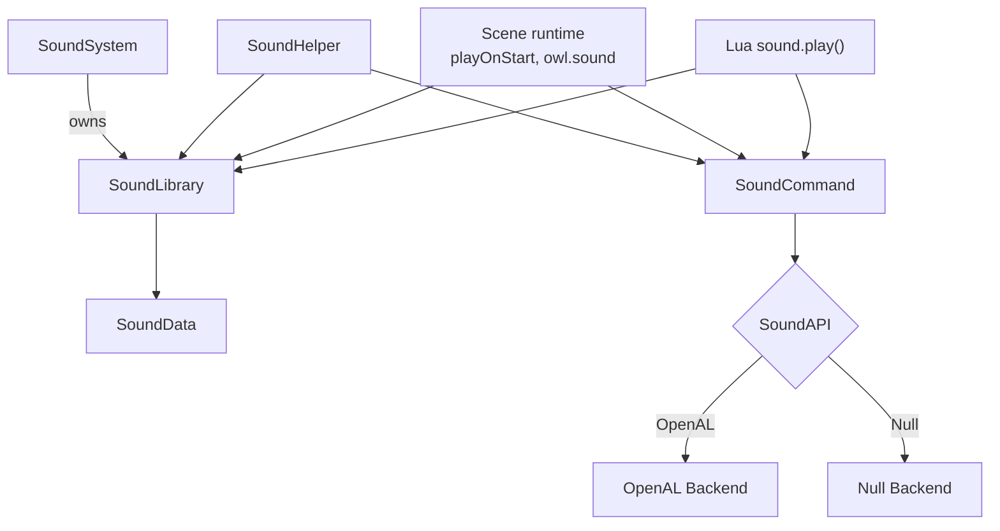
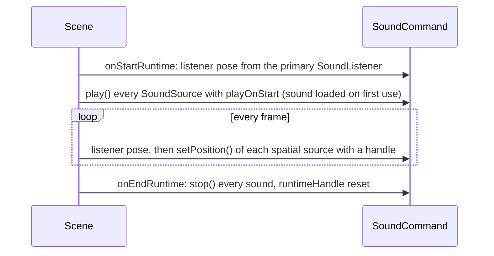

# Sound {#page-sound}

[TOC]

This page describes the Owl Engine sound system: audio in scenes, spatial sound, sounds from gameplay code.

## Overview

A component-based sound system with 3D spatial audio on an OpenAL or Null backend: files load into `SoundData`
buffers, playback is driven through opaque `SoundHandle` values ([Supported Formats](#supported-formats)).

## Architecture

The same backend abstraction as the renderer and input modules ([Architecture](architecture.md)):



| Class          | Role                                                     |
|----------------|----------------------------------------------------------|
| `SoundSystem`  | Lifecycle (init / shutdown / reset), owns `SoundLibrary` |
| `SoundCommand` | Static facade: delegates to the active `SoundAPI`        |
| `SoundAPI`     | Abstract interface implemented by each backend           |
| `SoundData`    | Loaded audio buffer (PCM data in OpenAL buffer object)   |
| `SoundHandle`  | Opaque `uint64_t` handle to an active playback source    |
| `PlayParams`   | Parameters struct: volume, pitch, loop, spatial, etc.    |
| `SoundHelper`  | Gameplay convenience: play/stop an entity's sound        |

## Adding Sounds to a Scene

1. Place audio files in your project's asset directory (e.g. `sounds/explosion.wav`)
2. In Owl Nest, select an entity (or create a new one)
3. Click **Add Component** and choose **Sound Source**
4. Set the `Sound Asset` field to the relative path of an audio file or a sound cue (e.g. `sounds/explosion.wav`)
5. Configure volume, pitch, loop, and other properties as needed
6. For spatial audio, also add a **Sound Listener** component to the camera or player entity

The scene then holds a `SoundSource:` block with the fields below.

## SoundSource Component

`SoundSource` wraps a `SceneSound` (YAML key `SoundSource`):

| Field       | Type     | Default | Description                                       |
|-------------|----------|---------|---------------------------------------------------|
| soundAsset  | string   | `""`    | Relative path to the audio file in assets         |
| category    | Category | SFX     | `SFX`, `Music`, or `Ambient`                      |
| volume      | float    | 1.0     | Gain factor (0 = silent, 1 = normal, >1 = louder) |
| pitch       | float    | 1.0     | Pitch multiplier (0.1 to 3.0 in editor)           |
| loop        | bool     | false   | Whether to loop playback                          |
| spatial     | bool     | false   | Enable 3D positional audio                        |
| playOnStart | bool     | false   | Auto-play when the scene enters Play mode         |
| maxDistance | float    | 50.0    | Maximum audible distance (spatial only)           |
| rolloff     | float    | 1.0     | Distance attenuation factor (spatial only)        |

The internal `runtimeHandle` (not saved) holds the active `SoundHandle` during playback.

## SoundListener Component

`SoundListener` marks the "ear" of spatial audio.

| Field   | Type | Default | Description                         |
|---------|------|---------|-------------------------------------|
| primary | bool | true    | Whether this is the active listener |

Keep one primary listener, on the camera or the player; it follows the entity's world transform every frame.

## Sound Categories

The category is stored for a future per-category mixer and does not change playback yet.

| Category | Typical Use                | Typical Settings                                  |
|----------|----------------------------|---------------------------------------------------|
| SFX      | Gunshots, footsteps, UI    | `spatial=true`, `loop=false`, `playOnStart=false` |
| Music    | Background music           | `spatial=false`, `loop=true`, `playOnStart=true`  |
| Ambient  | Wind, rain, fire crackling | `spatial=true/false`, `loop=true`                 |

Background music is a `SoundSource` with `loop=true` and `spatial=false`: there is no music subsystem.

## Spatial Audio

When `spatial=true`, the OpenAL backend positions the sound source in 3D space using
the **inverse distance clamped** attenuation model:

```
gain = referenceDistance / (referenceDistance + rolloff * (distance - referenceDistance))
```

Where `referenceDistance = 1.0` and `distance` is clamped to `[0, maxDistance]`.

- **Source position** is the entity's world transform, updated every frame
- **Listener position and orientation** come from the primary `SoundListener` entity
- For 2D games, the listener's forward direction is derived from the Z-axis rotation
- **Stereo audio files** are NOT spatialized by OpenAL (only mono sources are positioned in 3D)

## Gameplay Triggers (SoundHelper)

One-shot sounds from gameplay code (a `NativeScript`) go through `SoundHelper`:

```c++
#include <sound/SoundHelper.h>

// Play the sound configured on the entity's SoundSource component:
auto handle = owl::sound::SoundHelper::playEntitySound(entity);

// Stop it later:
owl::sound::SoundHelper::stopEntitySound(entity);
```

It reads the entity's `SoundSource` and plays it through `SoundHelper::playAsset`, which loads the data into the
`SoundLibrary` (a cue picks its take first) and calls `SoundCommand::play()`. For more control, use `SoundCommand`
directly:

```c++
#include <sound/SoundCommand.h>
#include <sound/SoundSystem.h>

auto& library = owl::sound::SoundSystem::getSoundLibrary();
auto data = library.get("sounds/explosion.wav");

owl::sound::PlayParams params;
params.volume = 0.8f;
params.spatial = true;
params.position = {10.0f, 5.0f, 0.0f};

auto handle = owl::sound::SoundCommand::play(data, params);

// Later: adjust properties
owl::sound::SoundCommand::setVolume(handle, 0.5f);
owl::sound::SoundCommand::setPitch(handle, 1.2f);

// Stop when done
owl::sound::SoundCommand::stop(handle);
```

## Waveform

`sound::readWaveform(path, buckets)` (`sound/Waveform.h`) reads a sound file once, in blocks, and returns the peak
amplitude (0 to 1, channels mixed) of each of `buckets` equal slices; the Content Browser draws it on sound tiles. It
returns an empty vector, with a warning, when the file cannot be read or the audio module is not built.

## Scene Lifecycle Integration



## Sound Cues

A sound cue (`.owlsound`, `sound::SoundCue`) groups takes of one sound, edited in Owl Nest
([Sound cues](editor_documents.md#sound-cues)). Each play picks a take by weight and varies its volume and pitch:

```yaml
SoundCue: ''
FormatVersion: 1
volume: 1
volumeJitter: 0.1   # ±10 % at each play
pitch: 1
pitchJitter: 0.05
loop: false
variants:
  - file: sounds/step_a.wav
    trimStart: 0.02   # seconds from the start of the file
    trimEnd: 0.4      # 0 for the end of the file
    loopStart: 0      # loop points, 0 and 0 loop the whole played part
    loopEnd: 0
    weight: 1
```

`SoundHelper::playAsset` plays an audio file or a cue: the scene sources, `sound.play` and the inspector preview go
through it. A take loads as its own sound data, cut to its trim, with its loop points on the OpenAL buffer
(`AL_SOFT_loop_points`); `SoundHelper::forgetCue` drops a cached cue after an edit.

## Supported Formats

| Format | Extension | Notes                                         |
|--------|-----------|-----------------------------------------------|
| WAV    | `.wav`    | Uncompressed PCM, universally supported       |
| Ogg    | `.ogg`    | Vorbis compressed, good quality-to-size ratio |
| FLAC   | `.flac`   | Lossless compressed, larger than Ogg          |
| MP3    | `.mp3`    | Lossy compressed, widely available            |

**libsndfile** loads them, with more sub-formats (IMA ADPCM, MS ADPCM, ALAC, Opus) in the WAV container; the OpenAL
backend picks the buffer type.

## Asset Packing

The game export (**Project > Pack Game**) packs every `SoundSource.soundAsset` of the scenes, with the audio files of
the takes of a cue, resolved through the asset directories by `AssetScanner`, into the `.owlpack`; the runner reads them from the pack. Packing pipeline:
[Architecture](architecture.md).
