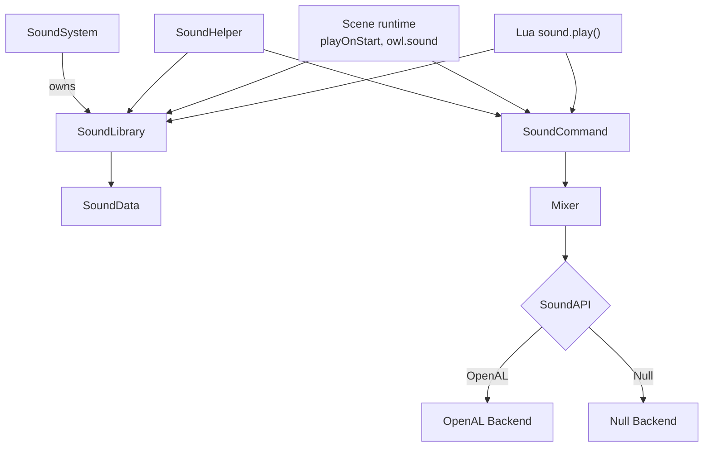
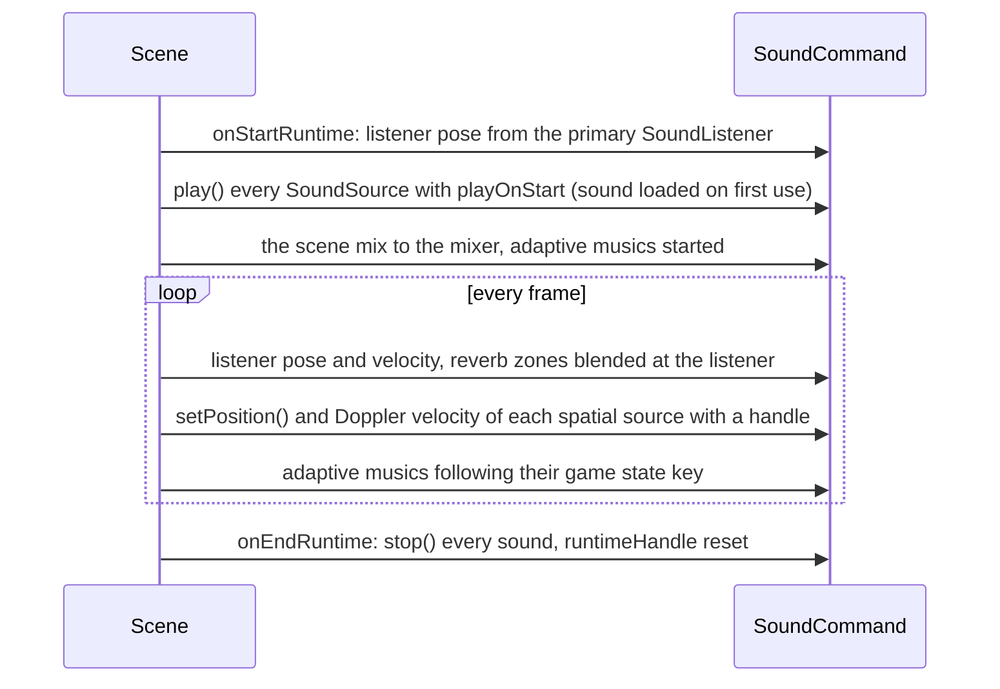

# Sound {#page-sound}

[TOC]

This page describes the Owl Engine sound system: audio in scenes, spatial sound, the mixer buses, reverb zones and
filters, the Doppler effect, adaptive music and sounds from gameplay code.

## Overview

A component-based sound system with 3D spatial audio on an OpenAL or Null backend: files load into `SoundData`
buffers, playback is driven through opaque `SoundHandle` values ([Supported Formats](#supported-formats)). The Null
backend is silent but keeps the state of every source and of the listener (gains, filters, reverb, velocities), so the
mixing logic runs and is tested headless.

## Architecture

The same backend abstraction as the renderer and input modules ([Architecture](architecture.md)):



| Class          | Role                                                     |
|----------------|----------------------------------------------------------|
| `SoundSystem`  | Lifecycle (init / shutdown / reset), owns `SoundLibrary` |
| `SoundCommand` | Static facade: plays through the `Mixer` of the backend  |
| `Mixer`        | Buses, fades, music track, environment of the listener   |
| `SoundAPI`     | Abstract interface implemented by each backend           |
| `SoundData`    | Loaded audio buffer (PCM data in OpenAL buffer object)   |
| `SoundHandle`  | Opaque `uint64_t` handle to an active playback source    |
| `PlayParams`   | Parameters struct: volume, pitch, loop, spatial, etc.    |
| `SoundHelper`  | Gameplay convenience: play/stop an entity's sound        |

## Adding Sounds to a Scene

1. Place audio files in your project's asset directory (e.g. `sounds/explosion.wav`)
2. In Owl Nest, select an entity (or create a new one)
3. Click **Add Component** and choose **Sound Source**
4. Set the `Sound Asset` field to the relative path of an audio file or a sound cue (e.g. `sounds/explosion.wav`)
5. Configure volume, pitch, loop, and other properties as needed
6. For spatial audio, also add a **Sound Listener** component to the camera or player entity

The scene then holds a `SoundSource:` block with the fields below.

## SoundSource Component

`SoundSource` wraps a `SceneSound` (YAML key `SoundSource`):

| Field       | Type     | Default | Description                                       |
|-------------|----------|---------|---------------------------------------------------|
| soundAsset  | string   | `""`    | Relative path to the audio file in assets         |
| category    | Bus      | SFX     | Mixer bus: `Master`, `Music`, `SFX`, `Ambient`... |
| volume      | float    | 1.0     | Gain factor (0 = silent, 1 = normal, >1 = louder) |
| pitch       | float    | 1.0     | Pitch multiplier (0.1 to 3.0 in editor)           |
| loop        | bool     | false   | Whether to loop playback                          |
| spatial     | bool     | false   | Enable 3D positional audio                        |
| playOnStart | bool     | false   | Auto-play when the scene enters Play mode         |
| maxDistance | float    | 50.0    | Maximum audible distance (spatial only)           |
| rolloff     | float    | 1.0     | Distance attenuation factor (spatial only)        |
| doppler     | bool     | true    | Pitch shift from the motion (spatial only)        |
| filter      | Filter   | none    | `gain`, `gainLow`, `gainHigh`, written when set   |
| subtitle    | string   | `""`    | Subtitle while it plays within hearing (a key)    |

The internal `runtimeHandle` (not saved) holds the active `SoundHandle` during playback.

A `subtitle` (a localisation key or the text itself) is drawn at the bottom of the screen while the sound plays within
hearing of the primary listener, when the player keeps the `subtitles` setting on
([Accessibility](design/accessibility.md#accessibility-subtitles)).

## SoundListener Component

`SoundListener` marks the "ear" of spatial audio.

| Field   | Type | Default | Description                         |
|---------|------|---------|-------------------------------------|
| primary | bool | true    | Whether this is the active listener |

Keep one primary listener, on the camera or the player; it follows the entity's world transform every frame.

## Mixer {#sound-mixer}

Every sound plays on a bus of `sound::Mixer`; every bus feeds Master.

| Bus     | Typical use                | Reverb zones and zone filter |
|---------|----------------------------|------------------------------|
| Master  | Sounds routed straight out | No                           |
| Music   | Music tracks and layers    | No (dry)                     |
| SFX     | Gunshots, footsteps, UI    | Yes                          |
| Ambient | Wind, rain, fire, drips    | Yes                          |
| Voice   | Dialogue, barks            | Yes                          |

The gain a source receives is `volume * fade * bus gain`. The bus gain multiplies the designer volume of the bus (the
mix of the scene, edited in the Mixer panel and saved as `Mixer:` in the scene), the player's volume (the settings
`volume_master`, `volume_music`, `volume_sfx`, `volume_ambient`, `volume_voice`) and the gain of Master; a muted bus is
silent, and while a bus is soloed only the soloed buses are heard. The scene gives its mix to the mixer when it
starts.

A `SoundSource` picks its bus with `category`; `sound.play` uses the bus of the cue (`bus:` of a `.owlsound`), SFX for a
bare audio file.

Fades run in the mixer (`Mixer::fadeTo`, linear or equal-power), and `Mixer::crossfade` fades one sound out (then stops
it) while another fades in. The mixer keeps one music track: `SoundHelper::playMusic` (Lua `sound.play_music`) starts a
looping track on the Music bus and crossfades from the previous one with equal-power curves, so the loudness holds.

## Reverb Zones and Filters

A **ReverbZone** component gives a reverb (a preset of the EFX table: `Cave`, `Hall`, `Forest`, `Underwater`... or
`Custom` parameters) and a filter to the sounds the listener hears while inside it:

| Field         | Type   | Default     | Description                                             |
|---------------|--------|-------------|---------------------------------------------------------|
| shape         | enum   | Box         | `Box` (half size `extents`) or `Sphere` (`radius`)      |
| extents       | vec3   | [2, 2, 2]   | Half size, in local units, scaled with the entity       |
| radius        | float  | 3           | Sphere radius, scaled by the largest axis of the entity |
| blendDistance | float  | 1           | Fade distance outside the volume, in world units        |
| preset        | enum   | Cave        | Reverb preset, or `Custom` with `reverb:` parameters    |
| filter        | Filter | none        | Filter put on the sounds heard inside the zone          |

The volume follows the world transform of the entity, so the gizmo moves, turns and resizes it in the viewport, which
draws it (and, selected, the edge of its fade). Every frame the `owl.sound` system weighs each zone at the listener
(1 inside, falling to 0 across the blend distance), averages the reverbs by weight and sets the send gain to the total
weight (at most 1); the zone filter fades in the same way. The reverb and the zone filter apply to the SFX, Ambient and
Voice buses. The OpenAL backend uses EFX (`ALC_EXT_EFX`): one auxiliary slot with the standard reverb, and a direct
filter per filtered source.

A **filter** has three gains in [0, 1]: `gain` for the whole sound, `gainHigh` above 5 kHz (low-pass: underwater,
behind a wall) and `gainLow` below 250 Hz (high-pass: a radio); both make a band-pass. A source filter and the zone
filter multiply.

## Doppler Effect

A spatial `SoundSource` with `doppler` set, and the listener, get a velocity from their world positions a frame apart.
World positions are in double ([Large worlds](design/large-worlds.md)): a shift of the floating origin does not read as
motion, and a speed above that of sound (a teleport) is held at 343 units per second. The Doppler factor of the scene
mix scales the effect (0 disables it).

## Adaptive Music

An **AdaptiveMusic** component holds layers (looping tracks that start together and stay in sync, each with a volume)
and states (`calm`, `danger`, `combat`), each naming the layers it plays and a stinger heard when it is entered:

```yaml
AdaptiveMusic:
  initialState: calm
  stateKey: threat      # game state key whose text value selects the state; empty: Lua only
  playOnStart: true
  fadeSeconds: 2
  layers:
    - {name: pads, asset: sounds/music_pads.wav, volume: 0.8}
    - {name: drums, asset: sounds/music_drums.wav, volume: 0.8}
  states:
    - {name: calm, layers: [pads], stinger: ""}
    - {name: combat, layers: [pads, drums], stinger: sounds/stinger.wav}
```

A state change fades each layer to its volume in the new state (equal power, `fadeSeconds`) through the mixer, then
plays the stinger on the Music bus. Lua switches it with `sound.set_music_state(state)`; with a `stateKey`, the
`owl.sound` system follows `gamestate.set(key, state)`. The logic is `sound::AdaptiveMusicPlayer`.

## Spatial Audio

When `spatial=true`, the OpenAL backend positions the sound source in 3D space using
the **inverse distance clamped** attenuation model:

```
gain = referenceDistance / (referenceDistance + rolloff * (distance - referenceDistance))
```

Where `referenceDistance = 1.0` and `distance` is clamped to `[0, maxDistance]`.

- **Source position** is the entity's world transform, updated every frame
- **Listener position and orientation** come from the primary `SoundListener` entity
- For 2D games, the listener's forward direction is derived from the Z-axis rotation
- **Stereo audio files** are NOT spatialized by OpenAL (only mono sources are positioned in 3D)

## Lua

The `sound` table plays sounds by handle and drives the mixer: `set_bus_volume`, `get_bus_volume`, `set_bus_muted`,
`is_bus_muted`, `play_music`, `stop_music`, `crossfade`, `set_music_state`, `get_music_state`
([Lua API: Sound](lua-api-sound.md)).

## Gameplay Triggers (SoundHelper)

One-shot sounds from gameplay code (a `NativeScript`) go through `SoundHelper`:

```c++
#include <sound/SoundHelper.h>

// Play the sound configured on the entity's SoundSource component:
auto handle = owl::sound::SoundHelper::playEntitySound(entity);

// Stop it later:
owl::sound::SoundHelper::stopEntitySound(entity);
```

It reads the entity's `SoundSource` and plays it through `SoundHelper::playAsset`, which loads the data into the
`SoundLibrary` (a cue picks its take first) and calls `SoundCommand::play()`. For more control, use `SoundCommand`
directly:

```c++
#include <sound/SoundCommand.h>
#include <sound/SoundSystem.h>

auto& library = owl::sound::SoundSystem::getSoundLibrary();
auto data = library.get("sounds/explosion.wav");

owl::sound::PlayParams params;
params.volume = 0.8f;
params.spatial = true;
params.position = {10.0f, 5.0f, 0.0f};

auto handle = owl::sound::SoundCommand::play(data, params);

// Later: adjust properties
owl::sound::SoundCommand::setVolume(handle, 0.5f);
owl::sound::SoundCommand::setPitch(handle, 1.2f);

// Stop when done
owl::sound::SoundCommand::stop(handle);
```

## Waveform

`sound::readWaveform(path, buckets)` (`sound/Waveform.h`) reads a sound file once, in blocks, and returns the peak
amplitude (0 to 1, channels mixed) of each of `buckets` equal slices; the Content Browser draws it on sound tiles. It
returns an empty vector, with a warning, when the file cannot be read or the audio module is not built.

## Scene Lifecycle Integration



## Sound Cues

A sound cue (`.owlsound`, `sound::SoundCue`) groups takes of one sound, edited in Owl Nest
([Sound cues](editor_documents.md#sound-cues)). Each play picks a take by weight and varies its volume and pitch:

```yaml
SoundCue: ''
FormatVersion: 1
volume: 1
volumeJitter: 0.1   # ±10 % at each play
pitch: 1
pitchJitter: 0.05
loop: false
bus: SFX            # bus of sound.play; a Sound Source picks its own
variants:
  - file: sounds/step_a.wav
    trimStart: 0.02   # seconds from the start of the file
    trimEnd: 0.4      # 0 for the end of the file
    loopStart: 0      # loop points, 0 and 0 loop the whole played part
    loopEnd: 0
    weight: 1
```

`SoundHelper::playAsset` plays an audio file or a cue: the scene sources, `sound.play` and the inspector preview go
through it. A take loads as its own sound data, cut to its trim, with its loop points on the OpenAL buffer
(`AL_SOFT_loop_points`); `SoundHelper::forgetCue` drops a cached cue after an edit.

## Supported Formats

| Format | Extension | Notes                                         |
|--------|-----------|-----------------------------------------------|
| WAV    | `.wav`    | Uncompressed PCM, universally supported       |
| Ogg    | `.ogg`    | Vorbis compressed, good quality-to-size ratio |
| FLAC   | `.flac`   | Lossless compressed, larger than Ogg          |
| MP3    | `.mp3`    | Lossy compressed, widely available            |

**libsndfile** loads them, with more sub-formats (IMA ADPCM, MS ADPCM, ALAC, Opus) in the WAV container; the OpenAL
backend picks the buffer type.

## Asset Packing

The game export (**Project > Pack Game**) packs every `SoundSource.soundAsset` of the scenes, with the audio files of
the takes of a cue, resolved through the asset directories by `AssetScanner`, into the `.owlpack`; the runner reads them from the pack. Packing pipeline:
[Architecture](architecture.md).
