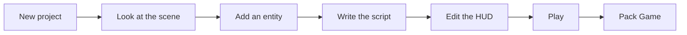

# Tutorial: Create a New Game {#page-tutorial-first-game}

[TOC]

**Level:** Beginner. **Read first:** nothing but [Getting Started](getting_started.md) to run Owl Nest.

You will make a tiny game in about 30 minutes, with Owl Nest only: an orange square you move with `W A S D`, a score
shown on screen that goes up when you press `Space`, then a game folder you can hand to a friend. No C++ and no
build step.



## 1. Create the project

1. Start **Owl Nest**. The **File** screen opens.
2. Click **New project**. The **New Project** window shows a card per template; the chips above them filter by style.
3. Click the **Empty 2D** card (a 2D world and a HUD layer, with a camera, a ground and a player sprite moved by a
   script). Under **Project**, leave the **Name** `MyGame`, choose a **Location** (a folder you own) and click
   **Create**.

You now have the folder `<Location>/MyGame` with an `owl_project.yml`, and the first scene, `scenes/main.owl`, opens
in a tab. The other templates are listed in [Projects and export](editor_projects.md#project-templates).

## 2. Look at the scene

The viewport shows a green bar (the ground) and an orange square (the player). On the right,
the **Scene Hierarchy** lists three entities: `MainCamera`, `Ground` and `Player`.

1. Click `Player` in the hierarchy: the square is outlined and its components show in **Properties** (Transform,
   Sprite Renderer, Lua Script, Visibility, Hierarchy).
2. Press `W` and drag the gizmo: the square moves. Press `Ctrl+Z`: it goes back.
3. In **Properties**, change the colour of the **Sprite Renderer**: the square changes at once.

Every entity is a name plus components; this one draws a coloured square. See [Scene and components](scene.md).

## 3. Add an entity

1. Right-click the background of the **Scene Hierarchy** and choose **Create Root Entity**; name it `Coin` in the
   **Entity name** field at the top of **Properties**.
2. Next to that field, click **Add** and choose **Sprite Renderer**. Set its colour to yellow.
3. In its **Transform**, set the translation to `3, -2, 0.1` (x, y, z). The yellow square sits right of the player.
4. Press `Ctrl+S` to save the scene.

## 4. Give the player a score

The template ships the built-in input actions of
[`input_actions.yml`](editor_documents.md#editor-action-map): `move` is `W A S D` or the left stick, `jump` is
`Space` or the pad button A. Its `Player` already runs `scripts/player.lua`, which moves it with `move`.

1. Select `Player`. In its **Lua Script** component, the **Hooks** list shows `on_update`; click its **Open** button:
   the script opens in the code editor at that function. The `speed` property above the hooks is the value the
   script reads: change it in the inspector, no code edit needed.
2. Replace the text of the script with this and press `Ctrl+S`:

```lua
properties = {
    { name = "speed", type = "float", default = 4.0 },
}

local score = 0
local label = 0

function on_create()
    label = ui.find("Title")            -- the HUD text, found by its name
end

function on_update(dt)
    local mx, my = input.get_action_vector("move")   -- x right, y down
    local x, y, z = transform.get_position(entity_id)
    transform.set_position(entity_id, x + mx * speed * dt, y - my * speed * dt, z)

    if input.is_action_just_pressed("jump") then
        score = score + 1
        ui.set_text(label, "Score: " .. score)
    end
end
```

3. The **Hooks** list now shows `on_create` too. Save the scene with `Ctrl+S`.

A script of your own starts from the Content Browser: right-click a folder, choose **New Lua Script**, then drag the
file onto the **Script** field of a **Lua Script** component (**Add** > **Lua Script**).

Every function and table used here is listed in the [Lua API reference](lua-api.md); the callbacks and the
properties are explained in [Scripting Games in Lua](scripting.md). If you prefer graphs to text, right-click a
folder of the Content Browser, choose **New Visual Script** and read [Visual scripts](visual-scripts.md): a graph
runs wherever a `.lua` does.

## 5. Show the score on the HUD

The template's HUD holds one text, the entity `Title`: the script above rewrites it.

1. Double-click `huds/gameplay.owlhud` in the Content Browser: the HUD editor opens.
2. Select `Title` and, in **Properties**, change the text of its **UI Text** to `Score: 0`.
3. Press `Ctrl+S`. Go back to the `main.owl` tab.

The HUD is laid out in reference pixels, see [HUD editor](editor_hud.md).

## 6. Play

1. Press `F5` (or the Play button over the viewport). The viewport is framed in blue and the status bar says
   `PLAYING`.
2. Hold `W A S D`: the orange square moves. Press `Space`: the text reads `Score: 1`, then `Score: 2`.
3. Press `F7` to stop. The scene is back exactly as you left it.

If nothing moves, open the **Log** panel: a script error names the file, the line and a `Fix:` hint. Details of what
Play does in [Play mode](editor_play.md).

## 7. Export the game

1. Press `Ctrl+S` on every tab you changed.
2. Choose **Home > Project > Pack Game**. Owl Nest lists the missing references, if any (fix them, or pack anyway),
   then asks for the **Output folder** (**Browse...**).
3. Open `<output>/MyGame/`: it holds the game executable, the shared libraries, `MyGame.owlpack` with every asset and
   `launch.sh` on Linux. Run the game from there; copy the whole folder to give it away.

The folder is described in [Projects and export](editor_projects.md#exporting-a-game).

## Where next

- Open the **Engine Demo** from the File screen and play its scenes: every feature is in it.
- Read the sample games of the **Sample games** list of the File screen: small and complete.
- Learn the editor: [Owl Nest Help](nest_help.md), then [The Owl Nest window](editor.md).
- Learn the components: [Scene and components](scene.md); add a tilemap, sound or physics from the
  [game maker pages](guide_game_maker.md).
