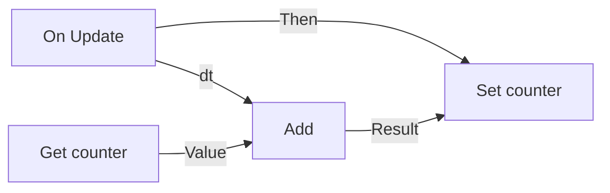

# Visual scripts {#page-visual-scripts}

[TOC]

A visual script (`.owlvs`) is an event graph edited in Owl Nest. Owl compiles it to Lua when it loads. It goes
wherever a `.lua` script goes: on a `LuaScript` component, as the scene script, in the pack of an exported game. Its
variables are script properties, shown in the inspector and saved with the scene. The Lua side is described in
[Scripting](scripting.md).

## Create and open

- In the Content Browser, right-click a folder and choose **New Visual Script**. The new graph holds an `On Create`
  and an `On Update` event and opens in a document tab.
- Double-click a `.owlvs` file to open it. **Ctrl+S** saves it.
- Drop the `.owlvs` file on the **Script** field of a `LuaScript` component. The **Hooks** list shows the events
  the graph defines, and **Open** brings the graph back.

## The graph

- **White arrow pins** carry the execution: an event runs the node linked to its output arrow, then the next one, in
  order. An execution output takes one link and an execution input takes several.
- **Round coloured pins** carry values; a filled pin is linked. A link joins compatible types only: an integer feeds a
  number, an entity feeds an integer.

| Colour | Type                    |
|--------|-------------------------|
| Red    | Boolean                 |
| Teal   | Integer                 |
| Green  | Number                  |
| Pink   | String                  |
| Blue   | Entity                  |
| Gold   | Vector 3 (`x, y, z`)    |
| Orange | Vector 2 (`x, y`)       |
| Indigo | Color (`r, g, b, a`)    |
| Grey   | Any value               |

- An unlinked input shows its value in a field on the node: a number, a text, a check box, a colour swatch or a
  vector. An empty field uses the default; an empty entity means the entity running the script.
- A node without execution pins (operators, getters such as `transform.get_position`) is computed where its value is
  read. A node with execution pins runs once each time the flow reaches it; its outputs keep the last values.
- The title bar gives the node group by its colour and its icon: red for events, blue for engine calls, green for
  engine reads, grey for flow, the value colour for variables and constants.

## Colours and vectors

The `x, y, z` and `r, g, b, a` parameters of an engine call are one pin, a vector or a colour. Right-click the pin and
choose **Split Pin** to show one number pin per component, **Recombine** to join them back; the links of the pin are
removed and its value is kept. **Make Color**, **Break Color**, **Make Vector 2 / 3** and **Break Vector 2 / 3**
convert between a value and its components. Variables can be of type `color`, `vec2` and `vec3`.

## Panels

| Panel                     | Content                                                                                       |
|---------------------------|-----------------------------------------------------------------------------------------------|
| **Nodes** (Hierarchy)     | Every node by group, with a search field: click one to add it in the view, or drag it in      |
| **Graph** (Properties)    | **Variables** tab and **Node** tab; **Show generated Lua** replaces the node by its Lua code   |
| **Details** (toolbar)     | The same tabs on the left of the graph, shown or hidden by the toolbar button                 |

- **Variables**: add, rename, retype or remove a variable and set its default; renaming one updates its nodes. Drag a
  variable onto the graph to read it.
- **Node**: the selected node, its description, its errors, its settings (variable, function name), the split of its
  grouped pins and the values of its unlinked inputs.
- The toolbar shows **Compiles to Lua** or the number of errors: click it to list them, then click one to centre its
  node. A node with an error has a red frame and a warning icon.

## Node palette

Right-click the canvas background to open the palette, type to search, then click a node to add it under the cursor.
Dropping a link on the background opens it too, with only the nodes that take the link: the new node is linked.

| Group                              | Nodes                                                                                                                                                              |
|------------------------------------|--------------------------------------------------------------------------------------------------------------------------------------------------------------------|
| Events                             | `On Create`, `On Update`, `On Tick`, `On Destroy`, `On Collision`, the trigger events, `Custom Event` (a function of a chosen name, e.g. a trigger `CallbackName`) |
| Flow                               | `Branch`, `Sequence`, `For Loop`                                                                                                                                   |
| Variables                          | `Get Variable`, `Set Variable`                                                                                                                                     |
| Values, Math, Compare, Logic, Text | Constants, `Self`, arithmetic, `Floor`, `Min`, `Max`, comparisons, `And`, `Or`, `Not`, `Concatenate`                                                               |
| Vector, Color                      | `Make` and `Break` nodes of vectors and colours                                                                                                                    |
| `transform`, `physics`, `scene`…   | One node per function of the [Lua API](lua-api.md), with its parameters and results                                                                                |

An event appears at most once in a graph.

## Editing

| Gesture                            | Action                                                              |
|------------------------------------|---------------------------------------------------------------------|
| Drag from a pin to a pin           | Link (replaces the link the pin already holds)                      |
| Drag from a pin to the background  | Palette of the nodes to link to                                     |
| **Alt**+click a pin                | Break its links                                                     |
| Hover a link, **Delete**           | Remove the link                                                     |
| Drag on the background             | Select many nodes; drag one of them to move them all                |
| Right-drag, middle-drag, wheel     | Pan and zoom                                                        |
| **Home**                           | Frame every node                                                    |
| **Delete**                         | Delete the selected nodes and their links                           |
| **Ctrl+C**, **Ctrl+X**, **Ctrl+V** | Copy, cut, paste (also between graphs, with the variables they use) |
| **Ctrl+D**                         | Duplicate the selection                                             |
| **Ctrl+A**                         | Select every node                                                   |
| Right-click a node or a pin        | Duplicate, Copy, Delete; Split / Recombine, Break Links             |

Every edit is undoable (**Ctrl+Z**, **Ctrl+Y**); consecutive value edits merge into one step.

## Example

The cellar ladder of the Engine Demo tavern (`engine_demo/scripts/tavern/cellar_ladder.owlvs`) is a graph: its
`on_ladder_interact` event checks a `climbing` variable with a `Branch`, sets it, records `tavern_from_cellar`, plays
a sound and calls `scene.transition_to` with the `tavern_scene` variable.
