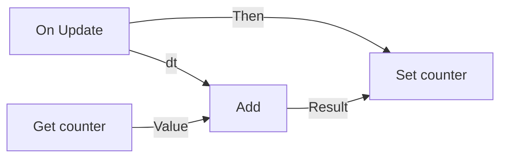

# Visual scripts {#page-visual-scripts}

[TOC]

**Level:** Beginner. **Read first:** [Scripting Games in Lua](scripting.md).

A visual script (`.owlvs`) is an event graph edited in Owl Nest. Owl compiles it to Lua when it loads. It goes
wherever a `.lua` script goes: on a `LuaScript` component, as the scene script, in the pack of an exported game. Its
exposed variables are script properties, shown in the inspector and saved with the scene; the others hold the internal
state of the script. The Lua side is described in
[Scripting](scripting.md).

## Create and open

- In the Content Browser, right-click a folder and choose **New Visual Script**. The new graph holds an `On Create`
  and an `On Update` event and opens in a document tab.
- Double-click a `.owlvs` file to open it. **Ctrl+S** saves it.
- Drop the `.owlvs` file on the **Script** field of a `LuaScript` component. The **Hooks** list shows the events
  the graph defines, and **Open** brings the graph back.

## The graph



- **White arrow pins** carry the execution: an event runs the node linked to its output arrow, then the next one, in
  order. An execution output takes one link and an execution input takes several.
- **Round coloured pins** carry values; a filled pin is linked. A link joins compatible types only: an integer feeds a
  number, an entity feeds an integer.

| Colour | Type                    |
|--------|-------------------------|
| Red    | Boolean                 |
| Teal   | Integer                 |
| Green  | Number                  |
| Pink   | String                  |
| Blue   | Entity                  |
| Gold   | Vector 3 (`x, y, z`)    |
| Orange | Vector 2 (`x, y`)       |
| Indigo | Color (`r, g, b, a`)    |
| Violet | Table, list             |
| Grey   | Any value               |

- An unlinked input shows its value in a field on the node: a number, a text, a check box, a colour swatch or a
  vector. An empty field uses the default; an empty entity means the entity running the script.
- A node without execution pins (operators, getters such as `transform.get_position`) is computed where its value is
  read. A node with execution pins runs once each time the flow reaches it; its outputs keep the last values.
- The title bar gives the node group by its colour and its icon: red for events, blue for engine calls, green for
  engine reads, grey for flow, the value colour for variables and constants.

## Colours and vectors

The `x, y, z` and `r, g, b, a` parameters and results of an engine call are one pin, a vector or a colour, also with a
prefix: `vx, vy` is a `velocity` pin, `cell_x, cell_y` a `cell` pin. Right-click the pin and
choose **Split Pin** to show one number pin per component, **Recombine** to join them back; the links of the pin are
removed and its value is kept. **Make Color**, **Break Color**, **Make Vector 2 / 3** and **Break Vector 2 / 3**
convert between a value and its components. Variables can be of type `color`, `vec2` and `vec3`.


## Tables and lists

A table value is typed on its node as `a, b, key = c`: plain items make a list, `key = value` items named fields; a
number or `true` / `false` stays one, any other text is a string, and text in double quotes keeps its commas. The
`Table` constant and every unlinked table input take this form; an empty one is an empty table.

- `Get Field` reads a key (`t.key` when the key is a name), `Set Field` writes one; `Get Item` reads a list at an index
  from 1, `Add Item` and `Remove Item` change a list, `List Length` counts it, `Contains` looks a value up.
- `For Each` runs its `Body` once per item of a list with the `Index` and the `Item`, then `Completed`.
- `Split` cuts a text at a separator into a list, `Format` builds a text from up to four values (`%d / %d blocks`).
- Variables of type `numbers` and `strings` are lists, their default typed as `1, 2, 3`.
- `Random` and `Random Integer` draw from the scene random stream each time a statement reads them: keep a draw read
  twice in a variable.

## Panels

| Panel                     | Content                                                                                       |
|---------------------------|-----------------------------------------------------------------------------------------------|
| **Nodes** (Hierarchy)     | Every node by group, with a search field: click one to add it in the view, or drag it in      |
| **Graph** (Properties)    | **Variables**, **Functions**, **Custom** and **Node** tabs                                    |

- **Variables**: one section per variable with its name, type and default, **Min**, **Max** and **Step** for a number
  (the bounds of its inspector field, empty for none) and **Exposed**: an exposed variable is a script property, the
  others are internal state, set to their default when the script loads. Its menu removes it. Renaming a variable
  updates its nodes. Drag the header of a variable onto the graph to read it.
- **Functions**: the functions and macros of the graph, see [Functions and macros](#visual-scripts-functions).
- **Custom**: the custom nodes of the graph, see [Custom nodes](#visual-scripts-custom).
- **Node**: the selected node, its description, its errors, its settings (variable, function name), the split of its
  grouped pins and the values of its unlinked inputs.
- The toolbar switches the document between **Graph** (the nodes), **Split** (the nodes and the generated Lua side by
  side, the divider drags) and **Lua** (the generated Lua alone). The Lua is coloured and read-only.
- The toolbar shows **Compiles to Lua** or the number of errors: click it to list them, then click one to centre its
  node. A node with an error has a red frame and a warning icon.

## Node palette

Right-click the canvas background to open the palette, type to search, then click a node to add it under the cursor.
Dropping a link on the background opens it too, with only the nodes that take the link: the new node is linked.

| Group                              | Nodes                                                                                                                                                              |
|------------------------------------|--------------------------------------------------------------------------------------------------------------------------------------------------------------------|
| Events                             | `On Create`, `On Update`, `On Tick`, `On Destroy`, `On Collision`, the trigger events, `Custom Event` (a function of a chosen name, e.g. a trigger `CallbackName`) |
| Flow                               | `Branch`, `Sequence`, `For Loop`, `For Each` (the items of a list, with their index)                                                                               |
| Variables                          | `Get Variable`, `Set Variable`                                                                                                                                     |
| Constant                           | `Self`, `Nil` (no value, to clear a variable), and a number, integer, boolean, text, vector, colour or table typed on the node                                     |
| Math                               | Arithmetic, `Floor`, `Ceil`, `Round`, `Min`, `Max`, `Clamp`, `Lerp`, `Square Root`, `Power`, `Sine`, `Cosine`, `Atan2`, `Pi`, `Random`, `Random Integer`           |
| Compare, Logic                     | Comparisons, `And`, `Or`, `Not`, `Select` (one of two values), `Or Default`, `Is Set` (not nil)                                                                    |
| Text                               | `Concatenate`, `Join Text`, `Format`, `Text Length`, `Split`, `To Number`, `To Text`, `Contains Text`, `Substring`, `Upper Case`, `Lower Case`                     |
| Table                              | `Get Field`, `Has Key`, `Get Item`, `List Length`, `Contains`, `Make List`, `Set Field`, `Add Item`, `Remove Item`                                                 |
| Vector, Color                      | `Make` and `Break` nodes of vectors and colours                                                                                                                    |
| Functions                          | `Call` of each function and macro of the graph and of the library graphs (`file / name`), the custom nodes, the annotated Lua functions (`module / name`)          |
| `transform`, `physics`, `scene`…   | One node per function of the [Lua API](lua-api.md), with its parameters and results                                                                                |

An event appears at most once in a graph.

## Editing

| Gesture                            | Action                                                              |
|------------------------------------|---------------------------------------------------------------------|
| Drag from a pin to a pin           | Link (replaces the link the pin already holds)                      |
| Drag from a pin to the background  | Palette of the nodes to link to                                     |
| **Alt**+click a pin                | Break its links                                                     |
| Hover a link, **Delete**           | Remove the link                                                     |
| **Alt**+click a link               | Cut it                                                              |
| Right-click a link                 | Its menu: add a waypoint there, a colour (execution links), delete  |
| Drag a waypoint                    | Move it; waypoints between moved nodes follow them                  |
| Hover a waypoint, **Delete**       | Remove the waypoint                                                 |
| Drag on the background             | Select many nodes; drag one of them to move them all                |
| Right-drag, middle-drag, wheel     | Pan and zoom                                                        |
| Magnet of the toolbar              | Snap nodes and waypoints to the grid, in every node editor          |
| **Home**                           | Frame every node                                                    |
| **Delete**                         | Delete the selected nodes and their links                           |
| **Ctrl+C**, **Ctrl+X**, **Ctrl+V** | Copy, cut, paste (also between graphs, with the variables they use) |
| **Ctrl+D**                         | Duplicate the selection                                             |
| **Ctrl+A**                         | Select every node                                                   |
| Right-click a node or a pin        | Duplicate, Copy, Delete; Split / Recombine, Break Links             |

Every edit is undoable (**Ctrl+Z**, **Ctrl+Y**); consecutive value edits merge into one step.

## Functions and macros {#visual-scripts-functions}

A function is a named part of a graph, called from several places. It has typed parameters and typed results. A macro
is a function with several execution exits.

- The **Functions** tab of the **Graph** panel lists them: **Add Function** and **Add Macro** create one, each section
  edits its name, its parameters, its results and, for a macro, its exits.
- A function is drawn as its own graph: a `func.entry` node holds the parameters, a `func.return` node takes the
  results. In a macro, each `func.return` node picks the exit it leaves by.
- Drag the header of a function onto the graph to call it (`func.call`), or pick it in the palette (**Functions**).
- A function compiles to a local Lua function of the script. An **Exported** function is a global function instead: the
  engine calls it by its name and reads its results, as a dialogue does for the condition of a `Branch`
  (`has_cellar_key` of `tavern_dialogues.owlvs`). A macro is never exported.

### Library graphs

Any other `.owlvs` of the project that defines functions is a library: its functions show in the palette, in the
**Functions** group, as `file / name`. The call node stores the asset path of the library in its `library` field.

- The functions of the library are compiled into the Lua of the caller.
- A function of a library has no variables and calls no function of another library.
- The export packs the library files with the scripts that call them.

## Custom nodes {#visual-scripts-custom}

A custom node runs Lua written in the graph: for the few lines a graph of small nodes would make hard to read.

- **Add Custom Node** in the **Custom** tab creates one and drops a call in the view. Its section edits the Lua name,
  the title, **Pure** (no execution pins: it runs where its outputs are read), the typed inputs and outputs, and the
  Lua body.
- The inputs are the parameters of the body; the body returns the outputs in order (`return speed, angle`).
- Drag the header of a custom node onto the graph, or pick it in the palette (**Functions**), to call it again.
- Renaming a pin keeps its links; removing one drops them; turning a node pure or not changes every call.

```lua
-- Body of a pure custom node `clamp_speed`, inputs `speed` and `limit`, output `clamped`.
if speed > limit then
	return limit
end
return speed
```

## Lua functions {#visual-scripts-lua}

A function of a Lua module of the project shows in the palette (**Functions**, `module / name`) once its comment lines
give its types. The code stays a `.lua` file, read and reviewed as code.

```lua
local M = {}

--- Keeps a value between two bounds.
---@pure
---@param value number
---@param low number
---@param high number
---@return number clamped
function M.clamp(value, low, high)
	return math.max(low, math.min(high, value))
end

return M
```

- `---@param name type` gives an input, `---@return type name` an output, `---@pure` a node without execution pins;
  the other `---` lines are its description. Only `function M.name(...)` forms are read.
- The types are those of the pins: `number`, `integer`, `boolean`, `string`, `table`, `entity`, `vector2`, `vector3`,
  `color`, `any`.
- The node calls `require("scripts.lib.maths").clamp(...)`: the module loads in the sandbox of the script, and the
  export packs it.

## Generated Lua

The **Lua** view shows what the graph compiles to. Locals take the names of the pins, a value read once is written
where it is read, and the two paths of a `Branch` meet again after its `if`, where every path of both runs the same
node. A node several events reach, or paths that meet nowhere else, becomes one Lua function the paths call
(`__join1`). A value one event writes and another reads goes through the table `__vs` of the script.

A pure node is computed again in each statement that reads it, so a value read across several statements (a draw of
`Random`, a slow search) belongs in a variable set once. A trailing optional input left empty is left out of the call
(`string.format("%d", n)`), and `Get Field` with a name for key reads `t.key`.

## HUD graphs

A `.owlhud` has a scene script of its own: the **Script** section of Scene Settings while the HUD is open, saved as the
`SceneScript` key of the file. It runs in Play with every scene that draws the HUD and has the hooks of a scene script.

A widget callback (the handler of a button, a slider or a list) is looked up in the scripts of the widget, then in the
HUD script and the scene script, then in the entity scripts.

The handler rows of the inspector have an **Edit in Graph** button. When the scene or the HUD has no script, it creates
`scripts/<file>_hud.owlvs` (or `scripts/<scene>.owlvs`) and sets it as its script. It then opens the graph, adds the
`Custom Event` of the handler when missing and selects it.

## Debugging {#visual-scripts-debugging}

- **Wire values**: during Play, each wire of the open graph shows the last value that crossed it. A graph is compiled
  with probes for that purpose, which the exported game never contains.
- **Breakpoints**: select a node and press **F9**, or right-click it and choose **Add Breakpoint**; the node shows a
  red dot, **F9** or **Remove Breakpoint** clears it. A breakpoint does not stop the script in the middle of its
  call: the call finishes, then the game pauses.
- When the game stops, the node it stopped on is outlined and the **Script Debug** panel gives the hit, see
  [Debugging scripts](scripting.md#scripting-debugging).

## Example

The cellar ladder of the Engine Demo tavern (`engine_demo/scripts/tavern/cellar_ladder.owlvs`) is a graph: its
`on_ladder_interact` event checks a `climbing` variable with a `Branch`, sets it, records `tavern_from_cellar`, plays
a sound and calls `scene.transition_to` with the `tavern_scene` variable.

The other gameplay scripts of the Engine Demo are graphs too (listed in `engine_demo/README.md`): the score
screens, trigger callbacks, the controls hint, the minimap dot, the coins and checkpoints, the hub's hero, villagers,
water, critters, ambience and day-night cycle, the main menu and the dialogue windows. `cellar_key.owlvs` calls a graph
function from two events. The algorithms stay in Lua: the traffic and the life of the isometric town, the raycast
level, the platformer hero, the inventory, the settings menu and the orbit scene.
