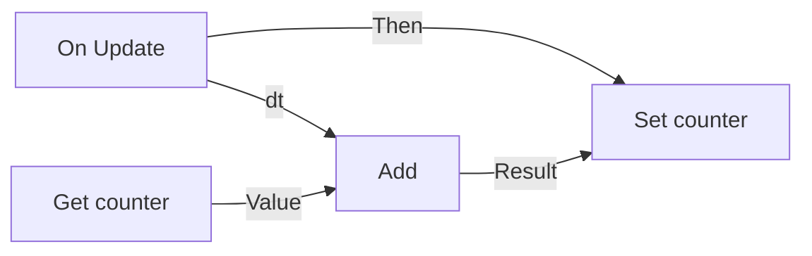

# Visual scripts {#page-visual-scripts}

[TOC]

A visual script (`.owlvs`) is an event graph edited in Owl Nest. Owl compiles it to Lua when it loads. It goes
wherever a `.lua` script goes: on a `LuaScript` component, as the scene script, in the pack of an exported game. Its
variables are script properties, shown in the inspector and saved with the scene. The Lua side is described in
[Scripting](scripting.md).

## Create and open

- In the Content Browser, right-click a folder and choose **New Visual Script**. The new graph holds an `On Create`
  and an `On Update` event and opens in a document tab.
- Double-click a `.owlvs` file to open it. **Ctrl+S** saves it.
- Drop the `.owlvs` file on the **Script** field of a `LuaScript` component. The **Hooks** list shows the events
  the graph defines, and **Open** brings the graph back.

## The graph

- **White pins** carry the execution: an event runs the node linked to its `Then`, then the next one, in order. An
  execution output takes one link and an execution input takes several.
- **Coloured pins** carry values: numbers in green, integers and entities in blue, strings in orange, booleans in red.
  A value input takes one link. A link joins compatible types only; an integer feeds a number, an entity feeds an
  integer.
- An unlinked input uses the value typed in the side panel, or its default when the field is empty. An entity input
  left empty means the entity running the script.
- A node without execution pins (operators, getters such as `transform.get_position`) is computed where its value is
  read. A node with execution pins runs once each time the flow reaches it; its outputs keep the last values.

## Node palette

Right-click the canvas background to open the palette, type to search, then click a node to add it under the cursor.

| Group                              | Nodes                                                                                                                                                              |
|------------------------------------|--------------------------------------------------------------------------------------------------------------------------------------------------------------------|
| Events                             | `On Create`, `On Update`, `On Tick`, `On Destroy`, `On Collision`, the trigger events, `Custom Event` (a function of a chosen name, e.g. a trigger `CallbackName`) |
| Flow                               | `Branch`, `Sequence`, `For Loop`                                                                                                                                   |
| Variables                          | `Get Variable`, `Set Variable`                                                                                                                                     |
| Values, Math, Compare, Logic, Text | Constants, `Self`, arithmetic, `Floor`, `Min`, `Max`, comparisons, `And`, `Or`, `Not`, `Concatenate`                                                               |
| `transform`, `physics`, `scene`…   | One node per function of the [Lua API](lua-api.md), with its parameters and results                                                                                |

An event appears at most once in a graph.

## Side panel

- **Variables**: add, rename, retype (`float`, `int`, `string`, `bool`, `entity`) or remove a variable, and set its
  default. Renaming a variable updates its nodes.
- **Node**: the selected node, its description, its settings (variable, function name) and the values of its
  unlinked inputs.
- **Lua**: the compilation errors (click one to select its node; the node title turns red) or **Compiles to Lua**.
  **Show generated Lua** displays the code the engine runs.

## Editing

| Gesture                            | Action                                                              |
|------------------------------------|---------------------------------------------------------------------|
| Drag from a pin to a pin           | Link                                                                |
| Hover a link, **Delete**           | Remove the link                                                     |
| Drag on the background             | Select many nodes; drag one to move them                            |
| **Delete**                         | Delete the selected nodes and their links                           |
| **Ctrl+C**, **Ctrl+X**, **Ctrl+V** | Copy, cut, paste (also between graphs, with the variables they use) |
| **Ctrl+D**                         | Duplicate the selection                                             |
| **Ctrl+A**                         | Select every node                                                   |
| Right-click a node                 | Duplicate, Copy, Delete                                             |

Every edit is undoable (**Ctrl+Z**, **Ctrl+Y**); consecutive moves and value edits merge into one step.

## Example

The cellar ladder of the Engine Demo tavern (`engine_demo/scripts/tavern/cellar_ladder.owlvs`) is a graph: its
`on_ladder_interact` event checks a `climbing` variable with a `Branch`, sets it, records `tavern_from_cellar`, plays
a sound and calls `scene.transition_to` with the `tavern_scene` variable.
