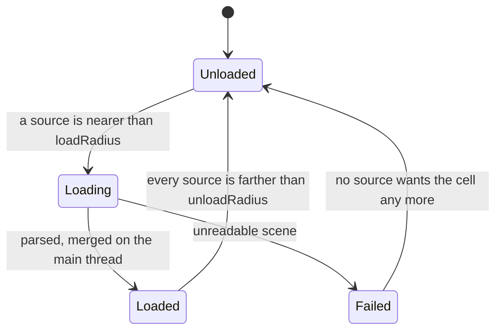

# World partition {#page-world-partition}

[TOC]

A **world partition** cuts a scene into cubic cells on world coordinates, each holding a scene of its own. In Play the
cells near a streaming source are read in the background and merged into the running scene, then removed once the
source has moved away, without a loading screen. Design notes and what is planned:
[Large worlds](design/large-worlds.md).

## Settings {#world-partition-settings}

Scene key `WorldPartition:` (Scene Settings, **World Partition**):

```yaml
WorldPartition:
  enabled: true
  cellSize: 500
  loadRadius: 600
  unloadRadius: 900
  cells:
    - {coords: [299200000, 0, -1], scene: scenes/orbit_cells/debris_a.owl}
    - {coords: [299200000, 0, -3], scene: scenes/orbit_cells/debris_b.owl}
```

| Key            | Default | Meaning                                                                                   |
|----------------|---------|-------------------------------------------------------------------------------------------|
| `enabled`      | false   | Stream the cells at runtime                                                               |
| `cellSize`     | 256     | Side of a cell in world units (at least 1)                                                |
| `loadRadius`   | 384     | A cell loads once a source is nearer than this to it                                      |
| `unloadRadius` | 512     | A loaded cell unloads once every source is farther than this (at least `loadRadius`)      |
| `cells`        | empty   | `coords` (integer x, y, z) and `scene` (an `.owl` path); at most one cell per coordinates |

## Cells {#world-partition-cells}

The cells are cubes on world coordinates (double): the cell `coords` spans `[coords, coords + 1) * cellSize`. The roots
of a cell scene without `WorldPosition` are placed from the corner of the cell; those with one keep their world
position. The distance of a source to a cell is the distance to its nearest point (0 inside). The export packs the
cell scenes with the scene that lists them.

## Streaming sources {#world-partition-streaming-sources}

The cells are streamed around the **Streaming Source** components (`StreamingSource`: `enabled`, `radiusScale`, a
factor on both radii) of the scene, or around the primary camera when no source is enabled. Position a source on an
entity that moves: the player, a ship. Several sources load the union of their cells.

## Lifecycle {#world-partition-lifecycle}

The `owl.world_streaming` system (`PostPhysics`, after `owl.floating_origin`) runs in Play only; Owl Nest does not stream
in Edit mode. A cell scene is read and parsed on the workers of the task scheduler and merged by the main thread, at
most two cells per frame. The gap between `loadRadius` and `unloadRadius` keeps a cell from loading and unloading at its
border.



## In Owl Nest {#world-partition-in-owl-nest}

**Scene Settings > World Partition**: the enable switch, the cell size and the radii, then the cell table (coordinates,
scene, state while playing).

- Drop a `.owl` scene on the table to add a cell at the typed coordinates; drop it on a row to change that cell's scene.
- Select several rows to **Remove** them or **Move selected** by an offset in cells; **Open** opens the cell scene.
- The viewport outlines every cell, the loaded ones in green.
- The **Streaming Source** inspector edits `enabled` and `radiusScale`.

| Command                      | Arguments                                              |
|------------------------------|--------------------------------------------------------|
| `scene.set_world_partition`  | `enabled`, `cell_size`, `load_radius`, `unload_radius` |
| `scene.add_world_cell`       | `cell` (x y z), `scene`                                |
| `scene.set_world_cell_scene` | `cell`, `scene`                                        |
| `scene.remove_world_cells`   | `cells` (`x y z; x y z`)                               |
| `scene.move_world_cells`     | `cells`, `offset` (cells)                              |

## Lua {#world-partition-lua}

`scene.is_world_cell_loaded(x, y, z)`, `scene.get_loaded_world_cells()` (the count) and `scene.set_world_streaming(enabled)`
(off unloads every cell): see the [Lua API](lua-api-scene.md). The Engine Demo far orbit streams debris cells along its
way and shows the count in its HUD.
