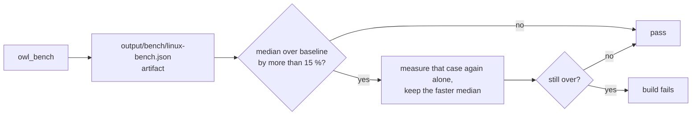

# Owl Engine benchmarks

`owl_bench` is a single executable of CPU micro-benchmarks for the engine, run headless on the Null render
backend. It uses a small in-house harness
(`test/bench/harness/Bench.h`): `steady_clock`, warm-up samples, auto-calibrated batch size, median, quartiles,
CSV / JSON output. It is off by default (`OWL_BENCHMARK=OFF`); the CI compiles it on every pull request
(`linux-clang-debug`) and runs it every night on `main` against a baseline (see [In CI](#in-ci)).

## Build

Use a build directory of its own, inside the Docker image:

```bash
./docker_run.sh cmake --preset linux-clang-release -S . -B output/build/linux-clang-release-bench -DOWL_BENCHMARK=ON
./docker_run.sh cmake --build output/build/linux-clang-release-bench --target owl_bench
```

## Run

Run from the `bin/` directory (the dummy application looks up `engine_assets/` and `engine_demo/` from
its working directory). Pin it to one performance core to cut the noise (CPUs 0-15 are P-cores on the
reference i9-13950HX):

```bash
cd output/build/linux-clang-release-bench/bin
../../../../docker_run.sh taskset -c 6 ./owl_bench --csv=bench.csv --json=bench.json
```

| Option              | Default | Meaning                                               |
|---------------------|---------|-------------------------------------------------------|
| `--filter=<text>`   | (all)   | Run only the benchmarks whose name contains `<text>`. |
| `--exclude=<text>`  | (none)  | Skip the benchmarks whose name contains `<text>`.     |
| `--samples=<n>`     | 15      | Timed samples per benchmark.                          |
| `--warmup=<n>`      | 2       | Untimed samples before the timed ones.                |
| `--min-sample-ms=x` | 10      | Minimum duration of one sample (sets the batch size). |
| `--csv=<file>`      | (none)  | Write the results as CSV.                             |
| `--json=<file>`     | (none)  | Write the results, metrics and load average as JSON.  |
| `--verbose`         | off     | Keep engine warnings and errors in the output.        |

Groups (name prefixes): `scene`, `serialize`, `prefab`, `renderer2d`, `hud`, `tilemap`, `frame`, `voxel`,
`script`, `physics`, `sample` (the Engine Demo scenes), `slang`, `iso`, `path`, `mcp`. The first Slang compilation is only "cold" when `slang` is the first group to
compile a shader in the process, which is the case for a full run. `voxel/streaming` streams a procedural world
through a real `RendererVoxel` layer with frames paced at 60 Hz (about 12 s) and reports the main-thread CPU time per
frame (p50, p99, peak), the meshing work and the chunk appearance latency.
`mcp/*` posts JSON-RPC messages to a real `McpServer` on `127.0.0.1` (kept-alive connection with `TCP_NODELAY`, bearer
token) from a client thread while the bench thread plays the editor main loop, calling `McpServer::onUpdate` without
pause: `mcp/ping` is the transport and dispatcher alone, `mcp/tools_call/entity_rename` a full `tools/call` of a
registry command on a headless session. The wait for the next frame of a real editor is excluded, so the median is the
"+5 ms" part of the MCP budget "≤ one frame + 5 ms". Both ends set `TCP_NODELAY`: without it, Nagle's algorithm and the
delayed ACK add 40 ms to every call. The libraries of the server are built with `OWL_BENCHMARK` even when
`OWL_BUILD_NEST` is off (never the editor).


## In CI

The nightly *Benchmarks* configuration builds the `linux-bench` preset (release, no tests, no editor) and runs
`ci_action.py Bench linux-bench`:



- Baseline: `test/bench/baseline/linux-bench.json`; without one the run only reports. Commit the artifact of a
  nightly run (or run the action with `-- --update-baseline` on the same agent) and refresh it when a change is
  deliberately slower or the agent changes.
- `test/bench/thresholds.json` widens the threshold by name pattern (multi-threaded physics steps and world creation
  of 100 bodies, the `mcp` round trips, `sample/load/game_over`, the flat `path/long_query` cases); it is not part of the baseline, so a refresh keeps it.
- Agent: pinned to `linux-build-hephaistos` (8 cores). The committed baseline is the median of its 5 runs of
  2026-10-19 on the v0.4.0 release code (builds 38655 to 38682, in `context.baseline_runs`); the runs agree within 2 %
  (median, 9 % for nine benchmarks in ten). Timings from another agent do not compare (artemis is 20 % faster but
  varies 10.7 % between runs, against 1.7 % here).
- Every group is in the baseline, `mcp`, `path` and `hud/frame/1000_row_list` included.

```bash
./docker_run.sh poetry run python ci_action.py Build linux-bench
./docker_run.sh poetry run python ci_action.py Bench linux-bench -- --threshold=0.15
```

## Reading the output

Each line gives the median time of one body call, the fastest sample, the interquartile range in percent
of the median, the median divided by the number of items (entities, quads, frames...) and the batch size.
Lines without a time are metrics (sizes, counts, memory, correctness checks). The load average at start
and end is printed: a loaded machine makes the numbers unreliable.

## Profiling a case

`perf` is not usable in the image yet; use callgrind on one filtered case:

```bash
../../../../docker_run.sh valgrind --tool=callgrind --toggle-collect='*Scene::onUpdateEditor*' \
    ./owl_bench --samples=1 --warmup=0 --min-sample-ms=1 --filter=frame/editor_update/flat10000
```

## Frame bench (GPU, real runner)

`owl_bench` never touches a GPU. Whole frames on Vulkan or OpenGL are measured by the runner itself, in its
`--frame-bench` mode (built with the default presets, no `OWL_BENCHMARK` needed):

```bash
./docker_run.sh --gui output/build/linux-clang-release/bin/OwlRunner \
    --frame-bench engine_demo/scenes/raycast_demo.owl --backend vulkan --frames 1000 --warmup 120 \
    --out output/frame-bench/raycast_demo.vulkan.json
```

| Option              | Default  | Meaning                                                                       |
|---------------------|----------|-------------------------------------------------------------------------------|
| `--frame-bench <f>` | required | Scene to load; relative paths are resolved from the caller's directory.       |
| `--frames <n>`      | 1000     | Measured frames.                                                              |
| `--warmup <n>`      | 120      | Frames run before the measure (shader cache, streaming, first uploads).       |
| `--backend <b>`     | vulkan   | `vulkan`, `opengl` or `null` (headless: null window, no GUI).                 |
| `--out <file>`      | (none)   | JSON report: options, device, summary and one record per frame.               |
| `--project <dir>`   | (auto)   | Project with `owl_project.yml`; found by walking up from the scene otherwise. |
| `--assets <dir>`    | (none)   | Extra asset directory searched after the project, repeatable (fixtures).      |
| `--size <WxH>`      | 1280x720 | Window size.                                                                  |
| `--timestep-ms <t>` | 16.667   | Fixed simulation step fed to the scene, whatever the real frame time.         |
| `--vsync`           | off      | Keep vertical synchronisation (the present mode is reported either way).      |
| `--validation`      | off      | Vulkan validation layers.                                                     |
| `--capture <png>`   | (none)   | Render offscreen and write the last frame as a PNG (image tests).             |

The run is deterministic: fixed time step, null input backend (no keyboard, mouse or cursor capture), the scene's
own primary camera, null sound, no `config.yml` and no user `settings.yml`. With `--capture`, asynchronous loads are
finished before every frame so the image does not depend on timing. It exits with 0 on success, 2 on a bad option or
scene, 3 when the scene quits early, 4 when the renderer cannot start, 5 when the report cannot be written, 6 when the
capture cannot be read back or written.

Per frame it records the wall time between two frame starts and its phases (`beginFrame`, scene update, scripts,
physics, render preparation, GUI, submission, present), the draw calls, the queue submissions, the
`vkQueueWaitIdle` / `vkDeviceWaitIdle` calls, the blocking fence waits besides the frame pacing (`fence_wait`: one-shot
uploads, mid-frame read-backs), the CPU time the frame pacing itself blocks (`cpu_pace_wait_ms`, Vulkan: frame fence
and `vkAcquireNextImageKHR`, inside `cpu_begin_frame_ms`; OpenGL blocks in the swap, inside `cpu_present_ms`), and
the GPU time from timestamp queries: `vkCmdWriteTimestamp` around every Vulkan command buffer (`gpu_busy_ms` is their
sum, `gpu_span_ms` first to last timestamp), `glQueryCounter` (`GL_TIMESTAMP`) at `beginFrame` / `endFrame` on
OpenGL. The text summary gives count, median, p95, p99,
interquartile range and maximum of every series.

It also measures the cold start of the real runner (`startup_ms` in the report, `start-up:` line in the summary):
`engine_ready` from the entry of `createApplication` to an engine able to load a scene (window, renderer, shader
compilation or cache), `first_frame` to the start of the first frame (scene loaded, render stack installed). The
dynamic loader and static initialisers before `main` are not counted. On lavapipe / llvmpipe (October 2026, warm
SPIR-V cache) the `mixed` image-test scene starts in about 365 ms to an engine ready and 400 ms to the first frame,
with either backend.

Pick the device with the driver's own variables: `VK_ICD_FILENAMES=/etc/vulkan/icd.d/nvidia_icd.json` (or
`/usr/share/vulkan/icd.d/intel_icd.json`, `lvp_icd.json`) for Vulkan,
`__NV_PRIME_RENDER_OFFLOAD=1 __GLX_VENDOR_LIBRARY_NAME=nvidia` or `__GLX_VENDOR_LIBRARY_NAME=mesa
MESA_LOADER_DRIVER_OVERRIDE=iris` for OpenGL. The `device` field of the report says which one actually ran.
Baseline and protocol: `doc/audit/20-mesures.md`, section 8.
